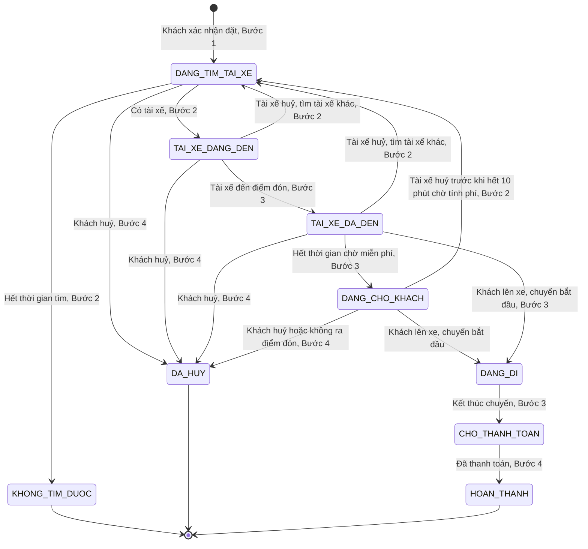
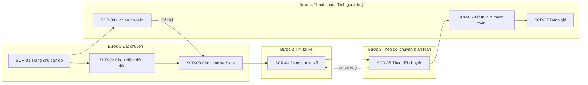

# Đề 5 · Đặt xe chở khách

> **Mã:** DE05 · **Độ khó:** 5/8 · **Vai trò:** 1 (khách đi xe) · **Nền tảng:** App khách iOS / Android

Ứng dụng đặt xe máy hoặc ô tô, nhìn từ phía khách: thấy giá trước khi đặt, chờ hệ thống tìm tài xế, theo dõi tài xế trên bản đồ, đi an toàn và thanh toán, đánh giá khi kết thúc chuyến. Tài xế dùng app riêng, **ngoài phạm vi đề**; khách chỉ thấy kết quả thao tác của tài xế. Đây là đề có **dữ liệu theo thời gian thực** (vị trí, trạng thái chuyến) mà app khách phải hiển thị đúng cả khi mạng chập chờn. Đề gồm **1 tính năng**, là **1 luồng** gồm 4 bước và các màn hình; tài liệu gồm 1 PRD và 1 SRS.

## Tính năng

| **Tính năng** | **Luồng** | **PRD** | **SRS** |
| --- | --- | --- | --- |
| Đặt xe chở khách | Đặt chuyến → Tìm tài xế → Theo dõi chuyến & an toàn → Thanh toán, đánh giá & huỷ chuyến | [PRD](docs/PRD.md) | [SRS](docs/SRS.md) |

## Các bước và màn hình của luồng

| **Bước** | **Tên bước** | **Màn hình** | **Phạm vi** |
| --- | --- | --- | --- |
| Bước 1 | Đặt chuyến | SCR-01, SCR-02, SCR-03 | Chọn điểm đón, điểm đến, loại xe; xem giá ước tính; xác nhận đặt |
| Bước 2 | Tìm tài xế | SCR-04 | Màn đang tìm, khu vực tìm mở rộng, có tài xế, không tìm được tài xế, tài xế huỷ thì tự tìm lại |
| Bước 3 | Theo dõi chuyến & an toàn | SCR-05 | Vị trí tài xế realtime, tài xế đã đến, thời gian chờ, mã xác nhận ban đêm, liên hệ ẩn số, chia sẻ hành trình, SOS |
| Bước 4 | Thanh toán, đánh giá & huỷ chuyến | SCR-06, SCR-07, SCR-08 | Tiền mặt hoặc ví, hoá đơn chuyến, đánh giá tài xế, tip, huỷ và phí huỷ, lịch sử, báo sự cố |

Luồng: Bước 1 Đặt chuyến → Bước 2 Tìm tài xế → Bước 3 Theo dõi chuyến & an toàn → Bước 4 Thanh toán, đánh giá & huỷ chuyến.

## Vòng đời chuyến đi (dùng chung cả đề)



## Bản đồ màn hình



## Bối cảnh chung

Khách cần xe nhanh với giá rõ ràng từ trước, và cần cảm thấy an toàn khi đi với người lạ. Bài toán thiết kế chính là cho khách luôn thấy **đúng trạng thái chuyến** khi trạng thái thay đổi liên tục do tài xế thao tác và mạng có thể chập chờn, và **minh bạch về tiền** (giá, phí chờ, phí huỷ).

| **Nhóm người dùng** | **Nhu cầu chính** |
| --- | --- |
| Khách đi làm hằng ngày | Đặt nhanh, giá ổn định, đến đúng giờ |
| Khách đi đêm, phụ nữ đi một mình | An toàn: biết rõ tài xế, chia sẻ hành trình, SOS |
| Khách lớn tuổi, ít dùng app | Chọn điểm đón dễ, gọi được tài xế |

Ngoài phạm vi cả đề: app tài xế (bật nhận chuyến, nhận yêu cầu, đón, chở, thu tiền, đánh giá khách), đăng ký và duyệt hồ sơ tài xế, thuật toán điều phối chi tiết, đặt xe hẹn giờ, đi chung, giao hàng, khuyến mãi và mã giảm giá, ví điện tử nạp tiền (dùng ví liên kết có sẵn), trang quản trị vận hành, điều phối giá động theo khu vực (chỉ mô tả hệ số cao điểm).

## Quy ước dùng chung

- Màn hình mã `SCR-..` (App khách).
- Tiền tệ VND; giá làm tròn tới 1.000 ₫.
- Mã BR, MSG, UC đánh số liên tục trong cả đề: Bước 1 dùng BR-01–12, MSG-01–09, UC-01–02; Bước 2 dùng BR-13–19, MSG-10–14, UC-03–04; Bước 3 dùng BR-20–30, MSG-15–23, UC-05–08; Bước 4 dùng BR-31–42, MSG-24–35, UC-09–12.
- Đăng nhập bằng số điện thoại và OTP theo luồng chuẩn, không mô tả trong bộ tài liệu này.

## Danh sách màn hình

| **Mã** | **Màn hình** | **Mô tả chi tiết ở** |
| --- | --- | --- |
| SCR-01 | Trang chủ bản đồ | Bước 1 |
| SCR-02 | Chọn điểm đón, điểm đến | Bước 1 |
| SCR-03 | Chọn loại xe & giá | Bước 1 |
| SCR-04 | Đang tìm tài xế | Bước 2 |
| SCR-05 | Theo dõi chuyến | Bước 3 |
| SCR-06 | Kết thúc & thanh toán | Bước 4 |
| SCR-07 | Đánh giá tài xế | Bước 4 |
| SCR-08 | Lịch sử chuyến | Bước 4 |

## Cấu trúc repo

```text
de05-dat-xe-cho-khach/
├── README.md
└── docs/
    ├── PRD.md    Bối cảnh, phạm vi, luồng, use case theo từng bước
    └── SRS.md    Quy tắc, trạng thái, use case, màn hình, API, thông báo theo từng bước
```

## Cách dùng bộ tài liệu

1. Đọc README để nắm vòng đời chuyến đi: mọi tính năng đều bám theo sơ đồ trạng thái ở trên.
2. Đọc PRD để nắm toàn bộ tính năng và luồng, rồi đọc SRS theo từng bước của luồng. Ở mỗi trạng thái chuyến, thiết kế rõ khách thấy gì và làm được gì; tài xế chỉ xuất hiện qua thông tin họ cập nhật.
3. Thiết kế màn hình theo đúng mã SCR, mã MSG trong SRS để dễ đối chiếu khi review.
4. Sơ đồ viết bằng Mermaid, xem trực tiếp trên GitHub hoặc trình xem Markdown có hỗ trợ Mermaid.
