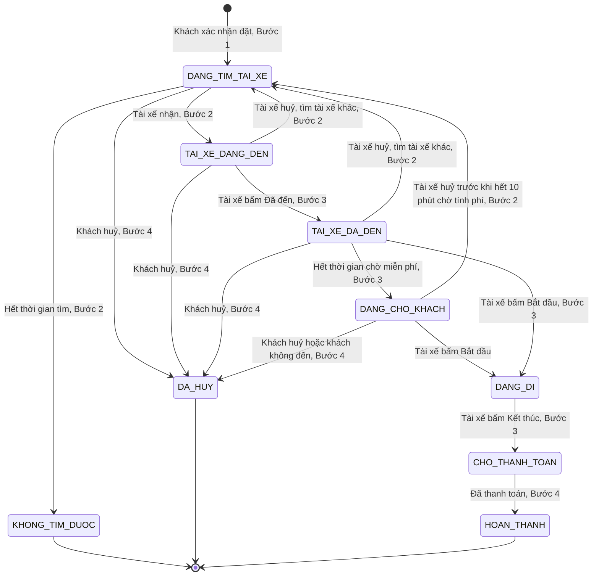
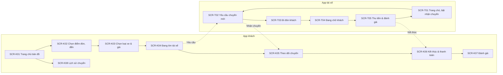

# Đề 5 · Đặt xe chở khách

> **Mã:** DE05 · **Độ khó:** 5/8 · **Vai trò:** 2 (khách, tài xế) · **Nền tảng:** App khách và App tài xế iOS / Android

Khách đặt xe máy hoặc ô tô, thấy giá trước khi đặt, theo dõi tài xế trên bản đồ và thanh toán khi kết thúc chuyến. Tài xế nhận yêu cầu, đón khách, hoàn thành chuyến. Đây là đề có **hai phía dùng chung một dữ liệu theo thời gian thực** (vị trí, trạng thái chuyến). Đề gồm **1 tính năng**, là **1 luồng** gồm 4 bước và các màn hình; tài liệu gồm 1 PRD và 1 SRS.

## Tính năng

| **Tính năng** | **Luồng** | **PRD** | **SRS** |
| --- | --- | --- | --- |
| Đặt xe chở khách | Đặt chuyến → Ghép tài xế & nhận chuyến → Theo dõi chuyến & an toàn → Thanh toán, đánh giá & huỷ chuyến | [PRD](docs/PRD.md) | [SRS](docs/SRS.md) |

## Các bước và màn hình của luồng

| **Bước** | **Tên bước** | **Màn hình** | **Phạm vi** |
| --- | --- | --- | --- |
| Bước 1 | Đặt chuyến | SCR-K01, SCR-K02, SCR-K03 | Chọn điểm đón, điểm đến, loại xe; xem giá ước tính; xác nhận đặt |
| Bước 2 | Ghép tài xế & nhận chuyến | SCR-K04, SCR-T01, SCR-T02 | Tìm tài xế, gửi yêu cầu, tài xế nhận hoặc bỏ qua, không tìm được tài xế |
| Bước 3 | Theo dõi chuyến & an toàn | SCR-K05, SCR-T03, SCR-T04 | Vị trí tài xế realtime, trạng thái chuyến hai phía, liên hệ, chia sẻ hành trình, SOS |
| Bước 4 | Thanh toán, đánh giá & huỷ chuyến | SCR-K06, SCR-K07, SCR-K08, SCR-T05 | Tiền mặt hoặc ví, hoá đơn chuyến, đánh giá hai chiều, huỷ và phí huỷ |

Luồng: Bước 1 Đặt chuyến → Bước 2 Ghép tài xế & nhận chuyến → Bước 3 Theo dõi chuyến & an toàn → Bước 4 Thanh toán, đánh giá & huỷ chuyến.

## Vòng đời chuyến đi (dùng chung cả đề)



## Bản đồ màn hình



## Bối cảnh chung

Khách cần xe nhanh với giá rõ ràng từ trước, và cần cảm thấy an toàn khi đi với người lạ. Tài xế cần nhận chuyến nhanh, biết rõ điểm đón và thu nhập của mỗi chuyến. Bài toán thiết kế chính là giữ hai phía luôn thấy **cùng một trạng thái** khi trạng thái thay đổi liên tục và mạng có thể chập chờn.

| **Nhóm người dùng** | **Nhu cầu chính** |
| --- | --- |
| Khách đi làm hằng ngày | Đặt nhanh, giá ổn định, đến đúng giờ |
| Khách đi đêm, phụ nữ đi một mình | An toàn: biết rõ tài xế, chia sẻ hành trình, SOS |
| Khách lớn tuổi, ít dùng app | Chọn điểm đón dễ, gọi được tài xế |
| Tài xế xe máy, ô tô | Nhận chuyến nhanh, điểm đón chính xác, thu nhập rõ ràng |

Ngoài phạm vi cả đề: đăng ký và duyệt hồ sơ tài xế, đặt xe hẹn giờ, đi chung, giao hàng, khuyến mãi và mã giảm giá, ví điện tử nạp tiền (dùng ví liên kết có sẵn), trang quản trị vận hành, điều phối giá động theo khu vực (chỉ mô tả hệ số cao điểm).

## Quy ước dùng chung

- Màn của App khách có mã `SCR-K..`, App tài xế có mã `SCR-T..`.
- Tiền tệ VND; giá làm tròn tới 1.000 ₫.
- Mã BR, MSG, UC đánh số liên tục trong cả đề: Bước 1 dùng BR-01–10, MSG-01–09; Bước 2 dùng BR-11–20, MSG-10–16; Bước 3 dùng BR-21–31, MSG-17–26; Bước 4 dùng BR-32–43, MSG-27–38. Mã bổ sung sau đánh tiếp từ số cuối: BR-44 (điểm đón chuẩn), BR-45 (xe gần trên bản đồ) ở Bước 1; BR-46 (tạm tắt khi bỏ qua nhiều), MSG-39 ở Bước 2.
- Đăng nhập bằng số điện thoại và OTP theo luồng chuẩn, không mô tả trong bộ tài liệu này.

## Danh sách màn hình

| **Mã** | **Màn hình** | **App** | **Mô tả chi tiết ở** |
| --- | --- | --- | --- |
| SCR-K01 | Trang chủ bản đồ | Khách | Bước 1 |
| SCR-K02 | Chọn điểm đón, điểm đến | Khách | Bước 1 |
| SCR-K03 | Chọn loại xe & giá | Khách | Bước 1 |
| SCR-K04 | Đang tìm tài xế | Khách | Bước 2 |
| SCR-K05 | Theo dõi chuyến | Khách | Bước 3 |
| SCR-K06 | Kết thúc & thanh toán | Khách | Bước 4 |
| SCR-K07 | Đánh giá tài xế | Khách | Bước 4 |
| SCR-K08 | Lịch sử chuyến | Khách | Bước 4 |
| SCR-T01 | Trang chủ, bật nhận chuyến | Tài xế | Bước 2 |
| SCR-T02 | Yêu cầu chuyến mới | Tài xế | Bước 2 |
| SCR-T03 | Đi đón khách | Tài xế | Bước 3 |
| SCR-T04 | Đang chở khách | Tài xế | Bước 3 |
| SCR-T05 | Thu tiền & đánh giá khách | Tài xế | Bước 4 |

## Cấu trúc repo

```text
de05-dat-xe-cho-khach/
├── README.md
└── docs/
    ├── PRD.md    Bối cảnh, phạm vi, luồng, use case theo từng bước
    └── SRS.md    Quy tắc, trạng thái, use case, màn hình, API, thông báo theo từng bước
```

## Cách dùng bộ tài liệu

1. Đọc README để nắm vòng đời chuyến đi: mọi bước của luồng đều bám theo sơ đồ trạng thái ở trên.
2. Đọc PRD để nắm toàn bộ tính năng và luồng, rồi đọc SRS theo từng bước của luồng. Luôn thiết kế **cả hai phía**: mỗi trạng thái khách thấy gì, tài xế thấy gì.
3. Thiết kế màn hình theo đúng mã SCR, mã MSG trong SRS để dễ đối chiếu khi review.
4. Sơ đồ viết bằng Mermaid, xem trực tiếp trên GitHub hoặc trình xem Markdown có hỗ trợ Mermaid.
