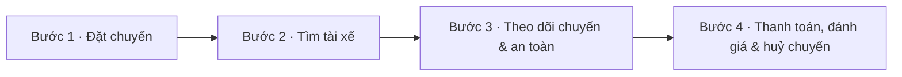
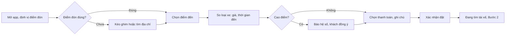
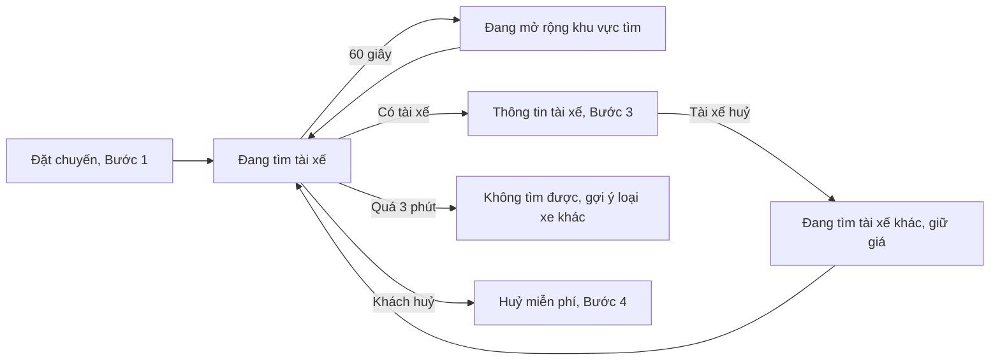
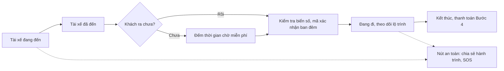
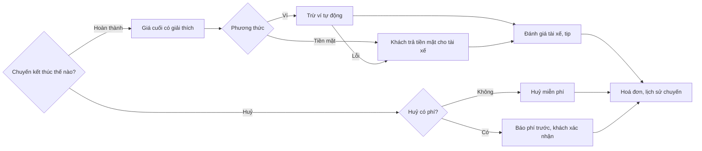

> **Mã:** DE05-PRD · **Trạng thái:** đã chốt · **Người viết:** Design · **SRS:** [SRS.md](SRS.md)

# PRD Đặt xe chở khách

> Đề gồm **1 tính năng**, là **1 luồng** gồm 4 bước và các màn hình: Đặt chuyến → Tìm tài xế → Theo dõi chuyến & an toàn → Thanh toán, đánh giá & huỷ chuyến. Sơ đồ chung xem [README](../README.md).

## 1. Bối cảnh và vấn đề

### 1.1 Bối cảnh

Ứng dụng đặt xe máy hoặc ô tô, nhìn từ phía khách: thấy giá trước khi đặt, chờ hệ thống tìm tài xế, theo dõi tài xế trên bản đồ, đi an toàn và thanh toán, đánh giá khi kết thúc chuyến. Tài xế dùng app riêng, **ngoài phạm vi đề**; khách chỉ thấy kết quả thao tác của tài xế. Đây là đề có **dữ liệu theo thời gian thực** (vị trí, trạng thái chuyến) mà app khách phải hiển thị đúng cả khi mạng chập chờn.

Khách cần xe nhanh với giá rõ ràng từ trước, và cần cảm thấy an toàn khi đi với người lạ. Bài toán thiết kế chính là cho khách luôn thấy **đúng trạng thái chuyến** khi trạng thái thay đổi liên tục do tài xế thao tác và mạng có thể chập chờn, và **minh bạch về tiền** (giá, phí chờ, phí huỷ).

### 1.2 Vấn đề

| **Vấn đề** | **Hệ quả** |
| --- | --- |
| Định vị lệch vài chục mét, nhất là trong hẻm, toà nhà | Tài xế đến sai chỗ, hai bên gọi nhau mất thời gian |
| Gõ địa chỉ tiếng Việt khó, gợi ý không đúng | Chọn nhầm điểm đến, giá sai |
| Giá chỉ biết sau chuyến | Khách lo bị tính quá, ngại đặt |
| Không so được các loại xe | Chọn loại không phù hợp |
| Giá cao điểm tăng mà không báo | Khách thấy bị lừa, đánh giá thấp |
| Khách chờ mà không biết hệ thống đang làm gì | Huỷ sớm, đặt lại liên tục |
| Có tài xế nhưng khách không biết là ai | Lo lắng, khó nhận ra xe |
| Không tìm được tài xế mà không có gợi ý | Khách bỏ đi |
| Tài xế huỷ sau khi nhận, khách phải đặt lại từ đầu | Mất thời gian, bực bội |
| Khách không biết tài xế còn bao xa | Ra đứng chờ quá sớm hoặc quá muộn |
| Khó nhận ra đúng xe ở chỗ đông | Lên nhầm xe, mất an toàn |
| Gọi điện lộ số điện thoại cá nhân | Lo bị làm phiền sau chuyến |
| Tài xế đến mà khách không biết | Bị tính phí chờ, có thể bị huỷ chuyến |
| Gặp sự cố không biết gọi ai | Hoảng loạn, không có hỗ trợ kịp thời |
| Người thân không biết mình đang đi tới đâu | Lo lắng khi đi đêm |
| Giá cuối khác giá ước tính mà không giải thích | Khách thấy bị tính sai, khiếu nại |
| Ví bị lỗi lúc thanh toán mà khách không biết | Đứng đợi, tranh cãi với tài xế |
| Huỷ chuyến không rõ khi nào mất phí | Khách bực khi bị trừ tiền |
| Bị tính phí khi lỡ hẹn mà không rõ lý do | Khiếu nại, bỏ app |
| Đánh giá xong không có tác dụng | Khách không đánh giá nữa |
| Không xem lại được chuyến cũ | Không có hoá đơn, không khiếu nại được |

### 1.3 Mục tiêu

- Từ mở app tới xác nhận đặt ≤ 30 giây với địa chỉ quen.
- Tỉ lệ chuyến bị gọi điện vì sai điểm đón ≤ 10%.
- Chênh lệch giữa giá ước tính và giá cuối ≤ 10% ở ≥ 90% chuyến.
- ≥ 85% chuyến tìm được tài xế trong 2 phút.
- Tỉ lệ khách huỷ khi đang tìm ≤ 10%.
- 100% chuyến bị tài xế huỷ được tự tìm lại mà khách không phải đặt lại.
- ≥ 95% chuyến khách thấy vị trí tài xế cập nhật đều, không trễ quá 10 giây.
- Tỉ lệ lên nhầm xe ≈ 0.
- Mọi lời gọi giữa khách và tài xế đi qua số trung gian.
- ≥ 98% chuyến hoàn thành được thanh toán ngay khi kết thúc.
- Tỉ lệ khiếu nại về giá ≤ 1% chuyến.
- ≥ 50% chuyến được khách đánh giá.

## 2. Người dùng

| **Nhóm** | **Nhu cầu với tính năng này** |
| --- | --- |
| Khách đi làm hằng ngày | Chọn nhanh địa chỉ nhà, công ty đã lưu |
| Khách đi đêm | Biết giá trước, chọn điểm đón sáng, dễ thấy; Biết rõ tài xế, xe, biển số ngay khi có |
| Khách lớn tuổi | Kéo ghim trên bản đồ thay vì gõ địa chỉ; Màn chờ đơn giản, chữ to, ít lựa chọn; Gọi tài xế dễ dàng, nhận ra xe nhờ biển số to |
| Khách đang vội | Biết đang tìm, đã tìm được chưa, bao lâu xe tới |
| Khách đi làm | Biết chính xác khi nào ra đón xe; Thanh toán ví tự động, có hoá đơn |
| Phụ nữ đi đêm | Chia sẻ hành trình cho người thân, nút SOS dễ thấy |
| Khách dùng tiền mặt | Biết chính xác số tiền phải trả |
| Khách đổi ý | Biết trước huỷ có mất phí không |
| Khách hài lòng | Đánh giá, tip tài xế dễ dàng |

## 3. Phạm vi

### 3.1 Trong phạm vi (MVP)

**Bước 1 · Đặt chuyến**

- Tự định vị điểm đón; chỉnh bằng kéo ghim hoặc tìm địa chỉ.
- Tìm điểm đến: gợi ý địa chỉ, địa điểm đã lưu (Nhà, Công ty), chuyến gần đây.
- Loại xe: Xe máy, Ô tô 4 chỗ, Ô tô 7 chỗ.
- Giá ước tính theo từng loại xe, thời gian đến dự kiến, thông báo cao điểm.
- Ghi chú cho tài xế (ví dụ "cổng sau").
- Chọn phương thức thanh toán trước khi đặt (chi tiết ở Bước 4).

**Bước 2 · Tìm tài xế**

- Màn đang tìm tài xế: hiệu ứng tìm, thời gian đã chờ, khu vực tìm mở rộng dần, nút Huỷ.
- Có tài xế: ảnh, tên, đánh giá, hãng và màu xe, biển số, thời gian đến.
- Không tìm được sau 3 phút: không mất phí, gợi ý loại xe khác hoặc thử lại.
- Tài xế huỷ sau khi nhận: báo khách, tự tìm tài xế khác, giữ giá.

**Bước 3 · Theo dõi chuyến & an toàn**

- Vị trí tài xế realtime trên bản đồ, thời gian đến cập nhật liên tục.
- Trạng thái chuyến khách thấy: đang đến, đã đến, đang chờ, đang đi, kết thúc.
- Gọi và nhắn tin qua kênh ẩn số; tin nhắn mẫu nhanh.
- Thời gian chờ miễn phí khi tài xế đã đến.
- Chia sẻ hành trình qua đường link cho người thân.
- Nút SOS: gọi số khẩn cấp, gửi vị trí cho liên hệ khẩn cấp và đội an toàn.
- Mã xác nhận chuyến cho chuyến đi đêm.

**Bước 4 · Thanh toán, đánh giá & huỷ chuyến**

- Phương thức: tiền mặt và ví liên kết (đã liên kết sẵn).
- Giá cuối: giá chốt, cộng phí chờ, tính lại khi lộ trình thay đổi nhiều.
- Thanh toán ví tự động khi kết thúc; ví lỗi thì chuyển tiền mặt.
- Hoá đơn chuyến trong app và qua email.
- Huỷ chuyến: miễn phí, có phí huỷ theo thời điểm; bị huỷ vì không ra điểm đón.
- Khách đánh giá tài xế: 1–5 sao kèm lý do, nhận xét.
- Tiền tip cho tài xế khi thanh toán bằng ví.
- Lịch sử chuyến và báo cáo sự cố một chuyến.

### 3.2 Ngoài phạm vi

- Đặt xe hẹn giờ, đặt nhiều điểm dừng → phase sau.
- Đặt hộ người khác.
- Mã giảm giá.
- Giá cố định trọn gói cho chặng sân bay.
- App tài xế: bật nhận chuyến, thẻ yêu cầu, nhận hoặc bỏ qua.
- Thuật toán điều phối chi tiết (khách chỉ thấy kết quả).
- Chọn tài xế yêu thích.
- Ghi âm trong chuyến.
- Phát hiện bất thường tự động (dừng lâu, lệch lộ trình) → phase sau.
- Đổi điểm đến giữa chuyến.
- Chat với tổng đài trong app.
- App tài xế: chỉ đường, bấm đã đến, nhập mã, bắt đầu và kết thúc chuyến.
- Nạp tiền vào ví, liên kết ví mới (dùng luồng của ví).
- Thẻ tín dụng, chia tiền với người đi cùng.
- Hoàn tiền tự động; khiếu nại do tổng đài xử lý.
- Xuất hoá đơn VAT → phase sau.

## 4. Nguyên tắc sản phẩm

### 4.1 Điểm đón là thứ quan trọng nhất

Điểm đón luôn hiện trên bản đồ với ghim lớn và tên dễ hiểu. Kéo ghim được ngay tại màn chính.

### 4.2 Biết giá trước khi đặt

Mỗi loại xe hiện giá ước tính trước khi khách bấm đặt. Giá cuối chỉ khác khi lộ trình thay đổi.

### 4.3 Nói thật về cao điểm

Giá cao điểm được ghi rõ, kèm hệ số, trước khi khách bấm đặt. Không tăng giá sau khi khách đã xác nhận.

### 4.4 Ít gõ nhất có thể

Địa điểm đã lưu, chuyến gần đây và gợi ý theo từ khoá giúp khách hầu như không phải gõ đầy đủ địa chỉ.

### 4.5 Khách luôn biết đang ở bước nào

Màn chờ có chuyển động, chữ "Đang tìm tài xế gần bạn" và thời gian đã chờ.

### 4.6 Có tài xế là thấy ngay

Ghép xong chuyển ngay sang thông tin tài xế, biển số to nhất.

### 4.7 Lỗi phía tài xế thì khách không phải làm lại

Tài xế huỷ thì hệ thống tự tìm lại, giữ giá; không tìm được thì không mất phí và có gợi ý.

### 4.8 Khách thấy đúng trạng thái thật

App khách chỉ đổi màn khi máy chủ xác nhận trạng thái mới; không đoán trước.

### 4.9 Nhận ra xe trước khi lên xe

Biển số in to nhất trên màn, kèm hãng, màu xe và ảnh tài xế.

### 4.10 An toàn luôn trong tầm tay

Nút an toàn có mặt ở mọi trạng thái từ khi có tài xế đến khi kết thúc chuyến, mở được bằng một chạm.

### 4.11 Riêng tư khi liên lạc

Khách và tài xế không thấy số điện thoại thật của nhau. Link chia sẻ hành trình hết hạn khi chuyến kết thúc.

### 4.12 Giá cuối luôn có giải thích

Giá cuối hiện từng dòng: giá chuyến, phí chờ, điều chỉnh do lộ trình. Khác giá ước tính thì nói rõ vì sao.

### 4.13 Huỷ minh bạch

Trước khi khách xác nhận huỷ, app nói rõ có mất phí hay không và bao nhiêu. Không có phí nào hiện ra sau đó.

### 4.14 Thanh toán không làm khách phải đứng đợi

Ví thanh toán tự động. Ví lỗi thì báo khách ngay và chuyển sang tiền mặt.

### 4.15 Đánh giá có tác dụng

Đánh giá thấp kèm lý do để đội vận hành xử lý; lý do an toàn được xử lý ưu tiên.

## 5. Quy tắc nghiệp vụ

| **Quy tắc** | **Giá trị** |
| --- | --- |
| Loại xe | Xe máy, Ô tô 4 chỗ, Ô tô 7 chỗ |
| Công thức giá | Giá mở cửa + giá mỗi km × km + giá mỗi phút × phút, nhân hệ số cao điểm, làm tròn 1.000 ₫ |
| Giá tối thiểu | Xe máy 12.000 ₫, Ô tô 4 chỗ 25.000 ₫, Ô tô 7 chỗ 32.000 ₫ |
| Hệ số cao điểm | 1,0 đến 2,0; hiện khi > 1,0 |
| Hiệu lực giá ước tính | 5 phút; quá thì tính lại |
| Khoảng cách | Điểm đến cách điểm đón 300 m đến 100 km |
| Vùng phục vụ | Điểm đón và điểm đến trong vùng phục vụ |
| Địa điểm đã lưu | Nhà, Công ty và tối đa 10 địa điểm khác |
| Khu vực tìm | Bắt đầu 2 km, mở rộng 1 km mỗi 30 giây, tối đa 5 km |
| Thời gian tìm tối đa | 3 phút; hết giờ không thu phí |
| Báo mở rộng khu vực | Sau 60 giây |
| Tài xế huỷ sau khi nhận | Tự tìm lại, giữ giá, không phí; tối đa 2 lần |
| Huỷ khi đang tìm | Miễn phí (Bước 4) |
| Tần suất vị trí tài xế | 5 giây khi có chuyến |
| Tài xế đã đến | Khi tài xế cách điểm đón ≤ 100 m và báo đã đến |
| Thời gian chờ miễn phí | Xe máy 3 phút, ô tô 5 phút |
| Phí chờ | Sau thời gian miễn phí, mỗi phút 1.000 ₫ (xe máy), 2.000 ₫ (ô tô); tối đa 10 phút |
| Kênh liên lạc | Số trung gian, có hiệu lực tới 30 phút sau khi kết thúc chuyến |
| Link chia sẻ hành trình | Hết hạn khi chuyến kết thúc |
| Mã xác nhận chuyến | 4 số, áp dụng cho chuyến 22:00–05:00 |
| Liên hệ khẩn cấp | Tối đa 3 người |
| Giá cuối | Giá chốt + phí chờ; lộ trình thực tế dài hơn đề xuất > 20% thì tính lại theo thực tế, ngắn hơn thì giữ giá chốt. Riêng chuyến dừng giữa đường do phía tài xế thì tính theo thực tế, không vượt giá chốt |
| Huỷ miễn phí | Khi đang tìm tài xế; trong 2 phút đầu sau khi có tài xế; khi tài xế đến trễ > 5 phút so với dự kiến |
| Phí huỷ | Sau 2 phút kể từ khi có tài xế: xe máy 10.000 ₫, ô tô 20.000 ₫ |
| Tài xế huỷ vì khách không đến | Sau 10 phút chờ tính phí (sau thời gian chờ miễn phí); khách bị tính phí huỷ và phí chờ |
| Phí huỷ với tiền mặt | Cộng vào chuyến sau của khách; nợ > 50.000 ₫ thì trả bằng ví trong app, hoặc trả tiền mặt cho tài xế ở chuyến kế tiếp |
| Tip | 5.000, 10.000, 20.000 ₫ hoặc tự nhập ≤ 100.000 ₫; chỉ với ví |
| Đánh giá | 1–5 sao; ≤ 3 sao bắt buộc chọn lý do; nhận xét ≤ 200 ký tự; trong 24 giờ sau chuyến |
| Báo cáo sự cố | Trong 7 ngày sau chuyến |

- Các giá trị trên là **cấu hình theo thành phố**, không cố định trong code.

## 6. Luồng trải nghiệm

### 6.1 Toàn bộ luồng

### 6.2 Bước 1 · Đặt chuyến

| **Bước** | **Giai đoạn** | **Trải nghiệm** | **Đầu ra** |
| --- | --- | --- | --- |
| 1 | Mở app | Bản đồ định vị điểm đón; ghim kèm tên địa điểm | Điểm đón đề xuất |
| 2 | Chỉnh điểm đón | Kéo ghim; hoặc chạm ô điểm đón để tìm | Điểm đón chính xác |
| 3 | Chọn điểm đến | Ô "Bạn muốn đi đâu?"; Nhà, Công ty, gần đây, gợi ý | Điểm đến |
| 4 | Chọn loại xe | Danh sách loại xe với giá ước tính, thời gian tài xế đến | Loại xe |
| 5 | Xác nhận | Phương thức thanh toán, ghi chú cho tài xế, nút "Đặt {loại xe}" | Chuyến được tạo |

### 6.3 Bước 2 · Tìm tài xế

| **Bước** | **Giai đoạn** | **Trải nghiệm khách** | **Đầu ra** |
| --- | --- | --- | --- |
| 1 | Đang tìm | Màn chờ, khu vực tìm mở rộng dần, nút Huỷ | – |
| 2 | Có tài xế | Ảnh, tên, xe, biển số, thời gian đến | Chuyến có tài xế |
| 3 | Không tìm được | Báo không mất phí, gợi ý loại xe khác, thử lại | Chuyến kết thúc hoặc đặt lại |
| 4 | Tài xế huỷ | Báo, tự tìm tài xế khác, giữ giá | Quay về bước 1 |

### 6.4 Bước 3 · Theo dõi chuyến & an toàn

| **Bước** | **Giai đoạn** | **Trải nghiệm khách** | **Đầu ra** |
| --- | --- | --- | --- |
| 1 | Đang đến | Xe di chuyển trên bản đồ, "Đến trong {n} phút"; gọi, nhắn tài xế | Khách ra điểm đón đúng lúc |
| 2 | Đã đến | Thông báo "Tài xế đã đến", đếm thời gian chờ | – |
| 3 | Lên xe | Kiểm tra biển số; đọc mã xác nhận cho tài xế (ban đêm) | Chuyến bắt đầu |
| 4 | Đang đi | Lộ trình, thời gian tới nơi; chia sẻ hành trình, SOS | – |
| 5 | Kết thúc | Màn thanh toán (Bước 4) | Chuyến kết thúc |

### 6.5 Bước 4 · Thanh toán, đánh giá & huỷ chuyến

| **Bước** | **Giai đoạn** | **Trải nghiệm khách** | **Đầu ra** |
| --- | --- | --- | --- |
| 1 | Kết thúc | Màn giá cuối với từng dòng | – |
| 2 | Thanh toán | Ví tự trừ; tiền mặt hiện số tiền cần trả, tài xế xác nhận đã thu | Chuyến hoàn thành |
| 3 | Đánh giá | Chọn sao, lý do, nhận xét, tip | Đánh giá |
| 4 | Sau chuyến | Hoá đơn trong lịch sử và email | Hoá đơn |
| 5 | Huỷ | Thấy phí (nếu có) trước khi xác nhận; được báo rõ khi bị huỷ vì không ra điểm đón | Chuyến huỷ |

## 7. Use Cases, User Stories và Acceptance Criteria

### Bước 1 · Đặt chuyến

#### UC1. Chọn điểm đón và điểm đến

##### US1.1 Chọn điểm đón chính xác

User Story: Là khách, tôi muốn điểm đón chính xác để tài xế tìm thấy tôi ngay.

AC01: Mở app tự định vị; điểm đón hiện ghim lớn và tên địa điểm gần nhất.

AC02: Kéo bản đồ để dời ghim; thả tay thì tên điểm đón cập nhật.

AC03: Độ chính xác định vị kém → nhắc khách kiểm tra lại ghim.

AC04: Chưa cấp quyền vị trí → hỏi quyền kèm lý do; từ chối thì khách tự tìm điểm đón.

AC05: Điểm đón ngoài vùng phục vụ → báo rõ, không cho tiếp tục.

##### US1.2 Chọn điểm đến

User Story: Là khách, tôi muốn chọn điểm đến nhanh từ địa điểm đã lưu hoặc gần đây để đặt xe trong vài giây.

AC01: Ô tìm kiếm gợi ý địa chỉ khi gõ, chấp nhận gõ không dấu.

AC02: Hiện Nhà, Công ty (nếu đã lưu) và 5 điểm đến gần đây ngay khi mở ô tìm.

AC03: Chọn được điểm đến bằng ghim trên bản đồ.

AC04: Điểm đến quá gần (< 300 m) hoặc quá xa (> 100 km) → báo rõ.

#### UC2. Chọn loại xe và xem giá

##### US2.1 So sánh loại xe

User Story: Là khách, tôi muốn thấy giá và thời gian đến của từng loại xe để chọn loại phù hợp.

AC01: Mỗi loại xe hiện giá ước tính, số chỗ, thời gian tài xế đến dự kiến.

AC02: Loại xe không có tài xế gần → hiện "Không có xe gần bạn", không chọn được.

AC03: Lộ trình hiện trên bản đồ, kèm quãng đường và thời gian đi.

##### US2.2 Biết về cao điểm

User Story: Là khách, tôi muốn được báo rõ khi giá đang cao điểm để không bất ngờ về giá.

AC01: Hệ số > 1,0 → nhãn "Cao điểm ×{hệ số}" cạnh giá và giải thích khi chạm.

AC02: Lần đầu gặp cao điểm trong phiên → khách phải bấm đồng ý trước khi đặt.

##### US2.3 Xác nhận đặt chuyến

User Story: Là khách, tôi muốn xem lại phương thức thanh toán và ghi chú cho tài xế trước khi đặt để tài xế đón đúng chỗ.

AC01: Hiện phương thức thanh toán đang chọn, đổi được trước khi đặt.

AC02: Ghi chú cho tài xế tuỳ chọn, tối đa 100 ký tự.

AC03: Giá ước tính quá 5 phút → tính lại; giá thay đổi thì báo khách trước khi đặt.

AC04: Bấm "Đặt" chỉ tạo một chuyến dù bấm nhiều lần.

#### UC3. Địa điểm đã lưu

AC01: Lưu Nhà, Công ty và tối đa 10 địa điểm khác từ ô tìm kiếm hoặc chuyến gần đây.

AC02: Sửa, xoá địa điểm đã lưu trong Hồ sơ.

### Bước 2 · Tìm tài xế

#### UC4. Chờ ghép tài xế

##### US4.1 Theo dõi việc tìm tài xế

User Story: Là khách, tôi muốn biết hệ thống đang tìm tài xế cho tôi để không phải đặt lại.

AC01: Màn chờ có hiệu ứng tìm kiếm, chữ "Đang tìm tài xế gần bạn", thời gian đã chờ.

AC02: Sau 60 giây hiện "Đang mở rộng khu vực tìm".

AC03: Có nút Huỷ chuyến; huỷ lúc đang tìm không mất phí (Bước 4).

##### US4.2 Nhận thông tin tài xế

User Story: Là khách, tôi muốn thấy ngay tài xế nào sẽ đến để nhận ra xe khi tới.

AC01: Ghép xong → hiện ảnh, tên, đánh giá, hãng và màu xe, biển số (to, dễ đọc), thời gian đến.

AC02: Thông báo đẩy khi app ở nền.

##### US4.3 Không tìm được tài xế

User Story: Là khách, tôi muốn được gợi ý khi không tìm được tài xế để vẫn có cách đi.

AC01: Sau 3 phút không ghép được → báo rõ, chuyến kết thúc, không mất phí.

AC02: Gợi ý loại xe khác đang có tài xế gần, kèm giá; hoặc "Thử lại".

#### UC5. Tài xế huỷ sau khi nhận

##### US5.1 Được tìm lại tự động

User Story: Là khách, tôi muốn được tìm tài xế khác ngay khi tài xế huỷ, không phải đặt lại.

AC01: Báo "Tài xế đã huỷ chuyến. Đang tìm tài xế khác", giá giữ nguyên, không phí.

AC02: Tìm lại tối đa 2 lần; lần thứ 3 tài xế huỷ → chuyến kết thúc, không thu phí.

### Bước 3 · Theo dõi chuyến & an toàn

#### UC6. Theo dõi tài xế đến đón

##### US6.1 Thấy tài xế đang đến

User Story: Là khách, tôi muốn thấy tài xế đang ở đâu và bao lâu nữa đến để ra đón xe đúng lúc.

AC01: Bản đồ hiện xe tài xế di chuyển mượt, cập nhật mỗi 5 giây.

AC02: "Đến trong {n} phút" cập nhật theo vị trí thật.

AC03: Biển số hiện to nhất; kèm ảnh, tên, đánh giá, hãng và màu xe.

AC04: Mất kết nối vị trí tài xế > 30 giây → hiện "Đang cập nhật vị trí tài xế", giữ vị trí cuối.

##### US6.2 Liên hệ với nhau

User Story: Là khách, tôi muốn gọi, nhắn tin cho tài xế mà không lộ số điện thoại để liên lạc an toàn.

AC01: Nút Gọi và Nhắn tin trên màn theo dõi chuyến; gọi qua số trung gian.

AC02: Tin nhắn mẫu nhanh: "Tôi đang ra", "Tôi đứng ở cổng", "Anh/chị ở đâu ạ?".

AC03: Tin nhắn mới có thông báo, kể cả khi app ở nền.

#### UC7. Đón khách

##### US7.1 Biết khi tài xế đã đến

User Story: Là khách, tôi muốn biết ngay khi tài xế đã đến điểm đón để ra đúng lúc, không bị tính phí chờ.

AC01: Tài xế đến (trong 100 m điểm đón) → khách nhận thông báo "Tài xế đã đến" kèm biển số, màu và hãng xe.

AC02: Màn theo dõi hiện đồng hồ thời gian chờ miễn phí; hết giờ thì báo đang tính phí chờ và số tiền mỗi phút.

##### US7.2 Bắt đầu chuyến an toàn

User Story: Là khách đi đêm, tôi muốn có mã xác nhận để chắc chắn mình lên đúng xe.

AC01: Chuyến 22:00–05:00 hiện mã xác nhận 4 số cho khách; khách đọc mã cho tài xế khi lên xe, đúng mã chuyến mới bắt đầu.

AC02: Chuyến bắt đầu → màn chuyển sang "Đang đi" với lộ trình và giờ tới nơi.

#### UC8. An toàn trong chuyến

##### US8.1 Chia sẻ hành trình

User Story: Là khách đi đêm, tôi muốn người thân thấy tôi đang đi tới đâu.

AC01: Nút "Chia sẻ hành trình" tạo link xem trên trình duyệt: biển số, tài xế, vị trí xe, thời gian tới nơi.

AC02: Link hết hạn khi chuyến kết thúc hoặc bị huỷ.

##### US8.2 SOS

User Story: Là khách, tôi muốn gọi trợ giúp khẩn cấp nhanh để an toàn khi có sự cố.

AC01: Nút an toàn ở góc màn, mở bảng gồm: Gọi 113, Gửi vị trí cho liên hệ khẩn cấp, Báo đội an toàn.

AC02: Gọi 113 cần giữ nút 2 giây để tránh bấm nhầm.

AC03: Gửi vị trí cho liên hệ khẩn cấp qua SMS kèm link hành trình.

AC04: Chưa có liên hệ khẩn cấp → mời thêm ngay tại bảng.

#### UC9. Kết thúc chuyến

AC01: Tài xế kết thúc chuyến tại điểm đến hoặc nơi khách xuống → khách chuyển sang màn thanh toán (Bước 4).

AC02: Kết thúc cách điểm đến > 500 m → khách thấy ghi chú khoảng cách, lý do và nút báo sự cố.

### Bước 4 · Thanh toán, đánh giá & huỷ chuyến

#### UC10. Thanh toán

##### US10.1 Chọn phương thức trước khi đặt

User Story: Là khách, tôi muốn chọn phương thức thanh toán trước khi đặt để không lúng túng lúc kết thúc chuyến.

AC01: Mặc định là phương thức đã dùng ở chuyến trước; đổi được ở màn chọn loại xe.

AC02: Ví liên kết hiện số dư; không đủ số dư cho giá ước tính → gợi ý tiền mặt.

##### US10.2 Thanh toán khi kết thúc

User Story: Là khách, tôi muốn biết chính xác mình trả bao nhiêu và vì sao.

AC01: Màn giá cuối hiện: giá chuyến, phí chờ, điều chỉnh lộ trình, phí huỷ chuyến trước (nếu có), tổng.

AC02: Giá cuối khác giá ước tính → một dòng giải thích lý do.

AC03: Ví → tự trừ, hiện "Đã thanh toán".

AC04: Ví lỗi → báo khách, chuyển tiền mặt, hiện số tiền cần trả tài xế.

AC05: Tiền mặt → hiện "Vui lòng trả tài xế {số tiền}"; tài xế xác nhận đã thu thì khách thấy "Đã thanh toán".

##### US10.3 Hoá đơn và lịch sử

User Story: Là khách, tôi muốn xem lịch sử chuyến và hoá đơn để đối chiếu, khiếu nại khi có vấn đề.

AC01: Lịch sử chuyến liệt kê chuyến hoàn thành và đã huỷ, mới nhất trước.

AC02: Chi tiết chuyến có lộ trình, thời gian, tài xế, biển số, từng dòng giá, phương thức thanh toán.

AC03: Hoá đơn gửi email nếu khách có email.

AC04: "Đặt lại" tạo chuyến mới với cùng điểm đón, điểm đến.

#### UC11. Huỷ chuyến

##### US11.1 Khách huỷ

User Story: Là khách, tôi muốn biết trước huỷ có mất phí không để quyết định.

AC01: Huỷ lúc đang tìm tài xế → không phí, không hỏi lý do.

AC02: Huỷ khi đã có tài xế → hỏi lý do và nói rõ phí (0 ₫ hoặc số tiền) trước khi xác nhận.

AC03: Tài xế đến trễ > 5 phút so với dự kiến → huỷ miễn phí, kèm lý do "Tài xế đến trễ".

AC04: Không huỷ được khi đã bắt đầu chuyến.

##### US11.2 Bị huỷ vì không ra điểm đón

User Story: Là khách, tôi muốn biết rõ vì sao bị tính phí khi lỡ hẹn với tài xế.

AC01: Tài xế chờ quá 10 phút chờ tính phí và huỷ vì không gặp khách → khách nhận thông báo kèm số phút chờ, phí huỷ, phí chờ.

AC02: Tài xế huỷ vì lý do khác trước khi bắt đầu chuyến, kể cả khi đã đến điểm đón → khách không bị phí, hệ thống tìm tài xế khác (Bước 2).

#### UC12. Đánh giá

##### US12.1 Khách đánh giá tài xế

User Story: Là khách, tôi muốn đánh giá tài xế sau chuyến để góp phần giữ chất lượng dịch vụ.

AC01: Màn đánh giá hiện sau thanh toán; bỏ qua được và đánh giá lại trong 24 giờ từ lịch sử.

AC02: ≤ 3 sao bắt buộc chọn ít nhất 1 lý do (ví dụ "Lái xe ẩu", "Thái độ").

AC03: 5 sao hiện lời khen gợi ý và tip (khi dùng ví).

AC04: Đánh giá thấp liên quan an toàn tạo yêu cầu cho đội an toàn.

##### US12.2 Điểm đánh giá của khách

AC01: Tài xế cũng đánh giá khách trên app tài xế (ngoài phạm vi); khách chỉ thấy điểm trung bình của mình trong hồ sơ, không thấy điểm từng chuyến.

#### UC13. Báo cáo sự cố

AC01: Từ chi tiết chuyến trong 7 ngày, chọn loại sự cố (sai giá, quên đồ, an toàn, khác) và mô tả.

AC02: Gửi xong có mã yêu cầu và thời gian phản hồi dự kiến.

## 8. Chỉ số theo dõi

| **Chỉ số** | **Định nghĩa** | **Mục tiêu MVP** |
| --- | --- | --- |
| Tỉ lệ chuyển đổi đặt | Chuyến được đặt / phiên mở màn chọn loại xe | ≥ 50% |
| Thời gian đặt | Từ mở app tới xác nhận đặt | ≤ 30 giây (trung vị) |
| Tỉ lệ chỉnh điểm đón | Phiên có kéo ghim / phiên đặt | Theo dõi; cao là dấu hiệu định vị kém |
| Sai lệch giá | Giá cuối so với giá ước tính | ≤ 10% ở ≥ 90% chuyến |
| Tỉ lệ bỏ khi cao điểm | Phiên bỏ sau khi thấy cao điểm / phiên gặp cao điểm | Theo dõi |
| Tỉ lệ dùng địa điểm đã lưu | Điểm đến chọn từ đã lưu, gần đây / tổng chuyến | ≥ 40% |
| Tỉ lệ ghép thành công | Chuyến có tài xế / chuyến đã đặt | ≥ 85% |
| Thời gian ghép | Từ đặt tới có tài xế | ≤ 30 giây (trung vị) |
| Tỉ lệ khách huỷ khi đang tìm | Chuyến bị khách huỷ khi `DANG_TIM_TAI_XE` / chuyến đã đặt | ≤ 10% |
| Dùng gợi ý khi không tìm được | Khách chọn loại xe khác hoặc thử lại / lần không tìm được | Theo dõi |
| Tìm lại sau khi tài xế huỷ | Chuyến tìm lại được tài xế / chuyến bị tài xế huỷ | ≥ 80% |
| Độ trễ vị trí | Từ tài xế gửi vị trí tới app khách hiện | ≤ 10 giây ở ≥ 95% lần |
| Độ chính xác thời gian đến | Thời gian đến dự báo lúc nhận so với thực tế | Sai lệch ≤ 2 phút ở ≥ 80% chuyến |
| Tỉ lệ dùng liên lạc | Chuyến có gọi hoặc nhắn / tổng chuyến | Theo dõi; cao là dấu hiệu điểm đón chưa rõ |
| Thời gian chờ thực tế | Từ Đã đến tới Bắt đầu chuyến | Theo dõi |
| Tỉ lệ chia sẻ hành trình | Chuyến có chia sẻ / tổng chuyến | Theo dõi |
| Lượt SOS | Số lượt mở bảng an toàn, gọi 113 | Theo dõi, mọi lượt đều được đội an toàn xem lại |
| Tỉ lệ thanh toán ngay | Chuyến thanh toán xong trong 2 phút sau kết thúc / chuyến hoàn thành | ≥ 98% |
| Tỉ lệ ví lỗi | Thanh toán ví lỗi / thanh toán ví | ≤ 2% |
| Tỉ lệ khiếu nại giá | Báo cáo sai giá / chuyến hoàn thành | ≤ 1% |
| Tỉ lệ khách huỷ có phí | Huỷ có phí / tổng huỷ của khách | Theo dõi |
| Tỉ lệ đánh giá | Chuyến được khách đánh giá / chuyến hoàn thành | ≥ 50% |
| Điểm trung bình | Trung bình sao khách cho tài xế | Theo dõi |
| Tỉ lệ tip | Chuyến có tip / chuyến dùng ví | Theo dõi |

## 9. Phụ thuộc và rủi ro

| **Mục** | **Mô tả** | **Hướng xử lý** |
| --- | --- | --- |
| Dịch vụ bản đồ, tìm địa chỉ | Phụ thuộc nhà cung cấp; dữ liệu hẻm, ngõ kém | Cho kéo ghim; ghi chú cho tài xế |
| Định vị trong nhà | GPS lệch | Nhắc kiểm tra ghim khi độ chính xác kém |
| Giá cao điểm | Dễ gây phản ứng | Báo rõ trước khi đặt, cần đồng ý |
| Bấm đặt nhiều lần | Tạo chuyến trùng | Idempotency key cho mỗi lần đặt |
| Hệ thống điều phối | Ghép chậm ở giờ cao điểm | Mở rộng khu vực; báo khách bằng chữ, không để màn đứng yên |
| Thông báo đẩy chậm | Khách không biết đã có tài xế | Giữ kết nối realtime khi đang tìm; đẩy là dự phòng |
| Cạnh tranh dữ liệu | Khách huỷ cùng lúc có tài xế | Máy chủ là nguồn đúng; app hiện theo trạng thái máy chủ trả về |
| Kết nối mạng tài xế | Mất mạng giữa đường | Lưu vị trí, gửi bù khi có mạng; khách thấy trạng thái đang cập nhật |
| Dịch vụ số trung gian | Phụ thuộc nhà cung cấp viễn thông | Nhắn tin trong app làm dự phòng |
| SOS bấm nhầm | Gọi 113 ngoài ý muốn | Giữ 2 giây; đếm ngược có nút huỷ |
| Lạm dụng link chia sẻ | Người lạ xem vị trí | Link khó đoán, hết hạn khi kết thúc |
| Tài xế bấm Bắt đầu khi khách chưa lên | Tính tiền sai | Mã xác nhận ban đêm; khách báo cáo được ở Bước 4 |
| Đối tác ví | Lỗi, chậm phản hồi | Timeout rõ ràng, chuyển tiền mặt; đối soát cuối ngày |
| Trừ tiền hai lần | Gửi lại yêu cầu thanh toán | Idempotency key theo chuyến |
| Phí huỷ gây tranh cãi | Khách không đồng ý phí | Luôn báo trước; khiếu nại qua báo cáo sự cố |
| Thu phí huỷ tiền mặt | Không thu được ngay | Cộng vào chuyến sau |
| Đánh giá trả đũa | Khách chấm thấp vì bị chấm thấp | Ẩn điểm từng chuyến; chỉ hiện trung bình |

## 10. Câu hỏi mở

- Có cho đặt khi điểm đón ngoài vùng nhưng điểm đến trong vùng? → **Đã chốt:** Không. Cả điểm đón và điểm đến phải trong vùng phục vụ (SRS BR-02).
- Hệ số cao điểm tối đa là bao nhiêu, ai quyết định? → **Đã chốt:** Hệ thống tự tính từ dữ liệu giao thông Google Maps, trần ×2,0 (SRS BR-07).
- Có gợi ý điểm đón chuẩn (cổng chính, sảnh) cho toà nhà lớn? → **Đã chốt:** Có, tối đa 3 điểm chuẩn (SRS BR-10).
- Giá ước tính có hiển thị dạng khoảng (từ–đến) thay vì một con số? → **Đã chốt:** Không. Hiện một con số (SRS BR-05).
- Thời gian tìm tối đa 3 phút có hợp lý ở giờ cao điểm? → **Đã chốt:** Giữ 3 phút (SRS BR-15).
- Khách có thấy vị trí các tài xế gần đó trước khi đặt? → **Đã chốt:** Có, tối đa 10 xe gần trên bản đồ, vị trí làm lệch (Bước 1 BR-11).
- Tài xế huỷ thì có tính lại giá? → **Đã chốt:** Không; giữ giá chốt, xoá phí chờ đã phát sinh (SRS BR-17).
- Mã xác nhận có áp dụng cho mọi chuyến, không chỉ ban đêm? → **Đã chốt:** Không. Chỉ chuyến có giờ đón 22:00–05:00 (SRS BR-25).
- Phí chờ có áp dụng cho xe máy không? → **Đã chốt:** Có, sau 3 phút chờ miễn phí (SRS BR-24).
- Đội an toàn hoạt động 24/7 hay theo khung giờ? → **Đã chốt:** Trực 24/7.
- Có phát hiện xe dừng lâu bất thường ngay ở MVP? → **Đã chốt:** Không ở MVP.
- Phí huỷ tiền mặt có giới hạn số chuyến cộng dồn không? → **Đã chốt:** Giới hạn theo số tiền, không theo số chuyến: nợ > 50.000 ₫ phải trả trước khi đặt chuyến mới (SRS BR-37).
- Có cho khách sửa đánh giá sau khi gửi? → **Đã chốt:** Không. Mỗi chuyến đánh giá 1 lần (SRS BR-39).
- Ngưỡng lộ trình dài hơn 20% có hợp lý không? → **Đã chốt:** Giữ 20% (SRS BR-32).
- Tip có áp dụng cho tiền mặt không? → **Đã chốt:** Không. Tip chỉ qua ví (SRS BR-38).
