> **Mã:** DE05-SRS · **Trạng thái:** đã chốt · **Người viết:** Design · **PRD:** [PRD.md](PRD.md)

# UC-DE05 - Đặt xe chở khách

> SRS này mô tả **1 tính năng**, là **1 luồng** gồm 4 bước: Đặt chuyến → Tìm tài xế → Theo dõi chuyến & an toàn → Thanh toán, đánh giá & huỷ chuyến. Mã BR, MSG, UC, SCR đánh số liên tục trong toàn tài liệu. Sơ đồ chung xem [README](../README.md).

## 1. Tổng quan

| **Mục** | **Nội dung** |
| --- | --- |
| Mục tiêu | Ứng dụng đặt xe máy hoặc ô tô, nhìn từ phía khách: thấy giá trước khi đặt, chờ hệ thống tìm tài xế, theo dõi tài xế trên bản đồ, đi an toàn và thanh toán, đánh giá khi kết thúc chuyến |
| Actor | Khách · App khách · Máy chủ · Dịch vụ bản đồ · Máy chủ điều phối · Dịch vụ số trung gian · Người thân (xem link) · Tài xế (cập nhật trạng thái trên app tài xế, ngoài phạm vi) · Đối tác ví · Tài xế (xác nhận thu tiền mặt, huỷ, đánh giá khách trên app tài xế, ngoài phạm vi) |
| Luồng | Bước 1 Đặt chuyến → Bước 2 Tìm tài xế → Bước 3 Theo dõi chuyến & an toàn → Bước 4 Thanh toán, đánh giá & huỷ chuyến |
| Ngoài phạm vi | App tài xế (bật nhận chuyến, nhận yêu cầu, đón, chở, thu tiền, đánh giá khách), đăng ký và duyệt hồ sơ tài xế, thuật toán điều phối chi tiết, đặt xe hẹn giờ, đi chung, giao hàng, khuyến mãi và mã giảm giá, ví điện tử nạp tiền (dùng ví liên kết có sẵn), trang quản trị vận hành, điều phối giá động theo khu vực (chỉ mô tả hệ số cao điểm) |
| Nền tảng | App khách iOS / Android |

### Các bước của luồng

| **Bước** | **Mục tiêu** | **Phạm vi** |
| --- | --- | --- |
| Bước 1 · Đặt chuyến | Khách chọn điểm đón, điểm đến, loại xe, xem giá ước tính và tạo chuyến | Định vị, chọn điểm đón và điểm đến, địa điểm đã lưu, loại xe, giá ước tính, cao điểm, xác nhận đặt |
| Bước 2 · Tìm tài xế | Khách biết đang tìm tài xế, thấy ngay tài xế khi có, được gợi ý khi không tìm được, được tìm lại khi tài xế huỷ | Màn đang tìm, khu vực tìm mở rộng, có tài xế, không tìm được, tài xế huỷ sau khi nhận |
| Bước 3 · Theo dõi chuyến & an toàn | Khách theo dõi chuyến realtime đúng trạng thái; liên lạc ẩn số; có công cụ an toàn | Vị trí realtime, đã đến, thời gian chờ, mã xác nhận, bắt đầu và kết thúc chuyến, gọi, nhắn tin, chia sẻ hành trình, SOS |
| Bước 4 · Thanh toán, đánh giá & huỷ chuyến | Tính giá cuối minh bạch, thanh toán tiền mặt hoặc ví, đánh giá tài xế, huỷ chuyến có quy tắc phí rõ ràng | Chọn phương thức; giá cuối; thanh toán; tip; hoá đơn; khách huỷ; bị huỷ vì không ra điểm đón; phí huỷ; đánh giá tài xế; lịch sử; báo cáo sự cố |

## 2. User Story

| **ID** | **As a** | **I want** | **So that** |
| --- | --- | --- | --- |
| US-01 | Khách | Điểm đón tự định vị và chỉnh được bằng kéo ghim | Tài xế tìm thấy tôi ngay |
| US-02 | Khách | Chọn điểm đến nhanh từ địa điểm đã lưu | Đặt xe trong vài giây |
| US-03 | Khách | Thấy giá và thời gian đến của từng loại xe | Chọn loại phù hợp |
| US-04 | Khách | Được báo rõ khi giá cao điểm | Không bất ngờ về giá |
| US-05 | Khách | Ghi chú cho tài xế | Tài xế đón đúng chỗ |
| US-06 | Khách | Biết hệ thống đang tìm tài xế | Không đặt lại, không huỷ vội |
| US-07 | Khách | Thấy ngay tài xế nào sẽ đến | Nhận ra xe khi tới |
| US-08 | Khách | Được gợi ý khi không tìm được tài xế | Vẫn có cách đi |
| US-09 | Khách | Được tìm tài xế khác khi tài xế huỷ | Không phải đặt lại |
| US-10 | Khách | Thấy tài xế đang đến và còn bao lâu | Ra đón xe đúng lúc |
| US-11 | Khách | Nhận ra đúng xe | Không lên nhầm xe |
| US-12 | Khách | Gọi, nhắn tin cho tài xế mà không lộ số | Liên lạc an toàn |
| US-13 | Khách | Biết ngay khi tài xế đã đến, chuyến bắt đầu, kết thúc | Không bị tính phí chờ, không bất ngờ |
| US-14 | Khách | Chia sẻ hành trình cho người thân | Người thân yên tâm |
| US-15 | Khách | Gọi trợ giúp khẩn cấp nhanh | An toàn khi có sự cố |
| US-16 | Khách | Thấy giá cuối có giải thích | Tin là mình trả đúng |
| US-17 | Khách | Thanh toán ví tự động | Không phải đứng đợi |
| US-18 | Khách | Biết số tiền mặt cần trả và được xác nhận đã trả | Không tranh cãi với tài xế |
| US-19 | Khách | Biết trước phí huỷ | Quyết định huỷ hay không |
| US-20 | Khách | Biết vì sao bị tính phí khi lỡ hẹn | Không bất ngờ, khiếu nại được |
| US-21 | Khách | Đánh giá tài xế, tip | Góp phần giữ chất lượng dịch vụ |
| US-22 | Khách | Xem lịch sử, hoá đơn, báo sự cố | Khiếu nại khi có vấn đề |

## 3. Business Rules

| **Mã** | **Quy tắc** |
| --- | --- |
| BR-01 | **Điểm đón mặc định** = vị trí thiết bị, khớp vào điểm đường gần nhất mà xe dừng được. Độ chính xác định vị > 50 m → hiện MSG-02 |
| BR-02 | **Vùng phục vụ**: điểm đón và điểm đến phải nằm trong vùng phục vụ của thành phố; ngoài vùng → MSG-03, không cho sang bước chọn loại xe |
| BR-03 | **Khoảng cách** điểm đón tới điểm đến từ 300 m đến 100 km theo đường đi |
| BR-04 | **Gợi ý điểm đến**: khi mở ô tìm hiện Nhà, Công ty, địa điểm đã lưu, 5 điểm đến gần nhất; khi gõ ≥ 2 ký tự gọi tìm địa chỉ, chấp nhận không dấu, chờ 300 ms sau lần gõ cuối |
| BR-05 | **Giá ước tính** = max(giá tối thiểu, giá mở cửa + đơn giá km × km + đơn giá phút × phút) × hệ số cao điểm, làm tròn lên 1.000 ₫. Đơn giá theo loại xe và thành phố |
| BR-06 | **Hiệu lực giá** 5 phút kể từ lúc tính (quote_id). Quá hạn khi bấm Đặt → tính lại; giá mới khác giá cũ → MSG-05 trước khi tạo chuyến |
| BR-07 | **Cao điểm**: hệ số do hệ thống tự tính từ **dữ liệu giao thông Google Maps** trả về cho lộ trình: hệ số = thời gian đi có giao thông / thời gian đi bình thường, làm tròn 0,1; < 1,2 coi là 1,0; trần ×2,0; không ai chỉnh tay. Hệ số > 1,0 thì nhãn "Cao điểm ×{hệ số}"; lần đầu mỗi phiên phải đồng ý (MSG-04). Giá sau khi khách đã đặt không đổi vì cao điểm |
| BR-08 | **Loại xe không khả dụng** khi không có tài xế đang rảnh trong bán kính 5 km; hiện "Không có xe gần bạn", disabled |
| BR-09 | **Tạo chuyến** dùng idempotency key cho mỗi lần xác nhận; bấm nhiều lần chỉ tạo 1 chuyến. Khách đang có chuyến chưa kết thúc thì không đặt thêm được (MSG-07) |
| BR-10 | **Điểm đón chuẩn**: điểm đón rơi vào khu vực lớn (toà nhà, trung tâm thương mại, bệnh viện, sân bay) có khai báo điểm đón chuẩn (cổng, sảnh) → **SCR-01** hiện tối đa 3 điểm chuẩn gần nhất, chọn sẵn điểm gần nhất; khách chạm để đổi hoặc vẫn giữ ghim tự do. Dữ liệu điểm chuẩn do vận hành khai báo |
| BR-11 | **Xe gần bạn**: **SCR-01** hiện tối đa 10 tài xế `DANG_RANH` trong bán kính 3 km, đúng loại xe đang chọn (mặc định loại phổ biến nhất); vị trí làm lệch ngẫu nhiên ~50 m, cập nhật mỗi 10 giây; không hiện tên, biển số |
| BR-12 | **Ghi chú cho tài xế** tối đa 100 ký tự. **Địa điểm đã lưu**: Nhà, Công ty và tối đa 10 địa điểm khác, tên 1–30 ký tự |
| BR-13 | **Ghép tài xế** do máy chủ điều phối tự động (ngoài phạm vi): chọn tài xế đang rảnh, đúng loại xe, gần điểm đón nhất; mỗi lần gửi cho 1 tài xế. Khách chỉ thấy kết quả qua \[TripEvent\] |
| BR-14 | **Khu vực tìm** bắt đầu 2 km quanh điểm đón, +1 km mỗi 30 giây, tối đa 5 km; **SCR-04** vẽ vòng tròn theo bán kính hiện tại. Sau 60 giây hiện MSG-10 |
| BR-15 | **Thời gian tìm tối đa** 3 phút tính trên máy chủ; app hiện thời gian đã chờ "{mm:ss}". Hết giờ → chuyến `KHONG_TIM_DUOC`, không thu phí, MSG-11 với danh sách loại xe khác đang có tài xế gần (kèm giá ước tính mới) và nút "Thử lại" (tạo chuyến mới cùng điểm đón, điểm đến; giá tính lại theo Bước 1) |
| BR-16 | **Có tài xế**: chuyến `TAI_XE_DANG_DEN`; app chuyển từ **SCR-04** sang **SCR-05** (Bước 3) với ảnh, tên, điểm đánh giá, hãng và màu xe, biển số, thời gian đến. App ở nền → thông báo đẩy MSG-12 |
| BR-17 | **Tài xế huỷ sau khi nhận** (trước khi bắt đầu chuyến, ở `TAI_XE_DANG_DEN`, `TAI_XE_DA_DEN`, hoặc `DANG_CHO_KHACH` chưa hết 10 phút chờ tính phí): chuyến quay về `DANG_TIM_TAI_XE`, MSG-13; khách không mất phí huỷ, phí chờ đã phát sinh (nếu có) bị xoá, giữ nguyên giá chốt; đồng hồ 3 phút tính lại từ đầu, không gửi lại cho tài xế vừa huỷ. Tìm lại tối đa 2 lần; tài xế thứ 3 huỷ → `KHONG_TIM_DUOC`, không thu phí |
| BR-18 | **Huỷ khi đang tìm**: nút "Huỷ chuyến" trên **SCR-04**, miễn phí, không hỏi lý do (Bước 4 BR-35) |
| BR-19 | **Mất kết nối khi đang tìm**: máy chủ vẫn tìm; app hiện MSG-14, giữ thời gian chờ theo máy chủ; có mạng lại thì gọi \[TripGet\] lấy trạng thái đầy đủ trước khi đổi màn |
| BR-20 | **Vị trí tài xế** gửi mỗi 5 giây khi chuyến chưa kết thúc; app khách nội suy chuyển động giữa 2 điểm. Không có vị trí mới > 30 giây → MSG-15 |
| BR-21 | **Thời gian đến** tính lại mỗi khi có vị trí mới, theo dịch vụ bản đồ; hiện làm tròn phút, tối thiểu "1 phút" |
| BR-22 | **Đổi trạng thái** do tài xế thao tác trên app tài xế (ngoài phạm vi) và máy chủ xác nhận; máy chủ đẩy \[TripEvent\] cho app khách. App khách chỉ đổi màn khi nhận sự kiện đã xác nhận |
| BR-23 | **Tài xế đã đến**: chỉ ghi nhận khi tài xế cách điểm đón ≤ 100 m; khách nhận MSG-16 kèm biển số, màu, hãng xe |
| BR-24 | **Thời gian chờ miễn phí** tính từ "Đã đến": xe máy 3 phút, ô tô 5 phút. Sau đó chuyến sang `DANG_CHO_KHACH`, tính phí chờ theo phút (tối đa 10 phút). Mốc **"10 phút chờ"** trong cả đề là 10 phút **tính phí**, đếm từ lúc chuyến vào `DANG_CHO_KHACH`, tức 13 phút (xe máy) hoặc 15 phút (ô tô) kể từ "Đã đến". Hết 10 phút này tài xế được huỷ với lý do "Khách không đến" (Bước 4). Phí chờ khi chuyến bị huỷ: xem Bước 4, BR-36 |
| BR-25 | **Mã xác nhận** 4 số cho chuyến có giờ đón 22:00–05:00: hiện trên **SCR-05** ở `TAI_XE_DA_DEN`, `DANG_CHO_KHACH`; khách đọc mã cho tài xế khi lên xe, đúng mã chuyến mới bắt đầu được. Chuyến bắt đầu → MSG-18. Không đọc mã qua điện thoại cho người chưa gặp |
| BR-26 | **Kết thúc chuyến** do tài xế xác nhận; chuyến sang `CHO_THANH_TOAN`, khách sang **SCR-06**; giá cuối tính theo Bước 4. Kết thúc cách điểm đến > 500 m → khách thấy MSG-19 kèm khoảng cách, lý do tài xế chọn và nút báo sự cố (Bước 4) |
| BR-27 | **Kênh liên lạc**: gọi qua số trung gian gán cho cặp khách – tài xế; có hiệu lực từ khi nhận chuyến tới 30 phút sau khi kết thúc. Nhắn tin trong app, tối đa 200 ký tự mỗi tin |
| BR-28 | **Link chia sẻ hành trình**: token ngẫu nhiên, không chứa số điện thoại, tên đầy đủ của khách; hết hạn khi chuyến kết thúc hoặc huỷ |
| BR-29 | **SOS** (đội an toàn trực **24/7**): Gọi 113 cần giữ nút 2 giây; Gửi vị trí gửi SMS tới tối đa 3 liên hệ khẩn cấp kèm link hành trình; Báo đội an toàn tạo ticket ưu tiên cao kèm vị trí, chuyến |
| BR-30 | **Nút an toàn** hiện ở **SCR-05** từ `TAI_XE_DANG_DEN` tới `CHO_THANH_TOAN` |
| BR-31 | **Phương thức**: `TIEN_MAT`, `VI_LIEN_KET`. Mặc định là phương thức của chuyến trước. Ví không đủ số dư cho giá ước tính → MSG-24 gợi ý tiền mặt |
| BR-32 | **Giá cuối** = giá chốt (Bước 1) + phí chờ (BR-24) + phí huỷ còn nợ của khách (BR-37). Lộ trình thực tế dài hơn lộ trình đề xuất > 20% → giá chuyến tính lại theo km, phút thực tế; ngắn hơn → giữ giá chốt. Ngoại lệ: chuyến dừng giữa đường do phía tài xế (xe hỏng, sự cố; Bước 3 UC-06 A2) → tính theo km, phút thực tế và không vượt giá chốt. Khách yêu cầu xuống sớm vẫn giữ giá chốt |
| BR-33 | **Thanh toán ví**: tự gọi trừ ví khi chuyến sang `CHO_THANH_TOAN`, idempotency key = trip_id. Thất bại hoặc không phản hồi trong 10 giây → kiểm tra lại trạng thái giao dịch; vẫn chưa thành công → chuyển `TIEN_MAT`, báo khách (MSG-26) |
| BR-34 | **Thanh toán tiền mặt**: **SCR-06** hiện "Vui lòng trả tài xế {số tiền}"; tài xế xác nhận đã thu trên app tài xế → chuyến `HOAN_THANH`, MSG-25. Tài xế báo khách trả thiếu → phần thiếu ghi nợ như BR-37, MSG-29 |
| BR-35 | **Huỷ của khách** – miễn phí khi: chuyến `DANG_TIM_TAI_XE`; trong 2 phút đầu kể từ lúc có tài xế; hoặc tài xế trễ > 5 phút so với thời gian đến dự kiến lúc nhận. Ba điều kiện miễn phí này áp dụng ở mọi trạng thái trước `DANG_DI`, kể cả khi tài xế đã đến. Ngoài các trường hợp trên: phí huỷ xe máy 10.000 ₫, ô tô 20.000 ₫. Khách huỷ ở `DANG_CHO_KHACH` trả thêm **phí chờ đã phát sinh** tới lúc huỷ. Không huỷ được từ `DANG_DI` |
| BR-36 | **Tài xế huỷ**: trước khi bắt đầu chuyến vì lý do của tài xế → chuyến quay về `DANG_TIM_TAI_XE`, khách không phí huỷ, không phí chờ (Bước 2 BR-17). **Khách không ra điểm đón**: sau 10 phút chờ tính phí (BR-24), tài xế được huỷ với lý do "Khách không đến" → chuyến `DA_HUY`, khách chịu phí huỷ **và phí chờ đã phát sinh** (đủ 10 phút), nhận MSG-30 |
| BR-37 | **Thu phí huỷ**: ví → trừ ngay; tiền mặt hoặc ví lỗi → ghi nợ, cộng vào giá cuối chuyến kế tiếp (một khoản nợ mỗi lần; nợ > 50.000 ₫ thì phải thanh toán trước khi đặt chuyến mới). Phí chờ thu kèm phí huỷ (BR-35, BR-36) được thu và ghi nợ cùng cách. **Trả nợ**: nút \[Thanh toán\] ở MSG-33 mở màn trả nợ bằng ví liên kết, cho liên kết ví ngay tại đó. Khách không dùng ví chọn "Trả bằng tiền mặt ở chuyến tới": được đặt đúng một chuyến `TIEN_MAT`, toàn bộ nợ cộng vào giá cuối chuyến đó để tài xế thu hộ; chưa trả hết thì không đặt được chuyến tiếp theo |
| BR-38 | **Tip**: chỉ khi thanh toán ví; 5.000 / 10.000 / 20.000 ₫ hoặc tự nhập ≤ 100.000 ₫; trừ ví riêng, 100% cho tài xế; chỉ trong lúc đánh giá; thành công → MSG-31 |
| BR-39 | **Đánh giá tài xế**: 1–5 sao; ≤ 3 sao bắt buộc ≥ 1 lý do; nhận xét ≤ 200 ký tự; trong 24 giờ sau chuyến; 1 lần mỗi chuyến, không sửa. Điểm hiển thị = trung bình 100 chuyến gần nhất, cần ≥ 5 đánh giá. Tài xế đánh giá khách trên app tài xế (ngoài phạm vi); khách chỉ thấy điểm trung bình của mình trong hồ sơ |
| BR-40 | **Đánh giá liên quan an toàn** (lý do "Lái xe nguy hiểm", "Quấy rối") → tự tạo ticket đội an toàn |
| BR-41 | **Lịch sử chuyến**: chuyến `HOAN_THANH`, `DA_HUY`, `KHONG_TIM_DUOC` của 12 tháng gần nhất; hoá đơn gửi email khi `HOAN_THANH` nếu có email |
| BR-42 | **Báo cáo sự cố** trong 7 ngày sau chuyến; loại: Sai giá, Quên đồ, An toàn, Thái độ, Khác; mô tả ≤ 500 ký tự; tối đa 3 ảnh |

## 4. Trạng thái

### 4.1 Bước 1 · Đặt chuyến

#### Các bước của luồng đặt

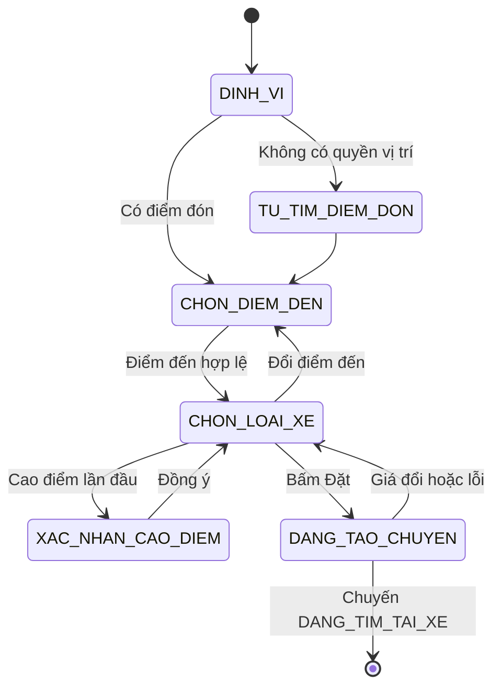

#### Trạng thái loại xe trên SCR-03

| **Trạng thái** | **Điều kiện** | **Hiển thị** |
| --- | --- | --- |
| `KHA_DUNG` | Có tài xế rảnh gần, có giá | Giá, "{n} phút", số chỗ; chọn được |
| `CAO_DIEM` | Khả dụng, hệ số > 1,0 | Như trên + nhãn "Cao điểm ×{hệ số}" |
| `KHONG_KHA_DUNG` | BR-08 | Mờ, "Không có xe gần bạn" |
| `DANG_TINH_GIA` | Đang gọi \[FareQuote\] | Skeleton ở ô giá |

### 4.2 Bước 2 · Tìm tài xế

#### Chuyến trong phạm vi SRS này

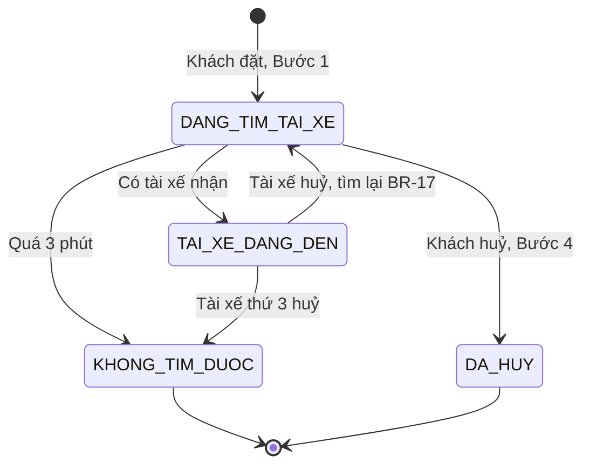

#### Khách thấy gì trên SCR-04

| **Tình huống** | **Hiển thị** |
| --- | --- |
| Đang tìm, < 60 giây | Hiệu ứng tìm, "Đang tìm tài xế gần bạn", "{mm:ss}", tóm tắt chuyến, nút Huỷ |
| Đang tìm, ≥ 60 giây | Thêm MSG-10, vòng khu vực tìm lớn dần |
| Đang tìm lại sau khi tài xế huỷ | Banner MSG-13, "Giá giữ nguyên {giá} ₫" |
| Có tài xế | Chuyển sang **SCR-05** (Bước 3) |
| `KHONG_TIM_DUOC` | Panel MSG-11, loại xe khác kèm giá, "Thử lại" |
| Mất kết nối | Banner MSG-14 |

### 4.3 Bước 3 · Theo dõi chuyến & an toàn

#### Trạng thái chuyến trong phạm vi SRS này

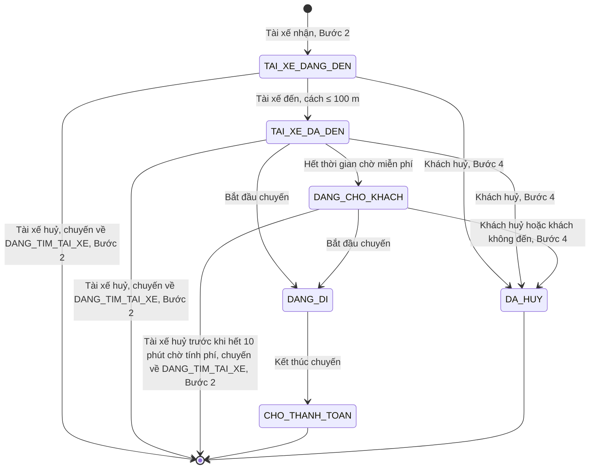

#### Khách thấy gì theo trạng thái

| **Trạng thái** | **SCR-05** |
| --- | --- |
| `TAI_XE_DANG_DEN` | Xe trên bản đồ, "Đến trong {n} phút", thông tin tài xế, Gọi, Nhắn, nút an toàn, Huỷ chuyến |
| `TAI_XE_DA_DEN` | "Tài xế đã đến", biển số to, đồng hồ chờ miễn phí, mã xác nhận (ban đêm) |
| `DANG_CHO_KHACH` | "Đang tính phí chờ: {x} ₫", đồng hồ, mã xác nhận (ban đêm) |
| `DANG_DI` | Lộ trình, "Tới nơi lúc {giờ}", chia sẻ hành trình nổi bật, nút an toàn |
| `CHO_THANH_TOAN` | Chuyển sang **SCR-06** (Bước 4) |

### 4.4 Bước 4 · Thanh toán, đánh giá & huỷ chuyến

#### Thanh toán của chuyến

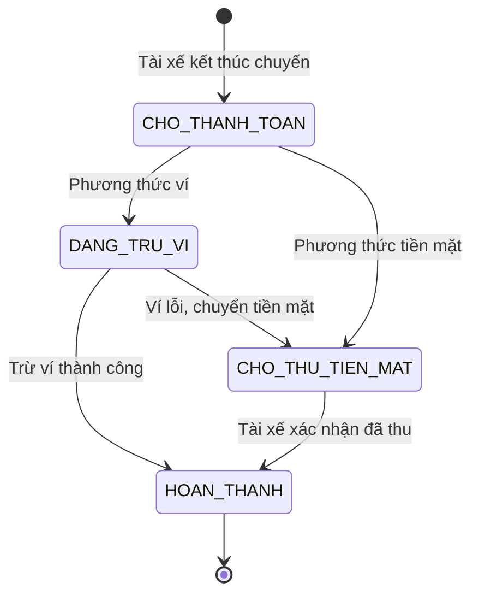

#### Huỷ theo thời điểm

| **Trạng thái chuyến** | **Khách huỷ** | **Nếu tài xế huỷ** |
| --- | --- | --- |
| `DANG_TIM_TAI_XE` | Miễn phí | – |
| `TAI_XE_DANG_DEN`, ≤ 2 phút từ lúc có tài xế | Miễn phí | Khách không phí, tìm tài xế khác (Bước 2) |
| `TAI_XE_DANG_DEN`, > 2 phút | Phí huỷ (miễn phí nếu tài xế trễ > 5 phút) | Khách không phí, tìm tài xế khác |
| `TAI_XE_DA_DEN` | Phí huỷ (miễn phí nếu còn trong 2 phút đầu hoặc tài xế trễ > 5 phút, BR-35) | Khách không phí, tìm tài xế khác |
| `DANG_CHO_KHACH`, chưa hết 10 phút chờ tính phí | Phí huỷ + phí chờ đã phát sinh (miễn phí nếu tài xế trễ > 5 phút) | Khách không phí, xoá phí chờ, tìm tài xế khác |
| `DANG_CHO_KHACH`, đã hết 10 phút chờ tính phí | Phí huỷ + phí chờ 10 phút | "Khách không đến": khách chịu phí huỷ + phí chờ 10 phút, `DA_HUY` |
| `DANG_DI` trở đi | Không huỷ được (MSG-35) | – |

## 5. Use Case

### Bước 1 · Đặt chuyến

#### UC-01 Chọn điểm đón và điểm đến

| **Mục** | **Nội dung** |
| --- | --- |
| Tiền điều kiện | Khách đã đăng nhập, không có chuyến đang diễn ra |
| Hậu điều kiện thành công | Có điểm đón và điểm đến hợp lệ; mở **SCR-03** |
| Hậu điều kiện thất bại | Ở lại **SCR-01** hoặc **SCR-02** với thông báo lỗi |

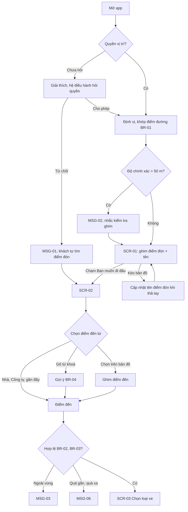

**Luồng chính**

| **Bước** | **Actor** | **Mô tả** |
| --- | --- | --- |
| 1 | Khách | Mở app |
| 2 | App | Định vị, khớp điểm đón (BR-01), hiện **SCR-01** với ghim và tên điểm đón |
| 3 | Khách | Chạm "Bạn muốn đi đâu?" |
| 4 | App | Mở **SCR-02**, hiện gợi ý theo BR-04 |
| 5 | Khách | Chọn điểm đến |
| 6 | App | Kiểm tra BR-02, BR-03; hợp lệ → mở **SCR-03** |

**Luồng thay thế**

| **Mã** | **Điều kiện** | **Xử lý** |
| --- | --- | --- |
| A1 | Kéo ghim điểm đón | Thả tay → cập nhật tên (\[ReverseGeocode\]) |
| A2 | Chạm ô điểm đón ở **SCR-02** | Tìm điểm đón như tìm điểm đến |
| A3 | Từ chối quyền vị trí | MSG-01; ô điểm đón trống, khách tự tìm |
| A4 | Chọn "Chọn trên bản đồ" | Ghim điểm đến ở giữa màn, kéo bản đồ để đặt |
| A5 | Lưu địa điểm | Biểu tượng ngôi sao cạnh gợi ý → đặt tên, lưu (BR-12) |

**Luồng lỗi**

| **Mã** | **Điều kiện** | **Xử lý** |
| --- | --- | --- |
| E1 | Ngoài vùng phục vụ | MSG-03 |
| E2 | Khoảng cách không hợp lệ | MSG-06 |
| E3 | Dịch vụ tìm địa chỉ lỗi | MSG-08; vẫn cho chọn trên bản đồ |

#### UC-02 Chọn loại xe và xác nhận đặt

| **Mục** | **Nội dung** |
| --- | --- |
| Tiền điều kiện | Có điểm đón, điểm đến hợp lệ |
| Hậu điều kiện thành công | Chuyến được tạo ở `DANG_TIM_TAI_XE` với giá đã chốt; mở **SCR-04** |
| Hậu điều kiện thất bại | Không tạo chuyến; ở lại **SCR-03** |

**Luồng chính**

| **Bước** | **Actor** | **Mô tả** |
| --- | --- | --- |
| 1 | App | Gọi \[FareQuote\] cho mọi loại xe; hiện **SCR-03** với lộ trình, giá, thời gian đến |
| 2 | Khách | Chọn loại xe |
| 3 | Khách | Kiểm tra phương thức thanh toán; thêm ghi chú cho tài xế (tuỳ chọn) |
| 4 | Khách | Bấm "Đặt {loại xe}" |
| 5 | App | Kiểm tra BR-06; gọi \[TripCreate\] với quote_id và idempotency key; nút chuyển loading |
| 6 | Máy chủ | Tạo chuyến `DANG_TIM_TAI_XE`, chốt giá ước tính |
| 7 | App | Mở **SCR-04** |

**Luồng thay thế**

| **Mã** | **Điều kiện** | **Xử lý** |
| --- | --- | --- |
| A1 | Cao điểm lần đầu | MSG-04 trước bước 4 (BR-07) |
| A2 | Quote hết hạn, giá đổi | MSG-05 (BR-06) |
| A3 | Đổi phương thức thanh toán | Mở chọn phương thức (Bước 4) |
| A4 | Ví liên kết lỗi hoặc không đủ số dư | Gợi ý chuyển sang tiền mặt (Bước 4) |
| A5 | Mọi loại xe `KHONG_KHA_DUNG` | MSG-09 ở **SCR-03**, nút Đặt disabled |

**Luồng lỗi**

| **Mã** | **Điều kiện** | **Xử lý** |
| --- | --- | --- |
| E1 | Đang có chuyến khác | MSG-07, nút "Xem chuyến hiện tại" |
| E2 | Lỗi mạng khi tạo chuyến | Gửi lại cùng idempotency key; vẫn lỗi → MSG-08 |
| E3 | \[FareQuote\] lỗi | Ô giá hiện "Chưa tính được giá" + Thử lại; nút Đặt disabled |

### Bước 2 · Tìm tài xế

#### UC-03 Chờ ghép tài xế

| **Mục** | **Nội dung** |
| --- | --- |
| Tiền điều kiện | Chuyến vừa tạo ở `DANG_TIM_TAI_XE` (Bước 1) |
| Hậu điều kiện thành công | Chuyến `TAI_XE_DANG_DEN`; khách ở **SCR-05** |
| Hậu điều kiện thất bại | Chuyến `KHONG_TIM_DUOC` hoặc `DA_HUY` |

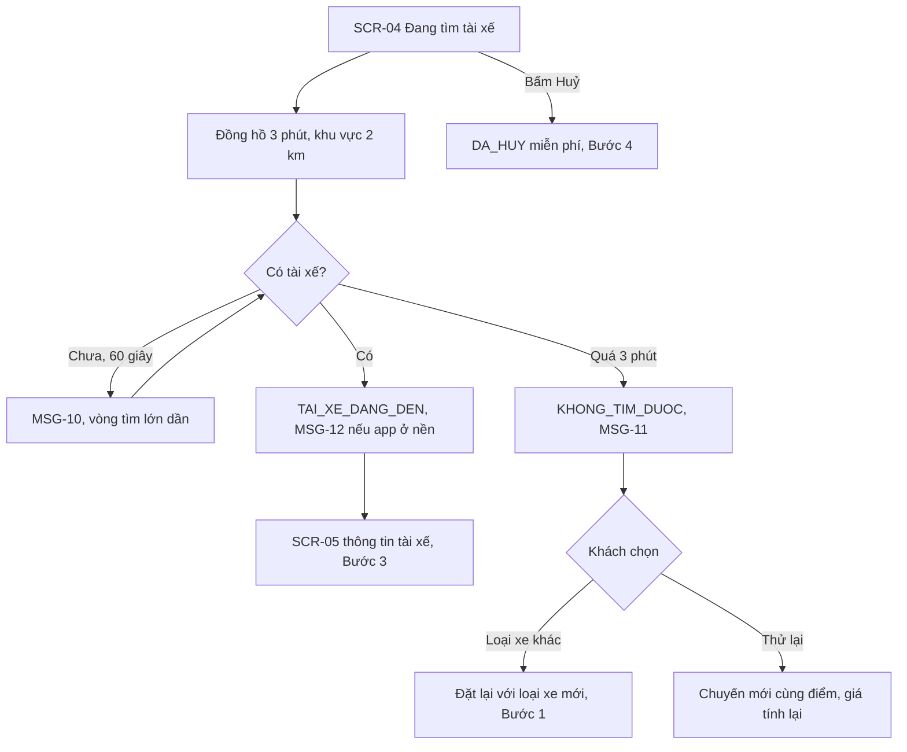

**Luồng chính**

| **Bước** | **Actor** | **Mô tả** |
| --- | --- | --- |
| 1 | App | Sau khi đặt, mở **SCR-04**: hiệu ứng tìm, "Đang tìm tài xế gần bạn", "00:00" |
| 2 | Máy chủ | Ghép tài xế (BR-13), mở rộng khu vực theo BR-14 |
| 3 | App | Nhận \[TripEvent\] `TAI_XE_DANG_DEN` kèm thông tin tài xế |
| 4 | App | Chuyển sang **SCR-05** (Bước 3) |

**Luồng thay thế**

| **Mã** | **Điều kiện** | **Xử lý** |
| --- | --- | --- |
| A1 | Chờ ≥ 60 giây | MSG-10 (BR-14) |
| A2 | App ở nền khi có tài xế | Thông báo đẩy MSG-12; chạm mở **SCR-05** |
| A3 | Khách huỷ khi đang tìm | Miễn phí (BR-18), về **SCR-01** |

**Luồng lỗi**

| **Mã** | **Điều kiện** | **Xử lý** |
| --- | --- | --- |
| E1 | Quá 3 phút | `KHONG_TIM_DUOC`, MSG-11 (BR-15) |
| E2 | Mất kết nối | MSG-14; có mạng lại gọi \[TripGet\] (BR-19) |
| E3 | Khách bấm Huỷ đúng lúc có tài xế | Máy chủ xử lý theo thứ tự đến; app hiện theo kết quả trả về (huỷ miễn phí nếu trong 2 phút đầu, Bước 4 BR-35) |

#### UC-04 Tài xế huỷ sau khi nhận

| **Mục** | **Nội dung** |
| --- | --- |
| Tiền điều kiện | Chuyến đã có tài xế, chưa bắt đầu (BR-17) |
| Hậu điều kiện thành công | Chuyến có tài xế mới |
| Hậu điều kiện thất bại | Chuyến `KHONG_TIM_DUOC`, không thu phí |

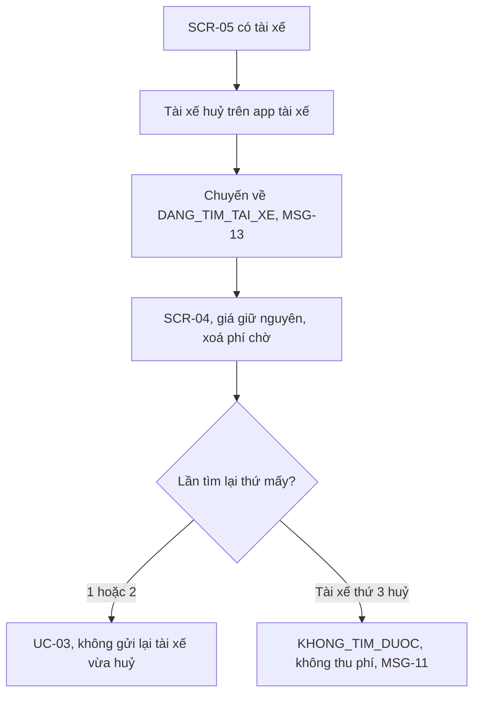

**Luồng chính**

| **Bước** | **Actor** | **Mô tả** |
| --- | --- | --- |
| 1 | App | Nhận \[TripEvent\] chuyến về `DANG_TIM_TAI_XE` |
| 2 | App | Banner, thông báo đẩy MSG-13; chuyển về **SCR-04** với "Giá giữ nguyên {giá} ₫" |
| 3 | Máy chủ | Tìm lại theo UC-03, đồng hồ 3 phút tính lại |
| 4 | App | Có tài xế mới → **SCR-05** |

**Luồng thay thế**

| **Mã** | **Điều kiện** | **Xử lý** |
| --- | --- | --- |
| A1 | Đã tìm lại 2 lần, tài xế thứ 3 vẫn huỷ | `KHONG_TIM_DUOC`, không thu phí, MSG-11 |
| A2 | Đã phát sinh phí chờ | Xoá phí chờ; **SCR-04** ghi "Bạn không bị tính phí chờ" |

### Bước 3 · Theo dõi chuyến & an toàn

#### UC-05 Chờ tài xế đến và lên xe

| **Mục** | **Nội dung** |
| --- | --- |
| Tiền điều kiện | Chuyến `TAI_XE_DANG_DEN` |
| Hậu điều kiện thành công | Chuyến `DANG_DI` |
| Hậu điều kiện thất bại | Chuyến `DA_HUY` (Bước 4) hoặc về `DANG_TIM_TAI_XE` khi tài xế huỷ (Bước 2) |

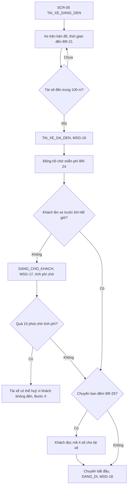

**Luồng chính**

| **Bước** | **Actor** | **Mô tả** |
| --- | --- | --- |
| 1 | App | **SCR-05**: xe trên bản đồ, thời gian đến (BR-21), thông tin tài xế |
| 2 | Máy chủ | Tài xế đến trong 100 m điểm đón (BR-23) → `TAI_XE_DA_DEN`; gửi MSG-16 |
| 3 | App | "Tài xế đã đến", biển số to, đồng hồ chờ miễn phí (BR-24) |
| 4 | Khách | Kiểm tra biển số, lên xe; chuyến ban đêm đọc mã xác nhận cho tài xế (BR-25) |
| 5 | Máy chủ | Chuyến `DANG_DI`; gửi \[TripEvent\] |
| 6 | App | Màn chuyển sang "Đang đi"; MSG-18 |

**Luồng thay thế**

| **Mã** | **Điều kiện** | **Xử lý** |
| --- | --- | --- |
| A1 | Hết thời gian chờ miễn phí | `DANG_CHO_KHACH`; MSG-17; bắt đầu tính phí chờ |
| A2 | Chờ tính phí quá 10 phút (BR-24) | Tài xế có thể huỷ vì khách không đến; khách chịu phí (Bước 4) |
| A3 | Khách ra trước khi tài xế đến | Khách nhắn tin mẫu "Tôi đang đứng ở điểm đón" |
| A4 | Tài xế huỷ trước khi bắt đầu | Chuyến về `DANG_TIM_TAI_XE`, không phí (Bước 2) |

**Luồng lỗi**

| **Mã** | **Điều kiện** | **Xử lý** |
| --- | --- | --- |
| E1 | Vị trí tài xế không cập nhật > 30 giây | MSG-15, giữ vị trí cuối |
| E2 | App khách mất mạng | Giữ màn cuối; có mạng lại gọi \[TripGet\] rồi mới đổi màn |

#### UC-06 Đang đi và kết thúc chuyến

| **Mục** | **Nội dung** |
| --- | --- |
| Tiền điều kiện | Chuyến `DANG_DI` |
| Hậu điều kiện | Chuyến `CHO_THANH_TOAN`; khách ở **SCR-06** |

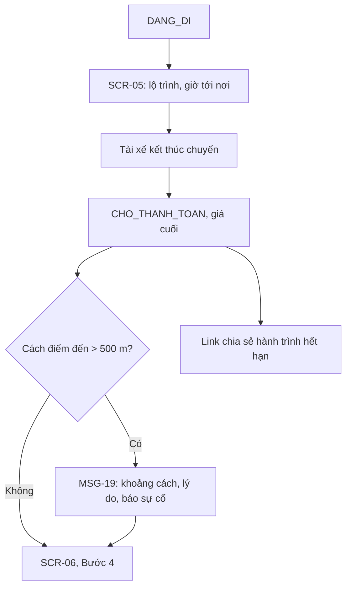

**Luồng chính**

| **Bước** | **Actor** | **Mô tả** |
| --- | --- | --- |
| 1 | App | **SCR-05** hiện lộ trình và giờ tới nơi |
| 2 | Máy chủ | Tài xế kết thúc chuyến → `CHO_THANH_TOAN`; tính giá cuối (Bước 4) |
| 3 | App | Chuyển sang **SCR-06** (Bước 4) |
| 4 | Máy chủ | Link chia sẻ hành trình hết hạn |

**Luồng thay thế**

| **Mã** | **Điều kiện** | **Xử lý** |
| --- | --- | --- |
| A1 | Khách yêu cầu xuống sớm | Tài xế kết thúc tại chỗ; MSG-19; giữ giá chốt (Bước 4 BR-32) |
| A2 | Chuyến dừng giữa đường do phía tài xế (xe hỏng, sự cố) | MSG-19 với lý do; giá tính theo km, phút thực tế và không vượt giá chốt (Bước 4 BR-32) |

**Luồng lỗi**

| **Mã** | **Điều kiện** | **Xử lý** |
| --- | --- | --- |
| E1 | App khách mất mạng lúc kết thúc | Có mạng lại gọi \[TripGet\], mở **SCR-06** với giá cuối |

#### UC-07 Liên lạc với tài xế

| **Mục** | **Nội dung** |
| --- | --- |
| Tiền điều kiện | Chuyến có tài xế, chưa quá 30 phút sau khi kết thúc |
| Hậu điều kiện | Cuộc gọi hoặc tin nhắn được chuyển, không lộ số thật |

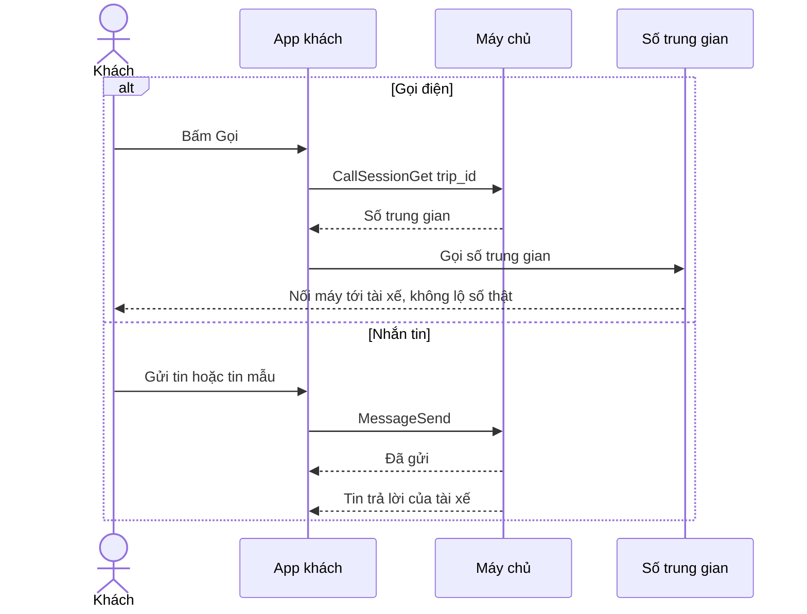

**Luồng chính**

| **Bước** | **Actor** | **Mô tả** |
| --- | --- | --- |
| 1 | Khách | Bấm Gọi ở **SCR-05** |
| 2 | Hệ thống | Gọi \[CallSessionGet\] lấy số trung gian |
| 3 | Hệ thống | App gọi số trung gian; tài xế nhận cuộc gọi, hai bên chỉ thấy số trung gian |

**Luồng thay thế**

| **Mã** | **Điều kiện** | **Xử lý** |
| --- | --- | --- |
| A1 | Chọn Nhắn tin | Gõ tin hoặc chọn tin mẫu ("Tôi đang ra", "Tôi đứng ở cổng") → \[MessageSend\]; tin trả lời của tài xế có thông báo, kể cả khi app ở nền |
| A2 | Quá 30 phút sau khi chuyến kết thúc | Ẩn nút Gọi, Nhắn tin |

**Luồng lỗi**

| **Mã** | **Điều kiện** | **Xử lý** |
| --- | --- | --- |
| E1 | Không lấy được số trung gian hoặc gửi tin thất bại | Báo lỗi, cho thử lại; không hiện số thật của tài xế |

#### UC-08 Chia sẻ hành trình và SOS

| **Mục** | **Nội dung** |
| --- | --- |
| Tiền điều kiện | Chuyến từ `TAI_XE_DANG_DEN` tới `DANG_DI` |
| Hậu điều kiện | Link được tạo, hoặc yêu cầu khẩn cấp được gửi |

**Luồng chính**

| **Bước** | **Actor** | **Mô tả** |
| --- | --- | --- |
| 1 | Khách | Chạm nút an toàn ở **SCR-05** |
| 2 | Hệ thống | Mở bảng an toàn |
| 3 | Khách | Chọn Chia sẻ hành trình |
| 4 | Hệ thống | Gọi \[TripShareCreate\] tạo link có token, mở bảng chia sẻ của hệ điều hành |
| 5 | Người thân | Mở link: thấy xe, vị trí, giờ tới nơi |
| 6 | Hệ thống | Chuyến kết thúc hoặc huỷ → link hết hạn, trang hiện MSG-23 |

**Luồng thay thế**

| **Mã** | **Điều kiện** | **Xử lý** |
| --- | --- | --- |
| A1 | Chọn Gọi 113 | Giữ nút 2 giây → đếm ngược 3 giây có nút huỷ → gọi 113, đồng thời báo đội an toàn |
| A2 | Chọn Gửi vị trí cho liên hệ khẩn cấp | Chưa có liên hệ → thêm ngay; có → \[SmsSosSend\] kèm link, MSG-21 |
| A3 | Chọn Báo đội an toàn | \[SafetyTicketCreate\] ưu tiên cao, MSG-22 |

**Luồng lỗi**

| **Mã** | **Điều kiện** | **Xử lý** |
| --- | --- | --- |
| E1 | Gửi SMS khẩn cấp thất bại | Báo lỗi, cho thử lại; nút Gọi 113 vẫn dùng được |

### Bước 4 · Thanh toán, đánh giá & huỷ chuyến

#### UC-09 Thanh toán khi kết thúc chuyến

| **Mục** | **Nội dung** |
| --- | --- |
| Tiền điều kiện | Chuyến `CHO_THANH_TOAN` |
| Hậu điều kiện thành công | Chuyến `HOAN_THANH`; hoá đơn tạo |
| Hậu điều kiện thất bại | Chuyến ở `CHO_THU_TIEN_MAT`; tổng đài theo dõi chuyến chưa thanh toán sau 30 phút |

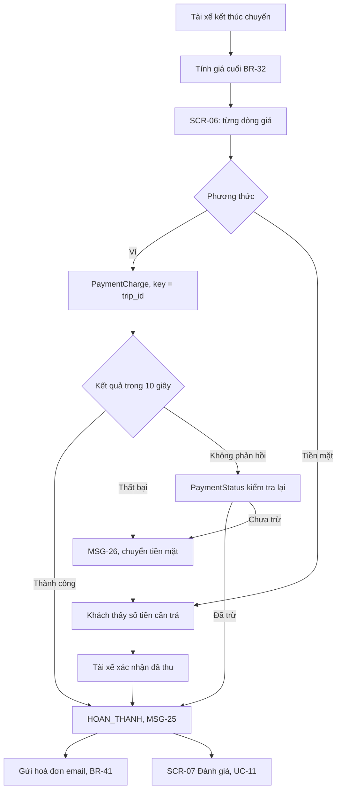

**Luồng chính**

| **Bước** | **Actor** | **Mô tả** |
| --- | --- | --- |
| 1 | Máy chủ | Chuyến `CHO_THANH_TOAN`; tính giá cuối (BR-32) |
| 2 | App | Mở **SCR-06** với giá cuối và từng dòng |
| 3 | Máy chủ | Ví → gọi \[PaymentCharge\] (BR-33) |
| 4 | Máy chủ | Thành công → chuyến `HOAN_THANH`; đẩy MSG-25 |
| 5 | App | Chuyển sang **SCR-07** (UC-11) |

**Luồng thay thế**

| **Mã** | **Điều kiện** | **Xử lý** |
| --- | --- | --- |
| A1 | Tiền mặt | **SCR-06** hiện "Vui lòng trả tài xế {số tiền}"; tài xế xác nhận đã thu → "Đã thanh toán" (BR-34) |
| A2 | Ví lỗi | MSG-26; chuyển A1 |
| A3 | Ví không phản hồi | Kiểm tra lại \[PaymentStatus\] trước khi kết luận |
| A4 | Giá cuối khác giá chốt | Dòng giải thích: "Lộ trình dài hơn dự kiến {x} km" hoặc "Phí chờ {n} phút" |
| A5 | Có nợ phí huỷ | Dòng "Phí huỷ chuyến {ngày}" cộng vào tổng |

**Luồng lỗi**

| **Mã** | **Điều kiện** | **Xử lý** |
| --- | --- | --- |
| E1 | App khách mất mạng khi đang thanh toán | Có mạng lại gọi \[TripGet\]; hiện trạng thái thanh toán theo máy chủ |
| E2 | Sau 30 phút chưa `HOAN_THANH` | Tạo ticket cho tổng đài |
| E3 | Tài xế báo khách trả thiếu tiền mặt | Chuyến `HOAN_THANH`; phần thiếu ghi nợ như BR-37; MSG-29; khách khiếu nại được qua báo cáo sự cố |

#### UC-10 Huỷ chuyến

| **Mục** | **Nội dung** |
| --- | --- |
| Tiền điều kiện | Chuyến trước `DANG_DI` |
| Hậu điều kiện thành công | Chuyến `DA_HUY` với người huỷ, lý do, phí (nếu có) |
| Hậu điều kiện thất bại | Chuyến giữ trạng thái cũ |

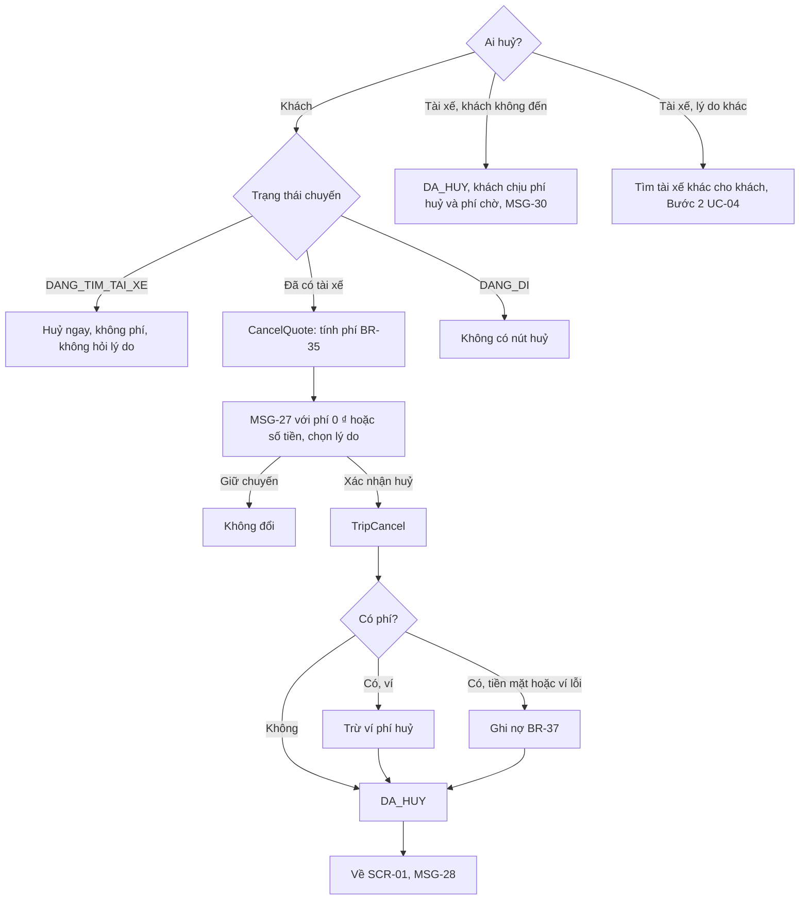

**Luồng chính (khách huỷ khi đã có tài xế)**

| **Bước** | **Actor** | **Mô tả** |
| --- | --- | --- |
| 1 | Khách | Bấm "Huỷ chuyến" ở **SCR-05** |
| 2 | App khách | Gọi \[CancelQuote\]; hiện MSG-27 với phí theo BR-35 và danh sách lý do |
| 3 | Khách | Chọn lý do, bấm "Xác nhận huỷ" |
| 4 | Máy chủ | \[TripCancel\]; thu phí theo BR-37; chuyến `DA_HUY` |
| 5 | App | Về **SCR-01** kèm MSG-28 |

**Luồng thay thế**

| **Mã** | **Điều kiện** | **Xử lý** |
| --- | --- | --- |
| A1 | Huỷ khi đang tìm | Không hỏi lý do, không phí |
| A2 | Tài xế trễ > 5 phút | Phí 0 ₫, lý do mặc định "Tài xế đến trễ" |
| A3 | Tài xế huỷ vì khách không đến | BR-36: thu phí huỷ và phí chờ; khách nhận MSG-30 |
| A5 | Tài xế huỷ vì lý do khác khi đã đến (`TAI_XE_DA_DEN`, hoặc `DANG_CHO_KHACH` chưa hết 10 phút chờ tính phí) | Chuyến về `DANG_TIM_TAI_XE` theo Bước 2 UC-04; khách không phí huỷ, không phí chờ |
| A6 | Khách huỷ ở `DANG_CHO_KHACH` | MSG-27 hiện phí huỷ kèm phí chờ đã phát sinh; thu theo BR-37 |
| A4 | Trạng thái đổi giữa lúc báo phí và lúc xác nhận | Máy chủ tính lại; phí khác → hiện lại MSG-27 |

#### UC-11 Đánh giá tài xế và tip

| **Mục** | **Nội dung** |
| --- | --- |
| Tiền điều kiện | Chuyến `HOAN_THANH`, trong 24 giờ |
| Hậu điều kiện | Đánh giá được lưu; điểm trung bình của tài xế cập nhật; tip trừ ví nếu có |

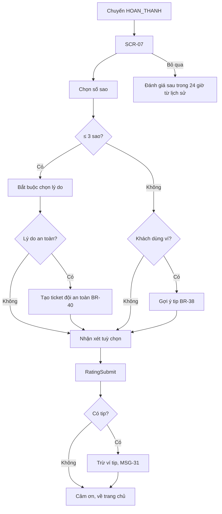

**Luồng chính**

| **Bước** | **Actor** | **Mô tả** |
| --- | --- | --- |
| 1 | App | Chuyến `HOAN_THANH`: mở **SCR-07** |
| 2 | Khách | Chọn số sao |
| 3 | Khách | Thêm nhận xét (tuỳ chọn), bấm Gửi |
| 4 | Hệ thống | Gọi \[RatingSubmit\]; cập nhật điểm trung bình |
| 5 | Hệ thống | Cảm ơn, về trang chủ |

**Luồng thay thế**

| **Mã** | **Điều kiện** | **Xử lý** |
| --- | --- | --- |
| A1 | ≤ 3 sao | Bắt buộc chọn ít nhất 1 lý do; lý do về an toàn → tạo ticket cho đội an toàn (BR-40) |
| A2 | Khách chấm trên 3 sao và dùng ví | Gợi ý tip (BR-38); có tip → trừ ví, MSG-31 |
| A3 | Bỏ qua | Đánh giá lại được trong 24 giờ từ lịch sử chuyến |

**Luồng lỗi**

| **Mã** | **Điều kiện** | **Xử lý** |
| --- | --- | --- |
| E1 | Gửi đánh giá thất bại | Giữ nội dung đã chọn, cho thử lại |
| E2 | Trừ ví tip thất bại | Đánh giá vẫn được lưu; báo tip chưa thực hiện được |

#### UC-12 Lịch sử chuyến và báo cáo sự cố

| **Mục** | **Nội dung** |
| --- | --- |
| Tiền điều kiện | Có ít nhất 1 chuyến |
| Hậu điều kiện | Khách xem được hoá đơn; sự cố có mã yêu cầu |

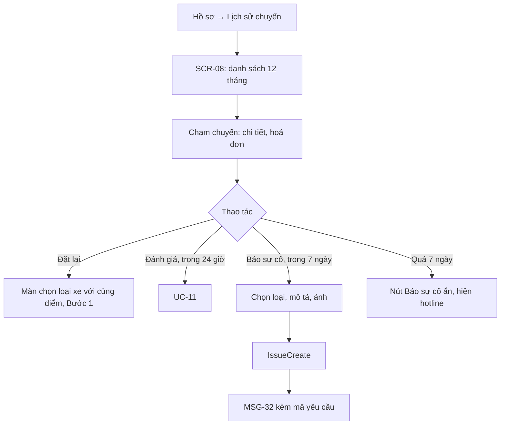

**Luồng chính**

| **Bước** | **Actor** | **Mô tả** |
| --- | --- | --- |
| 1 | Khách | Hồ sơ → Lịch sử chuyến |
| 2 | Hệ thống | **SCR-08**: danh sách chuyến 12 tháng, mới nhất trước |
| 3 | Khách | Chạm một chuyến |
| 4 | Hệ thống | Hiện chi tiết và hoá đơn |
| 5 | Khách | Chọn Báo sự cố (trong 7 ngày): chọn loại, mô tả, ảnh |
| 6 | Hệ thống | Gọi \[IssueCreate\]; MSG-32 kèm mã yêu cầu |

**Luồng thay thế**

| **Mã** | **Điều kiện** | **Xử lý** |
| --- | --- | --- |
| A1 | Chọn Đặt lại | Mở màn chọn loại xe với cùng điểm đón, điểm đến (Bước 1) |
| A2 | Chọn Đánh giá trong 24 giờ | UC-11 |
| A3 | Chuyến quá 7 ngày | Ẩn nút Báo sự cố, hiện hotline |

**Luồng lỗi**

| **Mã** | **Điều kiện** | **Xử lý** |
| --- | --- | --- |
| E1 | Gửi báo cáo thất bại | Giữ nội dung đã nhập, cho thử lại |

## 6. Điểm vào

| **Điểm vào** | **Dẫn tới** | **Ghi chú** |
| --- | --- | --- |
| Mở app | UC-01, **SCR-01** | Có chuyến đang diễn ra → mở thẳng **SCR-05** |
| Chạm Nhà, Công ty ở **SCR-01** | UC-01, nhảy thẳng **SCR-03** | |
| "Đặt lại" ở chuyến trong **SCR-08** | UC-02 với điểm đón, đến cũ | Bước 4 |
| Không tìm được tài xế → "Đặt lại" | UC-02 | Bước 2 |
| Đặt chuyến thành công (Bước 1) | UC-03, **SCR-04** | |
| Mở app khi chuyến đang tìm tài xế | **SCR-04** | Theo trạng thái máy chủ |
| Thông báo đẩy MSG-12 | **SCR-05** | |
| Sự kiện tài xế huỷ | UC-04, **SCR-04** | |
| Có tài xế (Bước 2) | UC-05, **SCR-05** | |
| Mở app khi có chuyến đang diễn ra | **SCR-05** | Theo trạng thái chuyến |
| Thông báo đẩy về trạng thái, tin nhắn | **SCR-05** | |
| Nút Gọi, Nhắn ở **SCR-05** | UC-07 | |
| Nút an toàn ở **SCR-05** | UC-08 | BR-30 |
| Hồ sơ → Liên hệ khẩn cấp | Thêm, sửa tối đa 3 liên hệ | |
| Chọn phương thức ở **SCR-03** | Bảng chọn phương thức | BR-31 |
| Chuyến sang `CHO_THANH_TOAN` | UC-09, **SCR-06** | Tự động |
| "Huỷ chuyến" ở **SCR-04**, **SCR-05** | UC-10 | |
| Thông báo bị huỷ vì không ra điểm đón (MSG-30) | Chi tiết chuyến ở **SCR-08** | BR-36 |
| Sau thanh toán | UC-11 | |
| Hồ sơ → Lịch sử chuyến | UC-12, **SCR-08** | |
| Thông báo "Bạn chưa đánh giá chuyến" | UC-11 | Gửi 1 lần sau 2 giờ |

## 7. Mô tả màn hình

<!-- Bước 1 · Đặt chuyến -->
### SCR-01 Trang chủ bản đồ

| **#** | **Thành phần** | **Loại** | **Hành vi** |
| --- | --- | --- | --- |
| 1 | Bản đồ | Map | Ghim điểm đón cố định giữa màn; kéo bản đồ để dời |
| 2 | Nhãn điểm đón | Tooltip | Tên điểm đón; "Đang xác định…" khi đang tìm tên |
| 3 | Nút về vị trí của tôi | Icon | Đưa bản đồ về vị trí thiết bị |
| 4 | Ô "Bạn muốn đi đâu?" | Search bar | Mở **SCR-02** |
| 5 | Lối tắt | Chips | Nhà, Công ty (nếu có), 2 điểm đến gần nhất |
| 6 | Cảnh báo định vị | Banner | MSG-02 |
| 7 | Điểm đón chuẩn | Chips trên bản đồ | Tối đa 3; điểm đang chọn tô đậm (BR-10) |
| 8 | Xe gần bạn | Biểu tượng xe | Theo BR-11 |

### SCR-02 Chọn điểm đón, điểm đến

| **#** | **Thành phần** | **Loại** | **Bắt buộc** | **Validate / hành vi** |
| --- | --- | --- | --- | --- |
| 1 | Điểm đón | Text | Có | Điền sẵn; chạm để tìm |
| 2 | Điểm đến | Text | Có | Focus sẵn; gõ ≥ 2 ký tự để gợi ý (BR-04) |
| 3 | Đã lưu & gần đây | List | – | Nhà, Công ty, đã lưu, 5 gần đây |
| 4 | Gợi ý địa chỉ | List | – | Tên, địa chỉ, khoảng cách; ngôi sao để lưu |
| 5 | "Chọn trên bản đồ" | Button | – | A4 |

### SCR-03 Chọn loại xe & giá

| **#** | **Thành phần** | **Loại** | **Hành vi** |
| --- | --- | --- | --- |
| 1 | Bản đồ lộ trình | Map | Đường đi, điểm đón, điểm đến; "{km} km · {phút} phút" |
| 2 | Danh sách loại xe | Radio list | Mỗi loại: biểu tượng, tên, số chỗ, "{n} phút", giá ước tính; trạng thái theo mục 4.2 |
| 3 | Nhãn cao điểm | Tag | "Cao điểm ×{hệ số}", chạm xem giải thích |
| 4 | Phương thức thanh toán | Dòng chọn | Tiền mặt hoặc ví liên kết (Bước 4) |
| 5 | Ghi chú cho tài xế | Dòng nhập | BR-12; placeholder "Ví dụ: đứng ở cổng sau" |
| 6 | Nút "Đặt {loại xe}" | Button | Disabled khi chưa chọn loại hoặc chưa có giá; loading khi đang tạo |
| 7 | Ghi chú giá | Text phụ | "Giá ước tính, có thể thay đổi nếu đổi lộ trình" |

<!-- Bước 2 · Tìm tài xế -->
### SCR-04 Đang tìm tài xế

| **#** | **Thành phần** | **Loại** | **Hành vi** |
| --- | --- | --- | --- |
| 1 | Bản đồ | Map | Điểm đón, vòng khu vực tìm mở rộng theo BR-14 |
| 2 | Trạng thái | Text | "Đang tìm tài xế gần bạn" + "{mm:ss}"; sau 60 giây thêm MSG-10 |
| 3 | Tóm tắt chuyến | Card | Loại xe, điểm đón, điểm đến, giá chốt |
| 4 | Banner tìm lại | Banner | MSG-13 khi tài xế huỷ (BR-17) |
| 5 | Huỷ chuyến | Button text | Miễn phí khi đang tìm (BR-18) |
| 6 | Không tìm được | Panel | MSG-11; danh sách loại xe khác đang có tài xế, kèm giá; nút "Thử lại" |

<!-- Bước 3 · Theo dõi chuyến & an toàn -->
### SCR-05 Theo dõi chuyến

| **#** | **Thành phần** | **Loại** | **Hành vi** |
| --- | --- | --- | --- |
| 1 | Bản đồ | Map | Xe tài xế, điểm đón, điểm đến, lộ trình; tự căn khung theo trạng thái |
| 2 | Trạng thái | Banner | Theo mục 4.2: "Đến trong {n} phút", "Tài xế đã đến", "Đang tính phí chờ", "Tới nơi lúc {giờ}" |
| 3 | Thẻ tài xế | Card | **Biển số to nhất**; ảnh, tên, đánh giá, hãng, màu xe |
| 4 | Mã xác nhận | Badge | 4 số, chỉ chuyến ban đêm, ở `TAI_XE_DA_DEN`, `DANG_CHO_KHACH` |
| 5 | Đồng hồ chờ | Text | "Chờ miễn phí còn {mm:ss}" / "Phí chờ {x} ₫" |
| 6 | Gọi, Nhắn tin | Button | UC-07; badge tin chưa đọc |
| 7 | Nút an toàn | FAB biểu tượng khiên | Mở bảng an toàn (UC-08) |
| 8 | Chia sẻ hành trình | Button | Ở `DANG_DI` hiện nổi bật |
| 9 | Huỷ chuyến | Button text | Chỉ trước `DANG_DI` (Bước 4) |

### Trang xem hành trình (Web, người thân)

| **#** | **Thành phần** | **Hành vi** |
| --- | --- | --- |
| 1 | Bản đồ | Vị trí xe, cập nhật mỗi 10 giây |
| 2 | Thông tin | Tên gọi của khách (tên hiển thị), biển số, hãng, màu xe, tên tài xế, giờ tới nơi dự kiến |
| 3 | Hết hạn | MSG-23 |

<!-- Bước 4 · Thanh toán, đánh giá & huỷ chuyến -->
### SCR-06 Kết thúc & thanh toán

| **#** | **Thành phần** | **Loại** | **Hành vi** |
| --- | --- | --- | --- |
| 1 | Trạng thái | Banner | "Đang thanh toán…" / "Đã thanh toán" / "Vui lòng trả tài xế {số tiền}" |
| 2 | Tổng tiền | Số lớn | Giá cuối |
| 3 | Chi tiết giá | List | Giá chuyến, phí chờ, điều chỉnh lộ trình, phí huỷ trước đó; mỗi dòng có giải thích ngắn |
| 4 | So với giá ước tính | Text phụ | Hiện khi khác: "Ước tính {x} ₫ · {lý do}" |
| 5 | Phương thức | Text | Ví (kèm 4 số cuối) hoặc Tiền mặt |
| 6 | Tiếp tục | Button | Sang **SCR-07** khi `HOAN_THANH` |

### SCR-07 Đánh giá tài xế

| **#** | **Thành phần** | **Loại** | **Bắt buộc** | **Hành vi** |
| --- | --- | --- | --- | --- |
| 1 | Tài xế | Header | – | Ảnh, tên, biển số |
| 2 | Sao | Rating 1–5 | Có | Chạm chọn |
| 3 | Lý do | Chips chọn nhiều | Khi ≤ 3 sao | Lái xe nguy hiểm, Thái độ, Đến trễ, Xe không sạch, Đi sai đường, Quấy rối, Khác |
| 4 | Lời khen | Chips | Không | Khi 5 sao: Lái xe an toàn, Thân thiện, Xe sạch |
| 5 | Nhận xét | Text | Không | ≤ 200 ký tự |
| 6 | Tip | Chips | Không | Chỉ khi ví (BR-38) |
| 7 | Gửi | Button | – | Disabled khi thiếu sao hoặc thiếu lý do |
| 8 | Bỏ qua | Button text | – | Đánh giá sau trong 24 giờ |

### SCR-08 Lịch sử chuyến

| **#** | **Thành phần** | **Loại** | **Hành vi** |
| --- | --- | --- | --- |
| 1 | Danh sách | List | Ngày giờ, điểm đón → điểm đến, loại xe, giá, trạng thái (Hoàn thành, Đã huỷ, Không tìm được) |
| 2 | Chi tiết chuyến | Màn | Bản đồ lộ trình, tài xế, biển số, từng dòng giá, phương thức, đánh giá đã gửi |
| 3 | Đặt lại | Button | Bước 1 |
| 4 | Đánh giá | Button | Trong 24 giờ, chưa đánh giá |
| 5 | Báo sự cố | Button | Trong 7 ngày (BR-42) |

## 8. API

### 8.1 Bước 1 · Đặt chuyến

| **API** | **Request chính** | **Response chính** | **Timeout / retry** |
| --- | --- | --- | --- |
| \[ReverseGeocode\] | lat, lng | Tên điểm, địa chỉ, điểm đường đã khớp | 3s / 1 lần |
| \[PlaceSearch\] | keyword, vị trí hiện tại | Danh sách gợi ý | 3s / không retry |
| \[ServiceAreaCheck\] | lat, lng | in_area | 3s / 1 lần |
| \[FareQuote\] | pickup, dropoff | Từng loại xe: quote_id, giá, hệ số (từ Google Maps, BR-07), thời gian đến, khả dụng; lộ trình, km, phút; expires_at | 5s / 1 lần |
| \[TripCreate\] | quote_id, vehicle_type, pickup, dropoff, note, payment_method, idempotency_key | trip_id, trạng thái `DANG_TIM_TAI_XE`, giá chốt | 8s / gửi lại cùng key |
| \[PickupPoints\] | lat, lng | Tối đa 3 điểm đón chuẩn | 3s / 1 lần; BR-10 |
| \[NearbyDrivers\] | lat, lng, vehicle_type | Tối đa 10 vị trí đã làm lệch | 3s / không retry; gọi mỗi 10 giây (BR-11) |
| \[SavedPlaceSave\] | name, lat, lng, type (HOME, WORK, OTHER) | place_id | 5s / 1 lần |

**Map lỗi → thông báo**

| **Nhóm lỗi** | **Message** |
| --- | --- |
| Không có quyền vị trí | MSG-01 |
| Vị trí kém chính xác | MSG-02 |
| Điểm đón hoặc điểm đến ngoài khu vực phục vụ | MSG-03 |
| Khoảng cách không hợp lệ | MSG-06 |
| Giá đã thay đổi khi tạo chuyến | MSG-05 |
| Đang có chuyến chưa kết thúc | MSG-07 |
| Không có xe gần | MSG-09 |
| Mất mạng, quá thời gian, lỗi máy chủ | MSG-08 |

### 8.2 Bước 2 · Tìm tài xế

| **API** | **Request chính** | **Response chính** | **Timeout / retry** |
| --- | --- | --- | --- |
| \[TripEvent\] (máy chủ → khách) | trip_id, status, search_radius, driver | – | Kết nối realtime; dự phòng thông báo đẩy |
| \[TripGet\] | trip_id | Trạng thái và thông tin đầy đủ của chuyến | 5s / 2 lần |
| \[VehicleOptions\] | điểm đón, điểm đến | Loại xe đang có tài xế gần, giá ước tính | 5s / 1 lần |

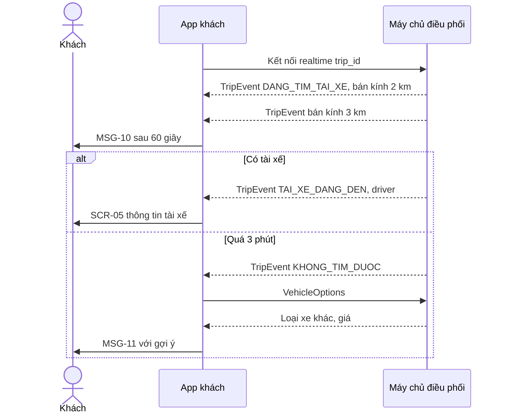

**Map lỗi → thông báo**

| **Nhóm lỗi** | **Message** |
| --- | --- |
| Đang mở rộng khu vực | MSG-10 |
| Hết thời gian tìm | MSG-11 |
| Có tài xế (app ở nền) | MSG-12 |
| Tài xế huỷ, đang tìm lại | MSG-13 |
| Mất kết nối | MSG-14 |

### 8.3 Bước 3 · Theo dõi chuyến & an toàn

| **API** | **Request chính** | **Response chính** | **Timeout / retry** |
| --- | --- | --- | --- |
| \[TripEvent\] (máy chủ → khách) | trip_id, status, driver_location, eta, wait_timer, confirm_code, end_note | – | Kết nối realtime; dự phòng thông báo đẩy |
| \[TripGet\] | trip_id | Trạng thái và thông tin đầy đủ của chuyến | 5s / 2 lần |
| \[CallSessionGet\] | trip_id | Số trung gian | 5s / 1 lần |
| \[MessageSend\] | trip_id, text hoặc template_id | message_id | 5s / 2 lần |
| \[TripShareCreate\] | trip_id | share_url, expires_at | 5s / 1 lần |
| \[SmsSosSend\] | trip_id, contact_ids | Kết quả từng liên hệ | 8s / 2 lần |
| \[SafetyTicketCreate\] | trip_id, vị trí, loại | ticket_id | 5s / 3 lần |

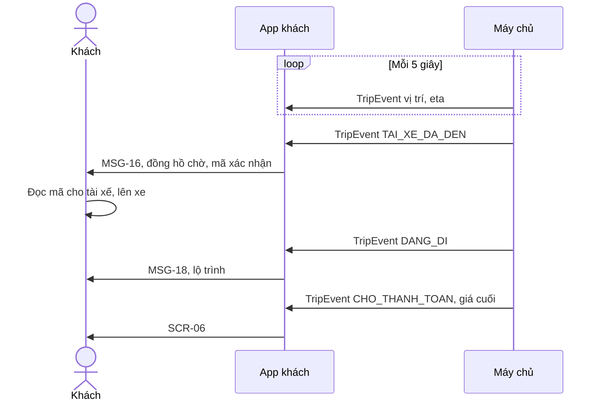

**Map lỗi → thông báo**

| **Nhóm lỗi** | **Message** |
| --- | --- |
| Vị trí tài xế không cập nhật | MSG-15 |
| Chuyến bắt đầu | MSG-18 |
| Kết thúc chuyến khi còn xa điểm đến | MSG-19 |
| Link chia sẻ hành trình hết hiệu lực | MSG-23 |
| App khách mất mạng | Giữ màn cuối, gọi \[TripGet\] khi có mạng (UC-05, E2) |
| Gửi SMS khẩn cấp thất bại | Thông báo lỗi chung của app (ngoài bộ MSG của SRS này), cho thử lại; vẫn cho gọi 113 |

### 8.4 Bước 4 · Thanh toán, đánh giá & huỷ chuyến

| **API** | **Request chính** | **Response chính** | **Timeout / retry** |
| --- | --- | --- | --- |
| \[PaymentMethodsGet\] | user_id | Phương thức, số dư ví, mặc định | 5s / 1 lần |
| \[FareFinalize\] | trip_id, lộ trình thực tế, thời gian chờ | Giá cuối, từng dòng, lý do chênh lệch | Máy chủ tự gọi khi \[TripEnd\] |
| \[PaymentCharge\] | trip_id, amount, method, idempotency_key = trip_id | status, transaction_id | 10s / không tự retry, kiểm tra \[PaymentStatus\] |
| \[PaymentStatus\] | trip_id | status giao dịch | 5s / 3 lần |
| \[CancelQuote\] | trip_id | fee, lý do miễn phí (nếu có) | 3s / 1 lần |
| \[TripCancel\] | trip_id, reason, quoted_fee | status `DA_HUY`, fee thực thu, debt | 5s / gửi lại cùng request_id |
| \[RatingSubmit\] | trip_id, stars, reasons, comment, tip | – | 5s / 2 lần |
| \[TripGet\] | trip_id | Trạng thái chuyến, thanh toán | 5s / 2 lần |
| \[TripHistory\] | user_id, cursor | Danh sách chuyến | 5s / 1 lần |
| \[IssueCreate\] | trip_id, type, description, photos | issue_id, sla | 8s / 2 lần |

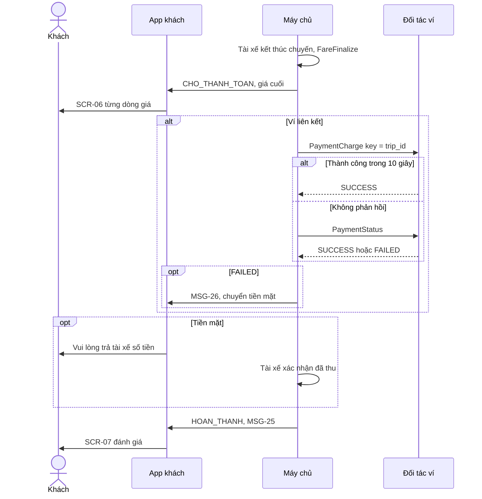

**Map lỗi → thông báo**

| **Nhóm lỗi** | **Message** |
| --- | --- |
| Ví không đủ số dư | MSG-24 |
| Trừ ví thất bại hoặc không phản hồi | MSG-26 |
| Tài xế báo trả thiếu tiền mặt | MSG-29 |
| Huỷ khi chuyến đã bắt đầu | MSG-35 |
| Phí huỷ thay đổi giữa lúc báo và lúc xác nhận | Hiện lại MSG-27 với phí mới |
| Còn nợ phí huỷ khi đặt chuyến mới | MSG-33 |
| Mất mạng, lỗi máy chủ khác | Thông báo lỗi chung của app (ngoài bộ MSG của SRS này), cho thử lại |

## 9. Danh sách thông báo

| **ID** | **Nơi hiện** | **Nội dung (VI)** |
| --- | --- | --- |
| MSG-01 | Banner | Bật vị trí để app tìm điểm đón cho bạn, hoặc nhập điểm đón bên dưới. \[Bật vị trí\] |
| MSG-02 | Banner **SCR-01** | Vị trí chưa chính xác. Kiểm tra lại ghim điểm đón nhé |
| MSG-03 | Inline | Địa điểm này nằm ngoài khu vực phục vụ |
| MSG-04 | Popup | Đang cao điểm, giá cao hơn bình thường ×{hệ số}. Giá ước tính: {giá} ₫. \[Đồng ý\] \[Để sau\] |
| MSG-05 | Popup | Giá đã cập nhật thành {giá mới} ₫. \[Đặt với giá mới\] \[Huỷ\] |
| MSG-06 | Inline | Điểm đến cần cách điểm đón từ 300 m đến 100 km |
| MSG-07 | Popup | Bạn đang có một chuyến chưa kết thúc. \[Xem chuyến hiện tại\] |
| MSG-08 | Toast | Kết nối không ổn định, vui lòng thử lại |
| MSG-09 | Inline **SCR-03** | Hiện không có xe gần bạn. Vui lòng thử lại sau ít phút |
| MSG-10 | **SCR-04** | Đang mở rộng khu vực tìm tài xế |
| MSG-11 | **SCR-04** | Hiện chưa có tài xế nhận chuyến. Bạn không bị tính phí. \[Thử lại\] \[Chọn loại xe khác\] |
| MSG-12 | Thông báo đẩy | {Tên tài xế} đang đến đón bạn · {biển số} · {n} phút |
| MSG-13 | Banner, thông báo đẩy | Tài xế đã huỷ chuyến. Đang tìm tài xế khác cho bạn, giá chuyến giữ nguyên |
| MSG-14 | Banner **SCR-04** | Mất kết nối. Chúng tôi vẫn đang tìm tài xế cho bạn |
| MSG-15 | Banner **SCR-05** | Đang cập nhật vị trí tài xế… |
| MSG-16 | Thông báo đẩy | Tài xế đã đến · {biển số} · {màu} {hãng xe} |
| MSG-17 | Banner, thông báo đẩy | Đã hết thời gian chờ miễn phí. Phí chờ {x} ₫/phút đang được tính |
| MSG-18 | Thông báo đẩy, toast | Chuyến đã bắt đầu. Bạn có thể chia sẻ hành trình cho người thân |
| MSG-19 | Banner **SCR-06** | Chuyến đã kết thúc cách điểm đến {m} m ({lý do}). Nếu có vấn đề, hãy báo sự cố. \[Báo sự cố\] |
| MSG-20 | Popup | Gọi 113? Giữ nút trong 2 giây. Cuộc gọi bắt đầu sau 3 giây. \[Huỷ\] |
| MSG-21 | Toast | Đã gửi vị trí và hành trình tới {n} liên hệ khẩn cấp |
| MSG-22 | Toast | Đội an toàn đã nhận yêu cầu và sẽ liên hệ bạn ngay |
| MSG-23 | Trang Web | Chuyến đi đã kết thúc. Đường link này không còn hiệu lực |
| MSG-24 | Inline **SCR-03** | Số dư ví không đủ cho chuyến này. \[Dùng tiền mặt\] \[Nạp ví\] |
| MSG-25 | Toast | Đã thanh toán {số tiền} ₫ |
| MSG-26 | Popup | Thanh toán ví chưa thành công. Vui lòng thanh toán {số tiền} ₫ bằng tiền mặt cho tài xế |
| MSG-27 | Popup | Huỷ chuyến? {Bạn sẽ không mất phí / Phí huỷ: {x} ₫ vì tài xế đã nhận chuyến hơn 2 phút{, cộng phí chờ {y} ₫}}. \[Giữ chuyến\] \[Xác nhận huỷ\] |
| MSG-28 | Toast | Đã huỷ chuyến{, phí huỷ {x} ₫ {đã trừ ví / sẽ cộng vào chuyến sau}} |
| MSG-29 | Popup | Tài xế báo bạn mới trả {x} ₫. Còn thiếu {y} ₫ sẽ được cộng vào chuyến sau. Nếu có nhầm lẫn, hãy báo sự cố |
| MSG-30 | Thông báo đẩy | Tài xế đã chờ {n} phút tại điểm đón và huỷ chuyến vì không gặp bạn. Phí huỷ {x} ₫, phí chờ {y} ₫ |
| MSG-31 | Toast | Đã gửi tip {x} ₫ cho tài xế. Cảm ơn bạn! |
| MSG-32 | Toast | Đã gửi báo cáo, mã {issue_id}. Chúng tôi sẽ phản hồi trong {sla} |
| MSG-33 | Popup | Bạn còn {x} ₫ phí huỷ chưa thanh toán. Vui lòng thanh toán trước khi đặt chuyến mới. \[Thanh toán bằng ví\] \[Trả bằng tiền mặt ở chuyến tới\] |
| MSG-34 | Thông báo đẩy | Chuyến của bạn với {tài xế} thế nào? \[Đánh giá\] |
| MSG-35 | Inline | Chuyến đã bắt đầu nên không thể huỷ. Nếu có vấn đề, hãy dùng nút an toàn |

## 10. Yêu cầu phi chức năng

| **Mục** | **Yêu cầu** |
| --- | --- |
| Hiệu năng | Định vị và hiện tên điểm đón ≤ 3 giây; \[FareQuote\] ≤ 2 giây (p95); gợi ý địa chỉ ≤ 1 giây; Cập nhật có tài xế tới App khách ≤ 2 giây sau khi máy chủ ghép xong; Sự kiện trạng thái tới app khách ≤ 2 giây (p95); vị trí tài xế hiện trên app khách ≤ 10 giây; Giá cuối hiện ≤ 2 giây sau khi kết thúc chuyến; trừ ví ≤ 10 giây (p95) |
| Độ chính xác | Giá cuối lệch giá ước tính ≤ 10% khi đi đúng lộ trình đề xuất |
| Bảo mật, riêng tư | Vị trí chỉ lấy khi app đang dùng; địa điểm đã lưu chỉ người dùng thấy; Không hiện số thật; link chia sẻ không chứa thông tin cá nhân nhạy cảm, hết hạn đúng lúc; nhật ký vị trí chuyến giữ 90 ngày |
| Log / audit | Mỗi quote: quote_id, đơn giá, hệ số, thời điểm; mỗi chuyến: quote_id đã dùng; Thời điểm đặt, có tài xế, tài xế huỷ, `KHONG_TIM_DUOC`, khách huỷ; Mỗi đổi trạng thái: thời điểm, vị trí; mỗi SOS: loại, thời điểm, vị trí; Mỗi chuyến: giá chốt, giá cuối, từng dòng, phương thức, kết quả thanh toán; mỗi lần huỷ: ai huỷ, trạng thái lúc huỷ, phí báo, phí thu |
| Tracking | Mở app, kéo ghim, chọn điểm đến (nguồn), xem loại xe, gặp cao điểm, đồng ý, đặt, lỗi; Thời gian chờ; huỷ khi đang tìm (sau bao lâu); không tìm được; chọn loại xe khác hay thử lại; tìm lại sau khi tài xế huỷ; Mở **SCR-05**, gọi, nhắn (mẫu hay tự gõ), chờ (thời lượng), chia sẻ hành trình, mở bảng an toàn, từng hành động SOS; Phương thức chọn; ví lỗi; chênh lệch giá; huỷ (ai huỷ, trạng thái, phí); đánh giá (sao, lý do, có nhận xét, tip); báo sự cố (loại) |
| Accessibility | Ghim và nút có nhãn đọc màn hình; có cách chọn điểm đón không cần kéo bản đồ (tìm địa chỉ); giá đọc được đầy đủ; Thời gian chờ đọc được bằng trình đọc màn hình; trạng thái đổi được thông báo bằng giọng đọc; không chỉ dùng chuyển động để báo đang tìm; Biển số cỡ chữ lớn; trạng thái chuyến đọc được bằng trình đọc màn hình; Từng dòng giá đọc được bằng trình đọc màn hình; sao có nhãn "1 sao … 5 sao"; phí huỷ hiện bằng chữ, không chỉ bằng màu |
| Nhất quán | Máy chủ là nguồn đúng về trạng thái; app không tự kết luận khi chưa có phản hồi; App khách không đổi màn khi chưa có xác nhận của máy chủ |
| Realtime | Giữ kết nối realtime khi đang tìm; tự kết nối lại; thông báo đẩy làm dự phòng; Tự kết nối lại; mở app thì lấy trạng thái đầy đủ qua \[TripGet\] trước khi nhận sự kiện |
| Bảo mật | Khách chỉ thấy thông tin tài xế của chuyến mình; không hiện số điện thoại thật; Không lưu thông tin ví ngoài token của đối tác; hoá đơn chỉ gửi email của chủ tài khoản |
| An toàn | Bảng an toàn mở ≤ 1 giây; SOS hoạt động khi mạng yếu (gọi 113 không cần mạng dữ liệu) |
| Toàn vẹn tiền | Không trừ ví hai lần cho một chuyến; mọi khoản phí, tip có bản ghi giao dịch; đối soát với đối tác ví hằng ngày |
