> **Mã:** DE05-SRS · **Trạng thái:** đã chốt · **Người viết:** Design · **PRD:** [PRD.md](PRD.md)

# UC-DE05 - Đặt xe chở khách

> SRS này mô tả **1 tính năng**, là **1 luồng** gồm 4 bước: Đặt chuyến → Ghép tài xế & nhận chuyến → Theo dõi chuyến & an toàn → Thanh toán, đánh giá & huỷ chuyến. Mã BR, MSG, UC, SCR đánh số liên tục trong toàn tài liệu. Sơ đồ chung xem [README](../README.md).

## 1. Tổng quan

| **Mục** | **Nội dung** |
| --- | --- |
| Mục tiêu | Khách đặt xe máy hoặc ô tô, thấy giá trước khi đặt, theo dõi tài xế trên bản đồ và thanh toán khi kết thúc chuyến |
| Actor | Khách · App khách · Máy chủ · Dịch vụ bản đồ · Tài xế · App tài xế · Máy chủ điều phối · Dịch vụ số trung gian · Người thân (xem link) · Đối tác ví |
| Luồng | Bước 1 Đặt chuyến → Bước 2 Ghép tài xế & nhận chuyến → Bước 3 Theo dõi chuyến & an toàn → Bước 4 Thanh toán, đánh giá & huỷ chuyến |
| Ngoài phạm vi | Đăng ký và duyệt hồ sơ tài xế, đặt xe hẹn giờ, đi chung, giao hàng, khuyến mãi và mã giảm giá, ví điện tử nạp tiền (dùng ví liên kết có sẵn), trang quản trị vận hành, điều phối giá động theo khu vực (chỉ mô tả hệ số cao điểm) |
| Nền tảng | App khách và App tài xế iOS / Android |

### Các bước của luồng

| **Bước** | **Mục tiêu** | **Phạm vi** |
| --- | --- | --- |
| Bước 1 · Đặt chuyến | Khách chọn điểm đón, điểm đến, loại xe, xem giá ước tính và tạo chuyến | Định vị, chọn điểm đón và điểm đến, địa điểm đã lưu, loại xe, giá ước tính, cao điểm, xác nhận đặt |
| Bước 2 · Ghép tài xế & nhận chuyến | Ghép chuyến với một tài xế phù hợp; tài xế nhận hoặc bỏ qua; khách thấy trạng thái tìm và thông tin tài xế | Bật, tắt nhận chuyến; thuật toán gửi lần lượt; thẻ yêu cầu; màn chờ của khách; không tìm được tài xế; tài xế huỷ sau khi nhận |
| Bước 3 · Theo dõi chuyến & an toàn | Hai phía theo dõi chuyến realtime với cùng trạng thái; liên lạc ẩn số; khách có công cụ an toàn | Vị trí realtime, đã đến, thời gian chờ, mã xác nhận, bắt đầu và kết thúc chuyến, gọi, nhắn tin, chia sẻ hành trình, SOS |
| Bước 4 · Thanh toán, đánh giá & huỷ chuyến | Tính giá cuối minh bạch, thanh toán tiền mặt hoặc ví, đánh giá hai chiều, huỷ chuyến có quy tắc phí rõ ràng | Chọn phương thức; giá cuối; thanh toán; tip; hoá đơn; huỷ của khách và tài xế; phí huỷ; đánh giá; lịch sử; báo cáo sự cố |

## 2. User Story

| **ID** | **As a** | **I want** | **So that** |
| --- | --- | --- | --- |
| US-01 | Khách | Điểm đón tự định vị và chỉnh được bằng kéo ghim | Tài xế tìm thấy tôi ngay |
| US-02 | Khách | Chọn điểm đến nhanh từ địa điểm đã lưu | Đặt xe trong vài giây |
| US-03 | Khách | Thấy giá và thời gian đến của từng loại xe | Chọn loại phù hợp |
| US-04 | Khách | Được báo rõ khi giá cao điểm | Không bất ngờ về giá |
| US-05 | Khách | Ghi chú cho tài xế | Tài xế đón đúng chỗ |
| US-06 | Tài xế | Bật, tắt nhận chuyến | Chỉ nhận yêu cầu khi sẵn sàng |
| US-07 | Tài xế | Thấy đủ thông tin chuyến trong thẻ yêu cầu | Quyết định nhanh và đúng |
| US-08 | Tài xế | Nhận bằng một chạm | An toàn khi đang lái |
| US-09 | Khách | Biết hệ thống đang tìm tài xế | Không đặt lại, không huỷ vội |
| US-10 | Khách | Thấy ngay tài xế nào sẽ đến | Nhận ra xe khi tới |
| US-11 | Khách | Được gợi ý khi không tìm được tài xế | Vẫn có cách đi |
| US-12 | Khách | Thấy tài xế đang đến và còn bao lâu | Ra đón xe đúng lúc |
| US-13 | Khách | Nhận ra đúng xe | Không lên nhầm xe |
| US-14 | Khách, tài xế | Gọi, nhắn tin mà không lộ số | Liên lạc an toàn |
| US-15 | Tài xế | Báo đã đến, bắt đầu, kết thúc chuyến | Trạng thái chuyến đúng thực tế |
| US-16 | Khách | Chia sẻ hành trình cho người thân | Người thân yên tâm |
| US-17 | Khách | Gọi trợ giúp khẩn cấp nhanh | An toàn khi có sự cố |
| US-18 | Khách | Thấy giá cuối có giải thích | Tin là mình trả đúng |
| US-19 | Khách | Thanh toán ví tự động | Không phải đứng đợi |
| US-20 | Tài xế | Xác nhận đã thu tiền mặt | Chuyến được ghi nhận đúng |
| US-21 | Khách | Biết trước phí huỷ | Quyết định huỷ hay không |
| US-22 | Tài xế | Huỷ khi khách không đến và được bù | Không mất công chờ |
| US-23 | Khách, tài xế | Đánh giá bên kia | Cộng đồng đi lại tốt hơn |
| US-24 | Khách | Xem lịch sử, hoá đơn, báo sự cố | Khiếu nại khi có vấn đề |

## 3. Business Rules

| **Mã** | **Quy tắc** |
| --- | --- |
| BR-01 | **Điểm đón mặc định** = vị trí thiết bị, khớp vào điểm đường gần nhất mà xe dừng được. Độ chính xác định vị > 50 m → hiện MSG-02 |
| BR-02 | **Vùng phục vụ**: điểm đón và điểm đến phải nằm trong vùng phục vụ của thành phố; ngoài vùng → MSG-03, không cho sang bước chọn loại xe |
| BR-03 | **Khoảng cách** điểm đón tới điểm đến từ 300 m đến 100 km theo đường đi |
| BR-04 | **Gợi ý điểm đến**: khi mở ô tìm hiện Nhà, Công ty, địa điểm đã lưu, 5 điểm đến gần nhất; khi gõ ≥ 2 ký tự gọi tìm địa chỉ, chấp nhận không dấu, chờ 300 ms sau lần gõ cuối |
| BR-05 | **Giá ước tính** = max(giá tối thiểu, giá mở cửa + đơn giá km × km + đơn giá phút × phút) × hệ số cao điểm, làm tròn lên 1.000 ₫. Đơn giá theo loại xe và thành phố |
| BR-06 | **Hiệu lực giá** 5 phút kể từ lúc tính (quote_id). Quá hạn khi bấm Đặt → tính lại; giá mới khác giá cũ → MSG-05 trước khi tạo chuyến |
| BR-07 | **Cao điểm**: hệ số do hệ thống tự tính từ **dữ liệu giao thông Google Maps** trả về cho lộ trình: hệ số = thời gian đi có giao thông / thời gian đi bình thường, làm tròn 0,1; < 1,2 coi là 1,0; trần ×2,0; không ai chỉnh tay. Hệ số > 1,0 thì nhãn "Cao điểm ×{hệ số}"; lần đầu mỗi phiên phải đồng ý (MSG-04). Giá sau khi khách đã đặt không đổi vì cao điểm |
| BR-08 | **Loại xe không khả dụng** khi không có tài xế đang rảnh trong bán kính 5 km; hiện "Không có xe gần bạn", disabled |
| BR-09 | **Tạo chuyến** dùng idempotency key cho mỗi lần xác nhận; bấm nhiều lần chỉ tạo 1 chuyến. Khách đang có chuyến chưa kết thúc thì không đặt thêm được (MSG-07) |
| BR-44 | **Điểm đón chuẩn**: điểm đón rơi vào khu vực lớn (toà nhà, trung tâm thương mại, bệnh viện, sân bay) có khai báo điểm đón chuẩn (cổng, sảnh) → **SCR-K01** hiện tối đa 3 điểm chuẩn gần nhất, chọn sẵn điểm gần nhất; khách chạm để đổi hoặc vẫn giữ ghim tự do. Dữ liệu điểm chuẩn do vận hành khai báo |
| BR-45 | **Xe gần bạn**: **SCR-K01** hiện tối đa 10 tài xế `DANG_RANH` trong bán kính 3 km, đúng loại xe đang chọn (mặc định loại phổ biến nhất); vị trí làm lệch ngẫu nhiên ~50 m, cập nhật mỗi 10 giây; không hiện tên, biển số |
| BR-10 | **Ghi chú cho tài xế** tối đa 100 ký tự. **Địa điểm đã lưu**: Nhà, Công ty và tối đa 10 địa điểm khác, tên 1–30 ký tự |
| BR-11 | **Tài xế đủ điều kiện**: trạng thái `DANG_RANH`, đúng loại xe, vị trí cập nhật trong 30 giây gần nhất, trong bán kính tìm, chưa bỏ qua chuyến này |
| BR-12 | **Bán kính tìm** bắt đầu 2 km, +1 km mỗi 30 giây, tối đa 5 km |
| BR-13 | **Thứ tự gửi**: tài xế có thời gian đi tới điểm đón ngắn nhất trước; bằng nhau thì ưu tiên tài xế chờ lâu nhất kể từ chuyến trước |
| BR-14 | **Gửi lần lượt**: mỗi yêu cầu chỉ gửi cho 1 tài xế; tài xế đó chuyển `DANG_XEM_YEU_CAU` và không nhận yêu cầu khác cho tới khi trả lời |
| BR-15 | **Thời gian trả lời** 15 giây tính trên máy chủ; app hiện đếm ngược theo thời điểm hết hạn máy chủ gửi về. Hết giờ hoặc Bỏ qua → gửi tài xế kế tiếp |
| BR-16 | **Nhận chuyến**: máy chủ kiểm tra chuyến còn `DANG_TIM_TAI_XE` và yêu cầu còn hạn; đúng → gán tài xế, chuyến `TAI_XE_DANG_DEN`, tài xế `DANG_CHAY`. Sai → MSG-14 cho tài xế |
| BR-17 | **Thời gian tìm tối đa** 3 phút; hết giờ → chuyến `KHONG_TIM_DUOC`, không thu phí |
| BR-18 | **Thu nhập dự kiến** trên thẻ = giá chốt × (1 − tỉ lệ chiết khấu); tỉ lệ theo loại xe |
| BR-19 | **Tài xế huỷ sau khi nhận** (trước khi bắt đầu chuyến, tức ở `TAI_XE_DANG_DEN`, `TAI_XE_DA_DEN`, hoặc `DANG_CHO_KHACH` khi chưa hết 10 phút chờ tính phí): chuyến quay về `DANG_TIM_TAI_XE`, khách không mất phí huỷ, phí chờ đã phát sinh (nếu có) bị xoá, giữ nguyên giá chốt, đồng hồ 3 phút tính lại từ đầu; tài xế vừa huỷ bị loại khỏi chuyến này. Mỗi chuyến tìm lại tối đa 2 lần; tài xế thứ 3 huỷ → chuyến `KHONG_TIM_DUOC`, không thu phí |
| BR-20 | **Tắt nhận chuyến** khi đang xem yêu cầu → tính là bỏ qua. Mất kết nối > 30 giây khi rảnh → tạm không được gửi yêu cầu |
| BR-46 | **Bỏ qua nhiều lần**: tài xế bỏ qua hoặc để hết giờ **3 yêu cầu liên tiếp** → tự chuyển sang Tắt nhận chuyến, hiện MSG-39; tài xế bật lại thủ công được ngay. Bộ đếm về 0 khi nhận một chuyến |
| BR-21 | **Vị trí tài xế** gửi mỗi 5 giây khi chuyến chưa kết thúc; app khách nội suy chuyển động giữa 2 điểm. Không có vị trí mới > 30 giây → MSG-18 |
| BR-22 | **Thời gian đến** tính lại mỗi khi có vị trí mới, theo dịch vụ bản đồ; hiện làm tròn phút, tối thiểu "1 phút" |
| BR-23 | **Đổi trạng thái** chỉ qua tài xế bấm và máy chủ xác nhận; máy chủ đẩy sự kiện cho cả hai app. App chỉ đổi màn khi nhận xác nhận |
| BR-24 | **"Đã đến"** bật khi tài xế cách điểm đón ≤ 100 m |
| BR-25 | **Thời gian chờ miễn phí** tính từ "Đã đến": xe máy 3 phút, ô tô 5 phút. Sau đó chuyến sang `DANG_CHO_KHACH`, tính phí chờ theo phút (tối đa 10 phút). Mốc **"10 phút chờ"** trong cả đề là 10 phút **tính phí**, đếm từ lúc chuyến vào `DANG_CHO_KHACH`, tức 13 phút (xe máy) hoặc 15 phút (ô tô) kể từ "Đã đến". Hết 10 phút này tài xế được huỷ với lý do "Khách không đến" mà không bị ghi nhận lượt huỷ (Bước 4). Phí chờ khi chuyến bị huỷ: xem Bước 4, BR-37 |
| BR-26 | **Mã xác nhận** 4 số cho chuyến có giờ đón 22:00–05:00; tài xế nhập đúng mới bắt đầu được; sai 3 lần → khoá 1 phút và gợi ý gọi cho khách |
| BR-27 | **Kết thúc chuyến**: tài xế bấm; nếu cách điểm đến > 500 m → hỏi xác nhận và ghi lý do. Chuyến sang `CHO_THANH_TOAN`; giá cuối tính theo Bước 4 |
| BR-28 | **Kênh liên lạc**: gọi qua số trung gian gán cho cặp khách – tài xế; có hiệu lực từ khi nhận chuyến tới 30 phút sau khi kết thúc. Nhắn tin trong app, tối đa 200 ký tự mỗi tin |
| BR-29 | **Link chia sẻ hành trình**: token ngẫu nhiên, không chứa số điện thoại, tên đầy đủ của khách; hết hạn khi chuyến kết thúc hoặc huỷ |
| BR-30 | **SOS** (đội an toàn trực **24/7**): Gọi 113 cần giữ nút 2 giây; Gửi vị trí gửi SMS tới tối đa 3 liên hệ khẩn cấp kèm link hành trình; Báo đội an toàn tạo ticket ưu tiên cao kèm vị trí, chuyến |
| BR-31 | **Nút an toàn** hiện ở **SCR-K05** từ `TAI_XE_DANG_DEN` tới `CHO_THANH_TOAN` |
| BR-32 | **Phương thức**: `TIEN_MAT`, `VI_LIEN_KET`. Mặc định là phương thức của chuyến trước. Ví không đủ số dư cho giá ước tính → MSG-27 gợi ý tiền mặt |
| BR-33 | **Giá cuối** = giá chốt (Bước 1) + phí chờ (BR-25) + phí huỷ còn nợ của khách (BR-38). Lộ trình thực tế dài hơn lộ trình đề xuất > 20% → giá chuyến tính lại theo km, phút thực tế; ngắn hơn → giữ giá chốt. Ngoại lệ: chuyến dừng giữa đường do phía tài xế (xe hỏng, sự cố; Bước 3 UC-07 A2) → tính theo km, phút thực tế và không vượt giá chốt. Khách yêu cầu xuống sớm vẫn giữ giá chốt |
| BR-34 | **Thanh toán ví**: tự gọi trừ ví khi chuyến sang `CHO_THANH_TOAN`, idempotency key = trip_id. Thất bại hoặc không phản hồi trong 10 giây → kiểm tra lại trạng thái giao dịch; vẫn chưa thành công → chuyển `TIEN_MAT`, báo hai phía (MSG-29) |
| BR-35 | **Thanh toán tiền mặt**: tài xế bấm "Đã thu {số tiền}" → chuyến `HOAN_THANH` |
| BR-36 | **Huỷ của khách** – miễn phí khi: chuyến `DANG_TIM_TAI_XE`; trong 2 phút đầu kể từ lúc có tài xế; hoặc tài xế trễ > 5 phút so với thời gian đến dự kiến lúc nhận. Ba điều kiện miễn phí này áp dụng ở mọi trạng thái trước `DANG_DI`, kể cả khi tài xế đã đến. Ngoài các trường hợp trên: phí huỷ xe máy 10.000 ₫, ô tô 20.000 ₫. Khách huỷ ở `DANG_CHO_KHACH` trả thêm **phí chờ đã phát sinh** tới lúc huỷ. Không huỷ được từ `DANG_DI` |
| BR-37 | **Huỷ của tài xế**: trước khi bắt đầu chuyến, ở `TAI_XE_DANG_DEN`, `TAI_XE_DA_DEN`, hoặc `DANG_CHO_KHACH` chưa hết 10 phút chờ tính phí (Bước 2, BR-19) → chuyến quay về `DANG_TIM_TAI_XE`, khách không phí huỷ, không thu phí chờ. "Khách không đến" chỉ bật sau 10 phút chờ tính phí (BR-25) → chuyến `DA_HUY`, khách chịu phí huỷ **và phí chờ đã phát sinh** (đủ 10 phút), tài xế nhận cả hai khoản |
| BR-38 | **Thu phí huỷ**: ví → trừ ngay; tiền mặt hoặc ví lỗi → ghi nợ, cộng vào giá cuối chuyến kế tiếp (một khoản nợ mỗi lần; nợ > 50.000 ₫ thì phải thanh toán trước khi đặt chuyến mới). Phí chờ thu kèm phí huỷ (BR-36, BR-37) được thu và ghi nợ cùng cách. **Trả nợ**: nút \[Thanh toán\] ở MSG-36 mở màn trả nợ bằng ví liên kết, cho liên kết ví ngay tại đó. Khách không dùng ví chọn "Trả bằng tiền mặt ở chuyến tới": được đặt đúng một chuyến `TIEN_MAT`, toàn bộ nợ cộng vào giá cuối chuyến đó để tài xế thu hộ; chưa trả hết thì không đặt được chuyến tiếp theo |
| BR-39 | **Tip**: chỉ khi thanh toán ví; 5.000 / 10.000 / 20.000 ₫ hoặc tự nhập ≤ 100.000 ₫; trừ ví riêng, 100% cho tài xế; chỉ trong lúc đánh giá |
| BR-40 | **Đánh giá**: 1–5 sao; ≤ 3 sao bắt buộc ≥ 1 lý do; nhận xét ≤ 200 ký tự; trong 24 giờ sau chuyến; mỗi bên đánh giá 1 lần, không sửa. Điểm hiển thị = trung bình 100 chuyến gần nhất, cần ≥ 5 đánh giá |
| BR-41 | **Đánh giá liên quan an toàn** (lý do "Lái xe nguy hiểm", "Quấy rối") → tự tạo ticket đội an toàn |
| BR-42 | **Lịch sử chuyến**: chuyến `HOAN_THANH`, `DA_HUY`, `KHONG_TIM_DUOC` của 12 tháng gần nhất; hoá đơn gửi email khi `HOAN_THANH` nếu có email |
| BR-43 | **Báo cáo sự cố** trong 7 ngày sau chuyến; loại: Sai giá, Quên đồ, An toàn, Thái độ, Khác; mô tả ≤ 500 ký tự; tối đa 3 ảnh |

## 4. Trạng thái

### 4.1 Bước 1 · Đặt chuyến

#### Các bước của luồng đặt

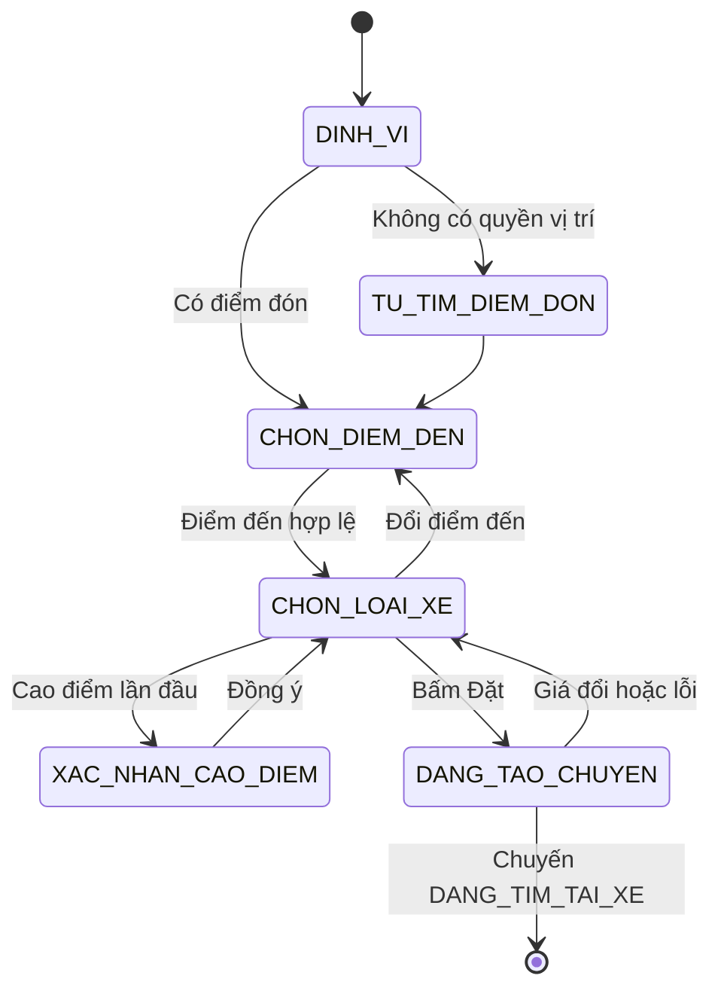

#### Trạng thái loại xe trên SCR-K03

| **Trạng thái** | **Điều kiện** | **Hiển thị** |
| --- | --- | --- |
| `KHA_DUNG` | Có tài xế rảnh gần, có giá | Giá, "{n} phút", số chỗ; chọn được |
| `CAO_DIEM` | Khả dụng, hệ số > 1,0 | Như trên + nhãn "Cao điểm ×{hệ số}" |
| `KHONG_KHA_DUNG` | BR-08 | Mờ, "Không có xe gần bạn" |
| `DANG_TINH_GIA` | Đang gọi \[FareQuote\] | Skeleton ở ô giá |

### 4.2 Bước 2 · Ghép tài xế & nhận chuyến

#### Trạng thái tài xế

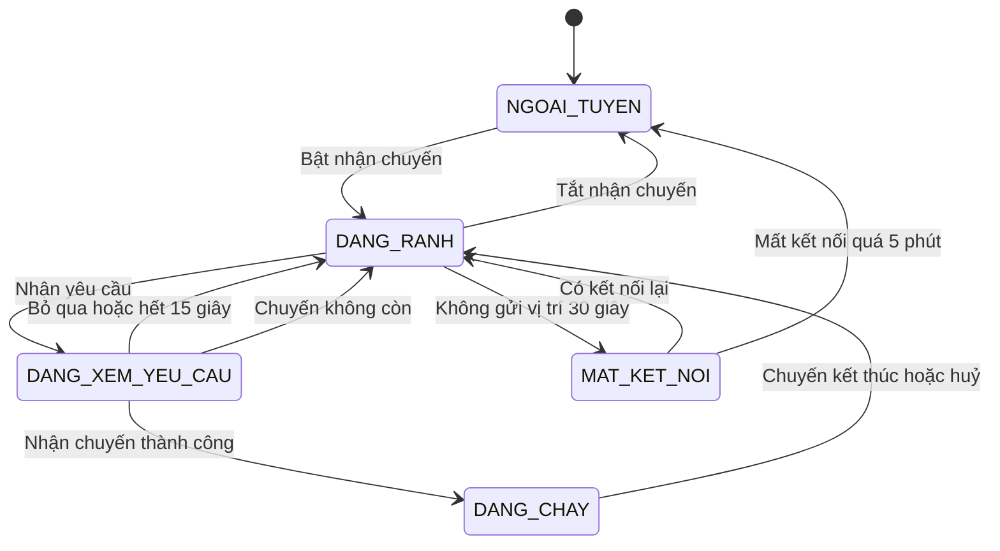

#### Trạng thái một yêu cầu gửi tài xế

| **Trạng thái** | **Điều kiện** | **Hiển thị (App tài xế)** |
| --- | --- | --- |
| `DA_GUI` | Máy chủ đã gửi, tài xế chưa trả lời | Thẻ **SCR-T02**, đếm ngược |
| `DA_NHAN` | Tài xế nhận, máy chủ chấp nhận | Chuyển sang **SCR-T03** |
| `BO_QUA` | Tài xế bấm Bỏ qua | Đóng thẻ, về **SCR-T01** |
| `HET_HAN` | Hết 15 giây | Đóng thẻ, MSG-13 |
| `HUY_BO` | Khách huỷ hoặc chuyến đã có tài xế khác | Đóng thẻ, MSG-14 |

#### Khách thấy gì theo trạng thái chuyến

| **Trạng thái chuyến** | **App khách** |
| --- | --- |
| `DANG_TIM_TAI_XE` | **SCR-K04** hiệu ứng tìm, thời gian chờ, nút Huỷ |
| `TAI_XE_DANG_DEN` | **SCR-K05** thông tin tài xế (Bước 3) |
| `KHONG_TIM_DUOC` | **SCR-K04** chuyển sang MSG-11 với gợi ý |

### 4.3 Bước 3 · Theo dõi chuyến & an toàn

#### Trạng thái chuyến trong phạm vi SRS này

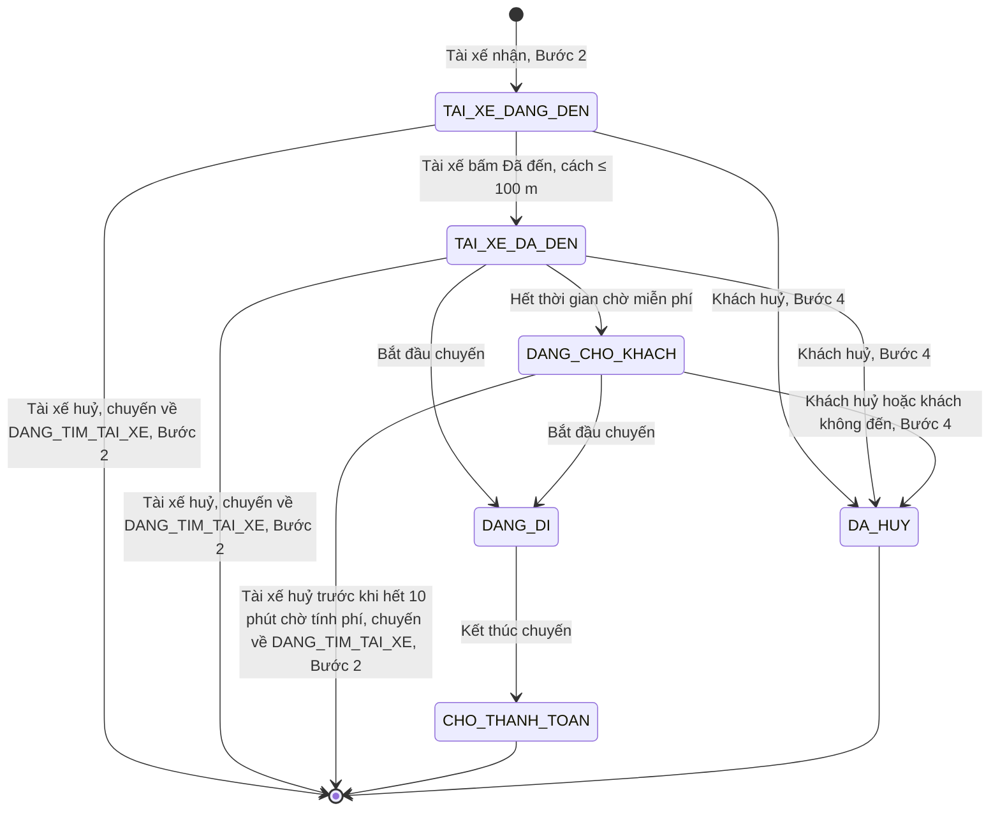

#### Hai phía thấy gì theo trạng thái

| **Trạng thái** | **App khách (SCR-K05)** | **App tài xế** |
| --- | --- | --- |
| `TAI_XE_DANG_DEN` | Xe trên bản đồ, "Đến trong {n} phút", thông tin tài xế, Gọi, Nhắn, nút an toàn | **SCR-T03** chỉ đường tới điểm đón, nút "Đã đến" (bật theo BR-24) |
| `TAI_XE_DA_DEN` | "Tài xế đã đến", biển số to, đồng hồ chờ miễn phí, mã xác nhận (ban đêm) | Đồng hồ chờ, ô nhập mã (ban đêm), nút "Bắt đầu chuyến" |
| `DANG_CHO_KHACH` | "Đang tính phí chờ: {x} ₫", đồng hồ | "Đang tính phí chờ", nút "Huỷ – khách không đến" sau 10 phút chờ tính phí |
| `DANG_DI` | Lộ trình, "Tới nơi lúc {giờ}", chia sẻ hành trình, nút an toàn | **SCR-T04** chỉ đường tới điểm đến, nút "Kết thúc chuyến" |
| `CHO_THANH_TOAN` | Chuyển sang **SCR-K06** (Bước 4) | Chuyển sang **SCR-T05** (Bước 4) |

### 4.4 Bước 4 · Thanh toán, đánh giá & huỷ chuyến

#### Thanh toán của chuyến

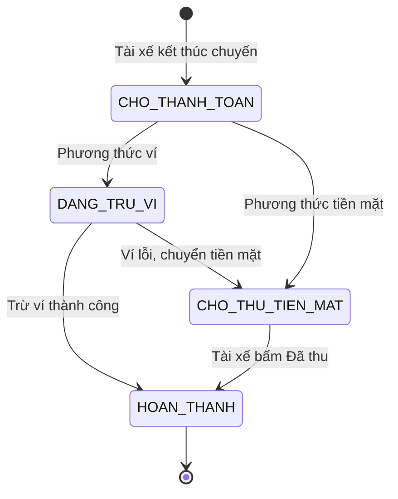

#### Huỷ theo thời điểm

| **Trạng thái chuyến** | **Ai huỷ được** | **Phí** |
| --- | --- | --- |
| `DANG_TIM_TAI_XE` | Khách | Không |
| `TAI_XE_DANG_DEN`, ≤ 2 phút từ lúc có tài xế | Khách; tài xế | Không |
| `TAI_XE_DANG_DEN`, > 2 phút | Khách (có phí, trừ khi tài xế trễ > 5 phút); tài xế (khách không phí, chuyến về `DANG_TIM_TAI_XE`) | Khách huỷ: phí huỷ |
| `TAI_XE_DA_DEN` | Khách (có phí, trừ khi còn trong 2 phút đầu từ lúc có tài xế hoặc tài xế trễ > 5 phút, BR-36); tài xế (khách không phí, chuyến về `DANG_TIM_TAI_XE`) | Khách huỷ: phí huỷ |
| `DANG_CHO_KHACH`, chưa hết 10 phút chờ tính phí | Khách (có phí, trừ khi tài xế trễ > 5 phút); tài xế (khách không phí, chuyến về `DANG_TIM_TAI_XE`, xoá phí chờ) | Khách huỷ: phí huỷ + phí chờ đã phát sinh |
| `DANG_CHO_KHACH`, đã hết 10 phút chờ tính phí | Khách (có phí); tài xế chọn "Khách không đến" (khách chịu phí, chuyến `DA_HUY`) | Phí huỷ + phí chờ 10 phút |
| `DANG_DI` trở đi | Không ai huỷ được | – |

## 5. Use Case

### Bước 1 · Đặt chuyến

#### UC-01 Chọn điểm đón và điểm đến

| **Mục** | **Nội dung** |
| --- | --- |
| Tiền điều kiện | Khách đã đăng nhập, không có chuyến đang diễn ra |
| Hậu điều kiện thành công | Có điểm đón và điểm đến hợp lệ; mở **SCR-K03** |
| Hậu điều kiện thất bại | Ở lại **SCR-K01** hoặc **SCR-K02** với thông báo lỗi |

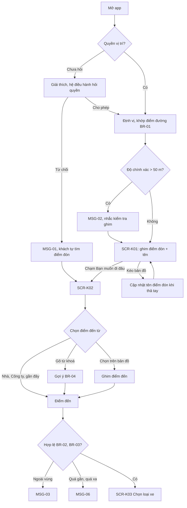

**Luồng chính**

| **Bước** | **Actor** | **Mô tả** |
| --- | --- | --- |
| 1 | Khách | Mở app |
| 2 | App | Định vị, khớp điểm đón (BR-01), hiện **SCR-K01** với ghim và tên điểm đón |
| 3 | Khách | Chạm "Bạn muốn đi đâu?" |
| 4 | App | Mở **SCR-K02**, hiện gợi ý theo BR-04 |
| 5 | Khách | Chọn điểm đến |
| 6 | App | Kiểm tra BR-02, BR-03; hợp lệ → mở **SCR-K03** |

**Luồng thay thế**

| **Mã** | **Điều kiện** | **Xử lý** |
| --- | --- | --- |
| A1 | Kéo ghim điểm đón | Thả tay → cập nhật tên (\[ReverseGeocode\]) |
| A2 | Chạm ô điểm đón ở **SCR-K02** | Tìm điểm đón như tìm điểm đến |
| A3 | Từ chối quyền vị trí | MSG-01; ô điểm đón trống, khách tự tìm |
| A4 | Chọn "Chọn trên bản đồ" | Ghim điểm đến ở giữa màn, kéo bản đồ để đặt |
| A5 | Lưu địa điểm | Biểu tượng ngôi sao cạnh gợi ý → đặt tên, lưu (BR-10) |

**Luồng lỗi**

| **Mã** | **Điều kiện** | **Xử lý** |
| --- | --- | --- |
| E1 | Ngoài vùng phục vụ | MSG-03 |
| E2 | Khoảng cách không hợp lệ | MSG-06 |
| E3 | Dịch vụ tìm địa chỉ lỗi | MSG-08; vẫn cho chọn trên bản đồ |

#### UC-02 Chọn loại xe và xác nhận đặt

| **Mục** | **Nội dung** |
| --- | --- |
| Tiền điều kiện | Có điểm đón, điểm đến hợp lệ |
| Hậu điều kiện thành công | Chuyến được tạo ở `DANG_TIM_TAI_XE` với giá đã chốt; mở **SCR-K04** |
| Hậu điều kiện thất bại | Không tạo chuyến; ở lại **SCR-K03** |

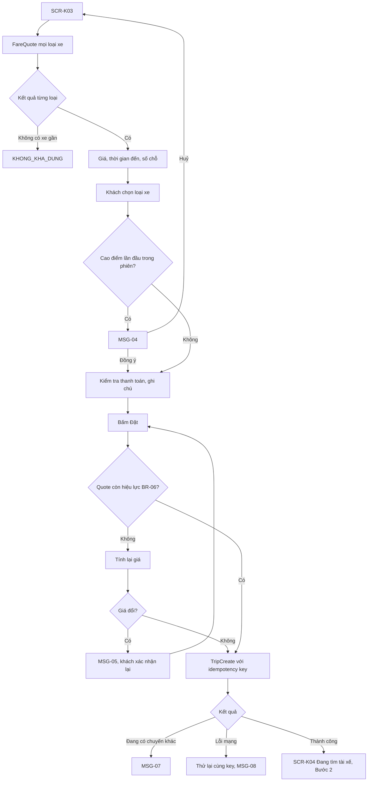

**Luồng chính**

| **Bước** | **Actor** | **Mô tả** |
| --- | --- | --- |
| 1 | App | Gọi \[FareQuote\] cho mọi loại xe; hiện **SCR-K03** với lộ trình, giá, thời gian đến |
| 2 | Khách | Chọn loại xe |
| 3 | Khách | Kiểm tra phương thức thanh toán; thêm ghi chú cho tài xế (tuỳ chọn) |
| 4 | Khách | Bấm "Đặt {loại xe}" |
| 5 | App | Kiểm tra BR-06; gọi \[TripCreate\] với quote_id và idempotency key; nút chuyển loading |
| 6 | Máy chủ | Tạo chuyến `DANG_TIM_TAI_XE`, chốt giá ước tính |
| 7 | App | Mở **SCR-K04** |

**Luồng thay thế**

| **Mã** | **Điều kiện** | **Xử lý** |
| --- | --- | --- |
| A1 | Cao điểm lần đầu | MSG-04 trước bước 4 (BR-07) |
| A2 | Quote hết hạn, giá đổi | MSG-05 (BR-06) |
| A3 | Đổi phương thức thanh toán | Mở chọn phương thức (Bước 4) |
| A4 | Ví liên kết lỗi hoặc không đủ số dư | Gợi ý chuyển sang tiền mặt (Bước 4) |
| A5 | Mọi loại xe `KHONG_KHA_DUNG` | MSG-09 ở **SCR-K03**, nút Đặt disabled |

**Luồng lỗi**

| **Mã** | **Điều kiện** | **Xử lý** |
| --- | --- | --- |
| E1 | Đang có chuyến khác | MSG-07, nút "Xem chuyến hiện tại" |
| E2 | Lỗi mạng khi tạo chuyến | Gửi lại cùng idempotency key; vẫn lỗi → MSG-08 |
| E3 | \[FareQuote\] lỗi | Ô giá hiện "Chưa tính được giá" + Thử lại; nút Đặt disabled |

### Bước 2 · Ghép tài xế & nhận chuyến

#### UC-03 Tài xế bật nhận chuyến

| **Mục** | **Nội dung** |
| --- | --- |
| Tiền điều kiện | Tài xế đăng nhập, hồ sơ đã duyệt |
| Hậu điều kiện thành công | Tài xế `DANG_RANH`, vị trí gửi mỗi 5 giây |
| Hậu điều kiện thất bại | Tài xế `NGOAI_TUYEN` |

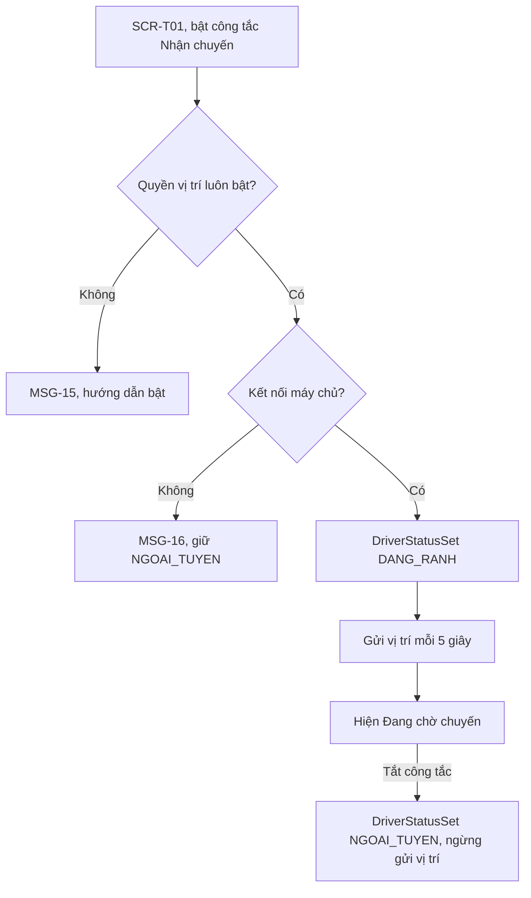

**Luồng chính**

| **Bước** | **Actor** | **Mô tả** |
| --- | --- | --- |
| 1 | Tài xế | Ở **SCR-T01**, bật công tắc Nhận chuyến |
| 2 | Hệ thống | Kiểm tra quyền vị trí "Luôn cho phép" và kết nối máy chủ |
| 3 | Hệ thống | Gọi \[DriverStatusSet\] `DANG_RANH` |
| 4 | Hệ thống | Gửi vị trí mỗi 5 giây |
| 5 | Hệ thống | Hiện "Đang chờ chuyến" |

**Luồng thay thế**

| **Mã** | **Điều kiện** | **Xử lý** |
| --- | --- | --- |
| A1 | Tài xế tắt công tắc | \[DriverStatusSet\] `NGOAI_TUYEN`, ngừng gửi vị trí |

**Luồng lỗi**

| **Mã** | **Điều kiện** | **Xử lý** |
| --- | --- | --- |
| E1 | Chưa cấp quyền vị trí "Luôn cho phép" | MSG-15 kèm hướng dẫn bật; giữ `NGOAI_TUYEN` |
| E2 | Không kết nối được máy chủ | MSG-16; giữ `NGOAI_TUYEN` |

#### UC-04 Ghép tài xế

| **Mục** | **Nội dung** |
| --- | --- |
| Tiền điều kiện | Chuyến `DANG_TIM_TAI_XE` (Bước 1) |
| Hậu điều kiện thành công | Chuyến `TAI_XE_DANG_DEN` với một tài xế |
| Hậu điều kiện thất bại | Chuyến `KHONG_TIM_DUOC` hoặc `DA_HUY` |

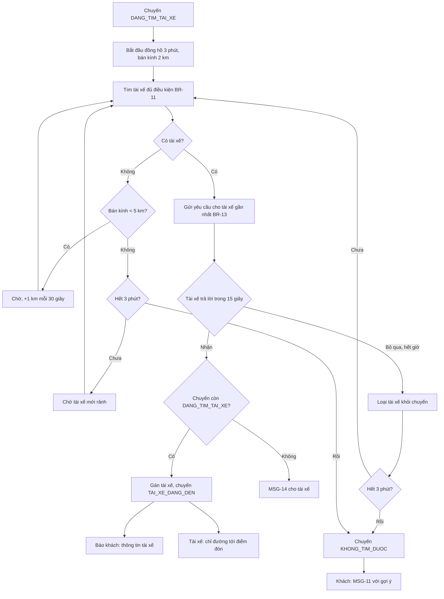

**Luồng chính**

| **Bước** | **Actor** | **Mô tả** |
| --- | --- | --- |
| 1 | Máy chủ | Nhận chuyến mới `DANG_TIM_TAI_XE`; bắt đầu đồng hồ 3 phút (BR-17) |
| 2 | Máy chủ | Lọc tài xế theo BR-11, BR-12; sắp theo BR-13 |
| 3 | Máy chủ | Gửi yêu cầu cho tài xế đầu danh sách (BR-14), hết hạn sau 15 giây (BR-15) |
| 4 | App tài xế | Hiện **SCR-T02** với âm thanh, rung, đếm ngược |
| 5 | Tài xế | Bấm "Nhận" |
| 6 | Máy chủ | Kiểm tra BR-16; gán tài xế; đẩy cập nhật cho cả hai app |
| 7 | App khách | **SCR-K04** chuyển sang **SCR-K05** với thông tin tài xế |
| 8 | App tài xế | Mở **SCR-T03** chỉ đường tới điểm đón |

**Luồng thay thế**

| **Mã** | **Điều kiện** | **Xử lý** |
| --- | --- | --- |
| A1 | Tài xế bỏ qua hoặc hết 15 giây | Loại tài xế khỏi chuyến; quay lại bước 2 |
| A2 | Không có tài xế trong bán kính | Mở rộng bán kính theo BR-12; khách thấy MSG-10 sau 60 giây |
| A3 | Khách huỷ khi đang tìm | Chuyến `DA_HUY` (Bước 4); yêu cầu đang gửi → `HUY_BO`, tài xế thấy MSG-14 |
| A4 | Tài xế bấm Nhận lúc khách vừa huỷ | Máy chủ từ chối theo BR-16; MSG-14 |
| A5 | App khách ở nền khi ghép xong | Thông báo đẩy MSG-12 |

**Luồng lỗi**

| **Mã** | **Điều kiện** | **Xử lý** |
| --- | --- | --- |
| E1 | Hết 3 phút | Chuyến `KHONG_TIM_DUOC`; khách thấy MSG-11 |
| E2 | App tài xế mất kết nối khi đang xem yêu cầu | Máy chủ tính hết hạn sau 15 giây; app có mạng lại thì đóng thẻ |
| E3 | Tài xế bấm Nhận khi mạng chập chờn | Nút loading; chờ phản hồi máy chủ tối đa 5 giây; không có phản hồi → hỏi lại trạng thái chuyến trước khi báo |

#### UC-05 Tài xế huỷ sau khi nhận

| **Mục** | **Nội dung** |
| --- | --- |
| Tiền điều kiện | Chuyến `TAI_XE_DANG_DEN`, `TAI_XE_DA_DEN`, hoặc `DANG_CHO_KHACH` chưa hết 10 phút chờ tính phí; chưa bắt đầu chuyến. Hết 10 phút chờ tính phí thì tài xế dùng "Khách không đến" (Bước 4, BR-37) |
| Hậu điều kiện | Chuyến quay về `DANG_TIM_TAI_XE`; khách được tìm tài xế mới |

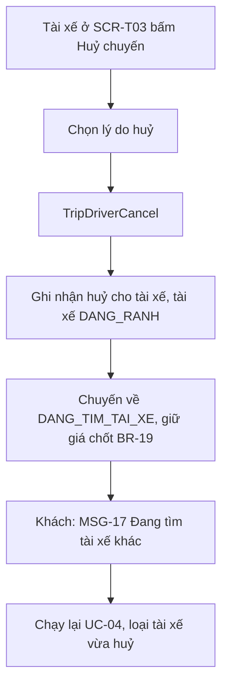

**Luồng chính**

| **Bước** | **Actor** | **Mô tả** |
| --- | --- | --- |
| 1 | Tài xế | Ở **SCR-T03**, bấm Huỷ chuyến |
| 2 | Tài xế | Chọn lý do huỷ |
| 3 | Hệ thống | Gọi \[TripDriverCancel\]; ghi nhận lượt huỷ cho tài xế, tài xế về `DANG_RANH` |
| 4 | Hệ thống | Chuyến về `DANG_TIM_TAI_XE`, giữ giá chốt, xoá phí chờ đã phát sinh (BR-19) |
| 5 | Hệ thống | Khách nhận MSG-17 |
| 6 | Hệ thống | Chạy lại UC-04, loại tài xế vừa huỷ |

**Luồng thay thế**

| **Mã** | **Điều kiện** | **Xử lý** |
| --- | --- | --- |
| A1 | Đã tìm lại 2 lần mà tài xế thứ 3 vẫn huỷ | Chuyến `KHONG_TIM_DUOC`, không thu phí (BR-19) |

### Bước 3 · Theo dõi chuyến & an toàn

#### UC-06 Tài xế đến đón và bắt đầu chuyến

| **Mục** | **Nội dung** |
| --- | --- |
| Tiền điều kiện | Chuyến `TAI_XE_DANG_DEN` |
| Hậu điều kiện thành công | Chuyến `DANG_DI` |
| Hậu điều kiện thất bại | Chuyến `DA_HUY` (Bước 4) |

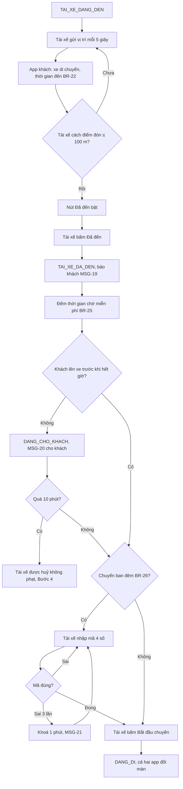

**Luồng chính**

| **Bước** | **Actor** | **Mô tả** |
| --- | --- | --- |
| 1 | App tài xế | Gửi vị trí theo BR-21; **SCR-T03** chỉ đường tới điểm đón |
| 2 | App khách | **SCR-K05**: xe trên bản đồ, thời gian đến (BR-22), thông tin tài xế |
| 3 | Tài xế | Tới gần điểm đón, bấm "Đã đến" (BR-24) |
| 4 | Máy chủ | Chuyển `TAI_XE_DA_DEN`; đẩy sự kiện; khách nhận MSG-19 |
| 5 | Hai app | Hiện đồng hồ thời gian chờ miễn phí (BR-25) |
| 6 | Khách | Lên xe; chuyến ban đêm đọc mã xác nhận cho tài xế |
| 7 | Tài xế | Nhập mã (nếu có), bấm "Bắt đầu chuyến" |
| 8 | Máy chủ | Chuyển `DANG_DI`; cả hai app đổi màn |

**Luồng thay thế**

| **Mã** | **Điều kiện** | **Xử lý** |
| --- | --- | --- |
| A1 | Hết thời gian chờ miễn phí | `DANG_CHO_KHACH`; khách nhận MSG-20; bắt đầu tính phí chờ |
| A2 | Chờ tính phí quá 10 phút (BR-25) | Tài xế có nút "Huỷ – khách không đến" (Bước 4) |
| A3 | Mã xác nhận sai 3 lần | Khoá 1 phút, MSG-21 gợi ý gọi khách |
| A4 | Tài xế bấm "Đã đến" khi còn xa | Nút disabled kèm "Còn {m} m tới điểm đón" |
| A5 | Khách ra trước khi tài xế đến | Khách nhắn tin mẫu "Tôi đang đứng ở điểm đón" |

**Luồng lỗi**

| **Mã** | **Điều kiện** | **Xử lý** |
| --- | --- | --- |
| E1 | Vị trí tài xế không cập nhật > 30 giây | App khách MSG-18, giữ vị trí cuối |
| E2 | Tài xế bấm đổi trạng thái khi mất mạng | Nút loading; xếp hàng gửi lại; báo "Đang chờ kết nối" sau 5 giây; không đổi màn khi chưa có xác nhận |

#### UC-07 Đang đi và kết thúc chuyến

| **Mục** | **Nội dung** |
| --- | --- |
| Tiền điều kiện | Chuyến `DANG_DI` |
| Hậu điều kiện | Chuyến `CHO_THANH_TOAN` |

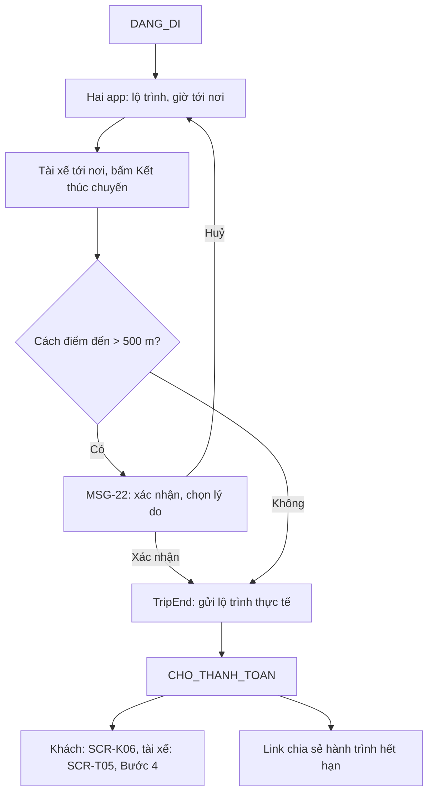

**Luồng chính**

| **Bước** | **Actor** | **Mô tả** |
| --- | --- | --- |
| 1 | Hệ thống | Chuyến `DANG_DI`: hai app hiện lộ trình và giờ tới nơi |
| 2 | Tài xế | Tới nơi, bấm Kết thúc chuyến |
| 3 | Hệ thống | Cách điểm đến ≤ 500 m → gọi \[TripEnd\], gửi lộ trình thực tế |
| 4 | Hệ thống | Chuyến `CHO_THANH_TOAN`; khách sang **SCR-K06**, tài xế sang **SCR-T05** (Bước 4) |
| 5 | Hệ thống | Link chia sẻ hành trình hết hạn |

**Luồng thay thế**

| **Mã** | **Điều kiện** | **Xử lý** |
| --- | --- | --- |
| A1 | Chuyến phải dừng giữa đường: xe hỏng, sự cố, khách yêu cầu xuống sớm | Tài xế bấm Kết thúc chuyến; cách điểm đến > 500 m nên hiện MSG-22, tài xế chọn lý do rồi xác nhận. Chuyến sang `CHO_THANH_TOAN`, không qua `DA_HUY` |
| A2 | Dừng giữa đường do phía tài xế (xe hỏng, sự cố) | Ngoại lệ của quy tắc "ngắn hơn thì giữ giá chốt" (BR-33): giá tính theo km, phút thực tế và không vượt giá chốt; lý do lưu vào chuyến để tổng đài đối soát |
| A3 | Khách yêu cầu xuống sớm | Giữ giá chốt theo BR-33 |

**Luồng lỗi**

| **Mã** | **Điều kiện** | **Xử lý** |
| --- | --- | --- |
| E1 | Tài xế bấm Huỷ ở MSG-22 | Quay lại màn đang đi, chuyến giữ `DANG_DI` |
| E2 | Mất mạng khi bấm Kết thúc | Báo "Đang chờ kết nối", lệnh xếp hàng và gửi khi có mạng; vị trí vẫn ghi trên máy |

#### UC-08 Liên lạc giữa khách và tài xế

| **Mục** | **Nội dung** |
| --- | --- |
| Tiền điều kiện | Chuyến có tài xế, chưa quá 30 phút sau khi kết thúc |
| Hậu điều kiện | Cuộc gọi hoặc tin nhắn được chuyển, không lộ số thật |

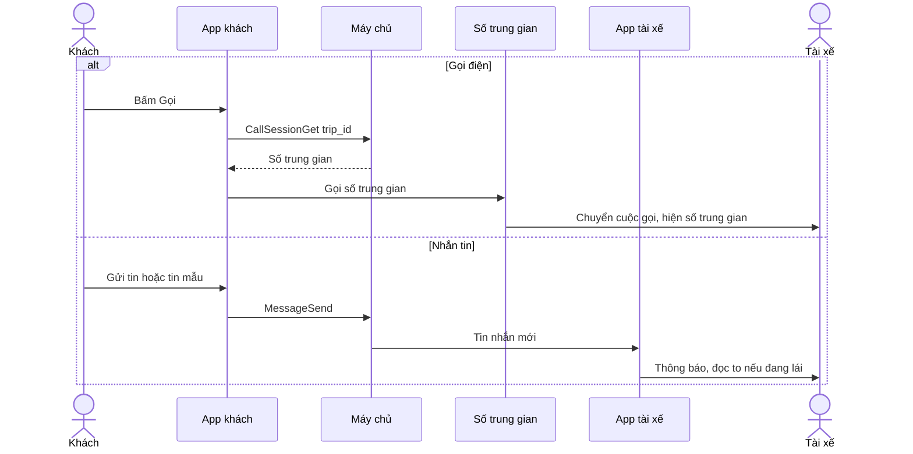

**Luồng chính**

| **Bước** | **Actor** | **Mô tả** |
| --- | --- | --- |
| 1 | Khách hoặc tài xế | Bấm Gọi ở màn chuyến |
| 2 | Hệ thống | Gọi \[CallSessionGet\] lấy số trung gian |
| 3 | Hệ thống | App gọi số trung gian; bên kia nhận cuộc gọi, chỉ thấy số trung gian |

**Luồng thay thế**

| **Mã** | **Điều kiện** | **Xử lý** |
| --- | --- | --- |
| A1 | Chọn Nhắn tin | Gõ tin hoặc chọn tin mẫu → \[MessageSend\] → bên kia nhận thông báo; app tài xế đọc to khi đang lái |
| A2 | Quá 30 phút sau khi chuyến kết thúc | Ẩn nút Gọi, Nhắn tin |

**Luồng lỗi**

| **Mã** | **Điều kiện** | **Xử lý** |
| --- | --- | --- |
| E1 | Không lấy được số trung gian hoặc gửi tin thất bại | Báo lỗi, cho thử lại; không hiện số thật của bên kia |

#### UC-09 Chia sẻ hành trình và SOS

| **Mục** | **Nội dung** |
| --- | --- |
| Tiền điều kiện | Chuyến từ `TAI_XE_DANG_DEN` tới `DANG_DI` |
| Hậu điều kiện | Link được tạo, hoặc yêu cầu khẩn cấp được gửi |

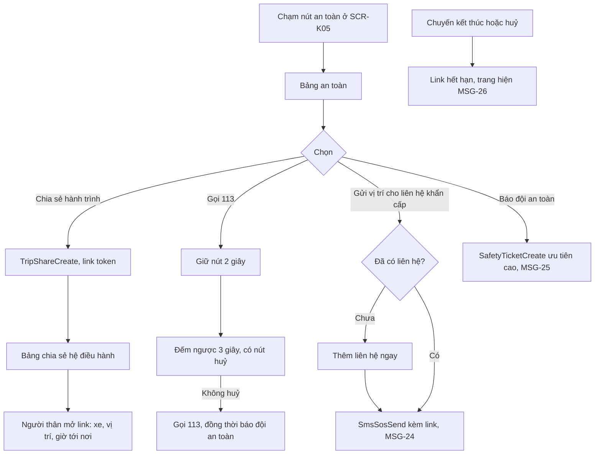

**Luồng chính**

| **Bước** | **Actor** | **Mô tả** |
| --- | --- | --- |
| 1 | Khách | Chạm nút an toàn ở **SCR-K05** |
| 2 | Hệ thống | Mở bảng an toàn |
| 3 | Khách | Chọn Chia sẻ hành trình |
| 4 | Hệ thống | Gọi \[TripShareCreate\] tạo link có token, mở bảng chia sẻ của hệ điều hành |
| 5 | Người thân | Mở link: thấy xe, vị trí, giờ tới nơi |
| 6 | Hệ thống | Chuyến kết thúc hoặc huỷ → link hết hạn, trang hiện MSG-26 |

**Luồng thay thế**

| **Mã** | **Điều kiện** | **Xử lý** |
| --- | --- | --- |
| A1 | Chọn Gọi 113 | Giữ nút 2 giây → đếm ngược 3 giây có nút huỷ → gọi 113, đồng thời báo đội an toàn |
| A2 | Chọn Gửi vị trí cho liên hệ khẩn cấp | Chưa có liên hệ → thêm ngay; có → \[SmsSosSend\] kèm link, MSG-24 |
| A3 | Chọn Báo đội an toàn | \[SafetyTicketCreate\] ưu tiên cao, MSG-25 |

**Luồng lỗi**

| **Mã** | **Điều kiện** | **Xử lý** |
| --- | --- | --- |
| E1 | Gửi SMS khẩn cấp thất bại | Báo lỗi, cho thử lại; nút Gọi 113 vẫn dùng được |

### Bước 4 · Thanh toán, đánh giá & huỷ chuyến

#### UC-10 Thanh toán khi kết thúc chuyến

| **Mục** | **Nội dung** |
| --- | --- |
| Tiền điều kiện | Chuyến `CHO_THANH_TOAN` |
| Hậu điều kiện thành công | Chuyến `HOAN_THANH`; hoá đơn tạo; thu nhập tài xế ghi nhận |
| Hậu điều kiện thất bại | Chuyến ở `CHO_THU_TIEN_MAT`; tổng đài theo dõi chuyến chưa thanh toán sau 30 phút |

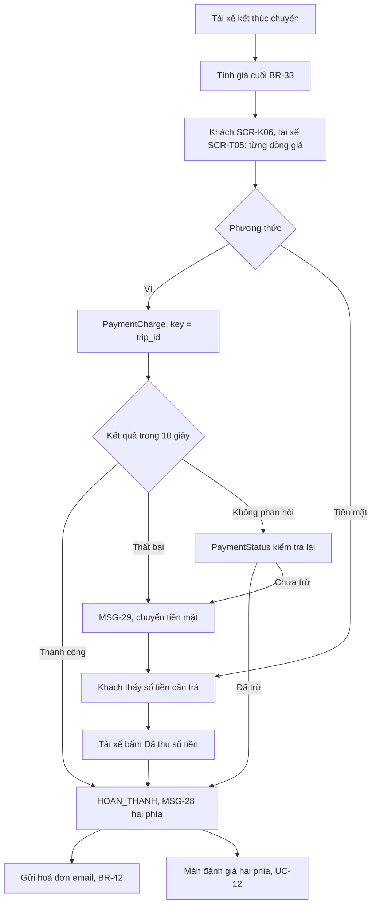

**Luồng chính**

| **Bước** | **Actor** | **Mô tả** |
| --- | --- | --- |
| 1 | Máy chủ | Chuyến `CHO_THANH_TOAN`; tính giá cuối (BR-33) |
| 2 | Hai app | Khách mở **SCR-K06**, tài xế mở **SCR-T05** với cùng giá cuối và từng dòng |
| 3 | Máy chủ | Ví → gọi \[PaymentCharge\] (BR-34) |
| 4 | Máy chủ | Thành công → chuyến `HOAN_THANH`; đẩy MSG-28 cho hai phía |
| 5 | Hai app | Chuyển sang đánh giá (UC-12) |

**Luồng thay thế**

| **Mã** | **Điều kiện** | **Xử lý** |
| --- | --- | --- |
| A1 | Tiền mặt | **SCR-K06** hiện "Vui lòng trả tài xế {số tiền}"; tài xế bấm "Đã thu" (BR-35) |
| A2 | Ví lỗi | MSG-29; chuyển A1 |
| A3 | Ví không phản hồi | Kiểm tra lại \[PaymentStatus\] trước khi kết luận |
| A4 | Giá cuối khác giá chốt | Dòng giải thích: "Lộ trình dài hơn dự kiến {x} km" hoặc "Phí chờ {n} phút" |
| A5 | Có nợ phí huỷ | Dòng "Phí huỷ chuyến {ngày}" cộng vào tổng |

**Luồng lỗi**

| **Mã** | **Điều kiện** | **Xử lý** |
| --- | --- | --- |
| E1 | Tài xế bấm "Đã thu" khi mất mạng | Xếp hàng gửi lại; app tài xế hiện "Đang chờ kết nối" |
| E2 | Sau 30 phút chưa `HOAN_THANH` | Tạo ticket cho tổng đài |
| E3 | Khách không trả hoặc trả thiếu tiền mặt | Tài xế chọn "Khách chưa trả đủ" ở **SCR-T05**, nhập số đã thu; chuyến `HOAN_THANH`, phần thiếu ghi nợ cho khách như BR-38, tạo ticket cho tổng đài |

#### UC-11 Huỷ chuyến

| **Mục** | **Nội dung** |
| --- | --- |
| Tiền điều kiện | Chuyến trước `DANG_DI` |
| Hậu điều kiện thành công | Chuyến `DA_HUY` với người huỷ, lý do, phí (nếu có) |
| Hậu điều kiện thất bại | Chuyến giữ trạng thái cũ |

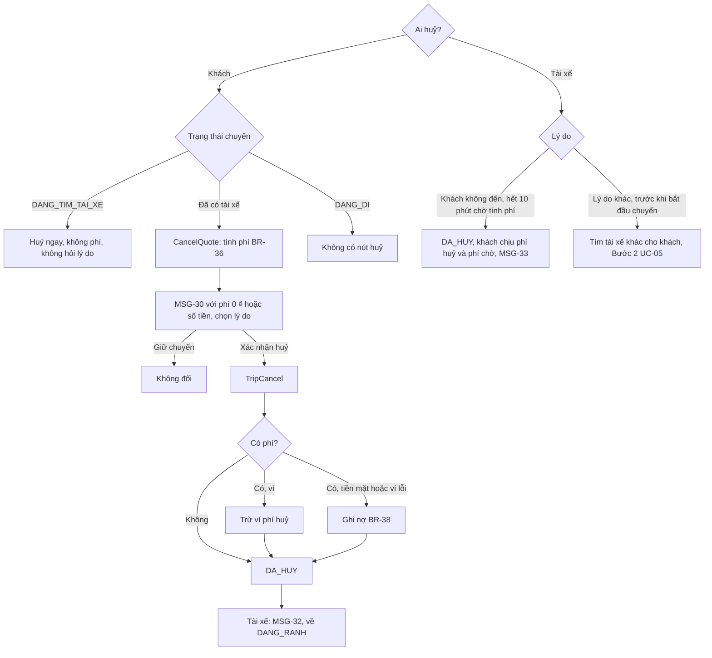

**Luồng chính (khách huỷ khi đã có tài xế)**

| **Bước** | **Actor** | **Mô tả** |
| --- | --- | --- |
| 1 | Khách | Bấm "Huỷ chuyến" ở **SCR-K05** |
| 2 | App khách | Gọi \[CancelQuote\]; hiện MSG-30 với phí theo BR-36 và danh sách lý do |
| 3 | Khách | Chọn lý do, bấm "Xác nhận huỷ" |
| 4 | Máy chủ | \[TripCancel\]; thu phí theo BR-38; chuyến `DA_HUY` |
| 5 | Hai app | Khách về **SCR-K01** kèm MSG-31; tài xế nhận MSG-32, về **SCR-T01** |

**Luồng thay thế**

| **Mã** | **Điều kiện** | **Xử lý** |
| --- | --- | --- |
| A1 | Huỷ khi đang tìm | Không hỏi lý do, không phí |
| A2 | Tài xế trễ > 5 phút | Phí 0 ₫, lý do mặc định "Tài xế đến trễ" |
| A3 | Tài xế chọn "Khách không đến" | BR-37: thu phí huỷ và phí chờ; khách nhận MSG-33 |
| A5 | Tài xế huỷ vì lý do khác khi đã đến (`TAI_XE_DA_DEN`, hoặc `DANG_CHO_KHACH` chưa hết 10 phút chờ tính phí) | Chuyến về `DANG_TIM_TAI_XE` theo Bước 2 UC-05; khách không phí huỷ, không phí chờ |
| A6 | Khách huỷ ở `DANG_CHO_KHACH` | MSG-30 hiện phí huỷ kèm phí chờ đã phát sinh; thu theo BR-38 |
| A4 | Trạng thái đổi giữa lúc báo phí và lúc xác nhận | Máy chủ tính lại; phí khác → hiện lại MSG-30 |

#### UC-12 Đánh giá hai chiều

| **Mục** | **Nội dung** |
| --- | --- |
| Tiền điều kiện | Chuyến `HOAN_THANH`, trong 24 giờ |
| Hậu điều kiện | Đánh giá được lưu; điểm trung bình cập nhật; tip trừ ví nếu có |

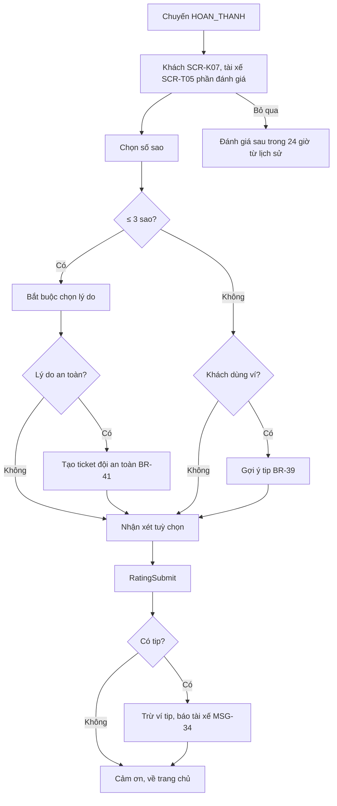

**Luồng chính**

| **Bước** | **Actor** | **Mô tả** |
| --- | --- | --- |
| 1 | Hệ thống | Chuyến `HOAN_THANH`: khách thấy **SCR-K07**, tài xế thấy phần đánh giá ở **SCR-T05** |
| 2 | Khách hoặc tài xế | Chọn số sao |
| 3 | Khách hoặc tài xế | Thêm nhận xét (tuỳ chọn), bấm Gửi |
| 4 | Hệ thống | Gọi \[RatingSubmit\]; cập nhật điểm trung bình |
| 5 | Hệ thống | Cảm ơn, về trang chủ |

**Luồng thay thế**

| **Mã** | **Điều kiện** | **Xử lý** |
| --- | --- | --- |
| A1 | ≤ 3 sao | Bắt buộc chọn ít nhất 1 lý do; lý do về an toàn → tạo ticket cho đội an toàn (BR-41) |
| A2 | Khách chấm trên 3 sao và dùng ví | Gợi ý tip (BR-39); có tip → trừ ví, tài xế nhận MSG-34 |
| A3 | Bỏ qua | Đánh giá lại được trong 24 giờ từ lịch sử chuyến |

**Luồng lỗi**

| **Mã** | **Điều kiện** | **Xử lý** |
| --- | --- | --- |
| E1 | Gửi đánh giá thất bại | Giữ nội dung đã chọn, cho thử lại |
| E2 | Trừ ví tip thất bại | Đánh giá vẫn được lưu; báo tip chưa thực hiện được |

#### UC-13 Lịch sử chuyến và báo cáo sự cố

| **Mục** | **Nội dung** |
| --- | --- |
| Tiền điều kiện | Có ít nhất 1 chuyến |
| Hậu điều kiện | Khách xem được hoá đơn; sự cố có mã yêu cầu |

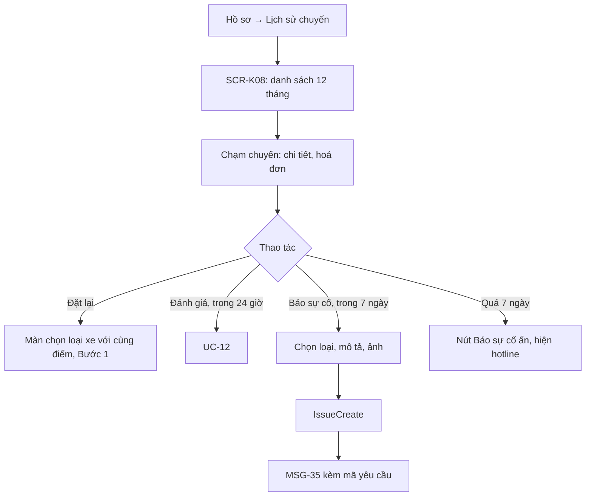

**Luồng chính**

| **Bước** | **Actor** | **Mô tả** |
| --- | --- | --- |
| 1 | Khách | Hồ sơ → Lịch sử chuyến |
| 2 | Hệ thống | **SCR-K08**: danh sách chuyến 12 tháng, mới nhất trước |
| 3 | Khách | Chạm một chuyến |
| 4 | Hệ thống | Hiện chi tiết và hoá đơn |
| 5 | Khách | Chọn Báo sự cố (trong 7 ngày): chọn loại, mô tả, ảnh |
| 6 | Hệ thống | Gọi \[IssueCreate\]; MSG-35 kèm mã yêu cầu |

**Luồng thay thế**

| **Mã** | **Điều kiện** | **Xử lý** |
| --- | --- | --- |
| A1 | Chọn Đặt lại | Mở màn chọn loại xe với cùng điểm đón, điểm đến (Bước 1) |
| A2 | Chọn Đánh giá trong 24 giờ | UC-12 |
| A3 | Chuyến quá 7 ngày | Ẩn nút Báo sự cố, hiện hotline |

**Luồng lỗi**

| **Mã** | **Điều kiện** | **Xử lý** |
| --- | --- | --- |
| E1 | Gửi báo cáo thất bại | Giữ nội dung đã nhập, cho thử lại |

## 6. Điểm vào

| **Điểm vào** | **Dẫn tới** | **Ghi chú** |
| --- | --- | --- |
| Mở app | UC-01, **SCR-K01** | Có chuyến đang diễn ra → mở thẳng **SCR-K05** |
| Chạm Nhà, Công ty ở **SCR-K01** | UC-01, nhảy thẳng **SCR-K03** | |
| "Đặt lại" ở chuyến trong **SCR-K08** | UC-02 với điểm đón, đến cũ | Bước 4 |
| Không tìm được tài xế → "Đặt lại" | UC-02 | Bước 2 |
| Công tắc Nhận chuyến ở **SCR-T01** | UC-03 | |
| Chuyến vừa tạo ở Bước 1 | UC-04, **SCR-K04** | |
| Yêu cầu đến (kết nối realtime hoặc thông báo đẩy) | **SCR-T02** | Mở được cả khi app ở nền |
| Nút Huỷ ở **SCR-T03** | UC-05 | Chi tiết huỷ và lý do ở Bước 4 |
| Ghép tài xế xong (Bước 2) | UC-06, **SCR-K05**, **SCR-T03** | |
| Mở app khi có chuyến đang diễn ra | **SCR-K05** hoặc **SCR-T03**/**T04** | Theo trạng thái chuyến |
| Thông báo đẩy về trạng thái, tin nhắn | **SCR-K05**, **SCR-T03**/**T04** | |
| Nút Gọi, Nhắn ở hai app | UC-08 | |
| Nút an toàn ở **SCR-K05** | UC-09 | BR-31 |
| Hồ sơ → Liên hệ khẩn cấp | Thêm, sửa tối đa 3 liên hệ | |
| Chọn phương thức ở **SCR-K03** | Bảng chọn phương thức | BR-32 |
| Chuyến sang `CHO_THANH_TOAN` | UC-10, **SCR-K06**, **SCR-T05** | Tự động |
| "Huỷ chuyến" ở **SCR-K04**, **SCR-K05** | UC-11 | |
| "Khách không đến" ở **SCR-T03** | UC-11 (A3) | Sau 10 phút chờ tính phí (BR-25) |
| Sau thanh toán | UC-12 | |
| Hồ sơ → Lịch sử chuyến | UC-13, **SCR-K08** | |
| Thông báo "Bạn chưa đánh giá chuyến" | UC-12 | Gửi 1 lần sau 2 giờ |

## 7. Mô tả màn hình

<!-- Bước 1 · Đặt chuyến -->
### SCR-K01 Trang chủ bản đồ

| **#** | **Thành phần** | **Loại** | **Hành vi** |
| --- | --- | --- | --- |
| 1 | Bản đồ | Map | Ghim điểm đón cố định giữa màn; kéo bản đồ để dời |
| 2 | Nhãn điểm đón | Tooltip | Tên điểm đón; "Đang xác định…" khi đang tìm tên |
| 3 | Nút về vị trí của tôi | Icon | Đưa bản đồ về vị trí thiết bị |
| 4 | Ô "Bạn muốn đi đâu?" | Search bar | Mở **SCR-K02** |
| 5 | Lối tắt | Chips | Nhà, Công ty (nếu có), 2 điểm đến gần nhất |
| 6 | Cảnh báo định vị | Banner | MSG-02 |
| 7 | Điểm đón chuẩn | Chips trên bản đồ | Tối đa 3; điểm đang chọn tô đậm (BR-44) |
| 8 | Xe gần bạn | Biểu tượng xe | Theo BR-45 |

### SCR-K02 Chọn điểm đón, điểm đến

| **#** | **Thành phần** | **Loại** | **Bắt buộc** | **Validate / hành vi** |
| --- | --- | --- | --- | --- |
| 1 | Điểm đón | Text | Có | Điền sẵn; chạm để tìm |
| 2 | Điểm đến | Text | Có | Focus sẵn; gõ ≥ 2 ký tự để gợi ý (BR-04) |
| 3 | Đã lưu & gần đây | List | – | Nhà, Công ty, đã lưu, 5 gần đây |
| 4 | Gợi ý địa chỉ | List | – | Tên, địa chỉ, khoảng cách; ngôi sao để lưu |
| 5 | "Chọn trên bản đồ" | Button | – | A4 |

### SCR-K03 Chọn loại xe & giá

| **#** | **Thành phần** | **Loại** | **Hành vi** |
| --- | --- | --- | --- |
| 1 | Bản đồ lộ trình | Map | Đường đi, điểm đón, điểm đến; "{km} km · {phút} phút" |
| 2 | Danh sách loại xe | Radio list | Mỗi loại: biểu tượng, tên, số chỗ, "{n} phút", giá ước tính; trạng thái theo mục 4.2 |
| 3 | Nhãn cao điểm | Tag | "Cao điểm ×{hệ số}", chạm xem giải thích |
| 4 | Phương thức thanh toán | Dòng chọn | Tiền mặt hoặc ví liên kết (Bước 4) |
| 5 | Ghi chú cho tài xế | Dòng nhập | BR-10; placeholder "Ví dụ: đứng ở cổng sau" |
| 6 | Nút "Đặt {loại xe}" | Button | Disabled khi chưa chọn loại hoặc chưa có giá; loading khi đang tạo |
| 7 | Ghi chú giá | Text phụ | "Giá ước tính, có thể thay đổi nếu đổi lộ trình" |

<!-- Bước 2 · Ghép tài xế & nhận chuyến -->
### SCR-K04 Đang tìm tài xế (App khách)

| **#** | **Thành phần** | **Loại** | **Hành vi** |
| --- | --- | --- | --- |
| 1 | Bản đồ | Map | Điểm đón, vòng bán kính tìm mở rộng theo BR-12 |
| 2 | Trạng thái | Text | "Đang tìm tài xế gần bạn" + "{mm:ss}"; sau 60 giây thêm MSG-10 |
| 3 | Tóm tắt chuyến | Card | Loại xe, điểm đón, điểm đến, giá chốt |
| 4 | Huỷ chuyến | Button text | Huỷ miễn phí khi đang tìm (Bước 4) |
| 5 | Không tìm được | Panel | MSG-11; danh sách loại xe khác đang có tài xế, kèm giá; nút "Thử lại" |

### SCR-T01 Trang chủ, bật nhận chuyến (App tài xế)

| **#** | **Thành phần** | **Loại** | **Hành vi** |
| --- | --- | --- | --- |
| 1 | Công tắc Nhận chuyến | Toggle lớn | Bật, tắt theo UC-03 |
| 2 | Trạng thái | Banner | "Đang chờ chuyến" / "Đang nghỉ" / "Mất kết nối" |
| 3 | Bản đồ | Map | Vị trí tài xế |
| 4 | Thu nhập hôm nay | Card | Số chuyến, tổng thu nhập trong ngày |

### SCR-T02 Yêu cầu chuyến mới (App tài xế, toàn màn)

| **#** | **Thành phần** | **Loại** | **Hành vi** |
| --- | --- | --- | --- |
| 1 | Đếm ngược | Vòng tròn | 15 giây theo thời điểm hết hạn của máy chủ |
| 2 | Thu nhập dự kiến | Số lớn | BR-18 |
| 3 | Tới điểm đón | Text | "{km} km · {phút} phút" |
| 4 | Điểm đón | Text | Tên điểm, ghi chú của khách |
| 5 | Quãng đường chuyến | Text | Chỉ "{km} km chuyến đi" và hướng đi (ví dụ "Về phía Quận 1"); **không hiện tên điểm đến** trước khi nhận. Nhận xong mới hiện điểm đến ở **SCR-T03** |
| 6 | Thông tin khách | Text phụ | Đánh giá của khách, phương thức thanh toán |
| 7 | Nút "Nhận" | Button lớn | Chiếm phần lớn chiều rộng; loading khi đang gửi |
| 8 | Nút "Bỏ qua" | Button phụ | |
| 9 | Âm thanh, rung | Hệ thống | Lặp tới khi trả lời hoặc hết giờ |

<!-- Bước 3 · Theo dõi chuyến & an toàn -->
### SCR-K05 Theo dõi chuyến (App khách)

| **#** | **Thành phần** | **Loại** | **Hành vi** |
| --- | --- | --- | --- |
| 1 | Bản đồ | Map | Xe tài xế, điểm đón, điểm đến, lộ trình; tự căn khung theo trạng thái |
| 2 | Trạng thái | Banner | Theo mục 4.2: "Đến trong {n} phút", "Tài xế đã đến", "Đang tính phí chờ", "Tới nơi lúc {giờ}" |
| 3 | Thẻ tài xế | Card | **Biển số to nhất**; ảnh, tên, đánh giá, hãng, màu xe |
| 4 | Mã xác nhận | Badge | 4 số, chỉ chuyến ban đêm, ở `TAI_XE_DA_DEN`, `DANG_CHO_KHACH` |
| 5 | Đồng hồ chờ | Text | "Chờ miễn phí còn {mm:ss}" / "Phí chờ {x} ₫" |
| 6 | Gọi, Nhắn tin | Button | UC-08; badge tin chưa đọc |
| 7 | Nút an toàn | FAB biểu tượng khiên | Mở bảng an toàn (UC-09) |
| 8 | Chia sẻ hành trình | Button | Ở `DANG_DI` hiện nổi bật |
| 9 | Huỷ chuyến | Button text | Chỉ trước `DANG_DI` (Bước 4) |

### SCR-T03 Đi đón khách (App tài xế)

| **#** | **Thành phần** | **Loại** | **Hành vi** |
| --- | --- | --- | --- |
| 1 | Chỉ đường | Map + chỉ dẫn | Tới điểm đón; nút mở app bản đồ khác |
| 2 | Thông tin đón | Card | Tên khách, điểm đón, ghi chú của khách, phương thức thanh toán |
| 3 | Gọi, Nhắn tin | Button | UC-08; tin mẫu: "Tôi đã đến", "Tôi sắp đến" |
| 4 | Nút "Đã đến" | Button lớn | Bật theo BR-24 |
| 5 | Đồng hồ chờ | Text | Sau Đã đến |
| 6 | Ô nhập mã | Input 4 số | Chỉ chuyến ban đêm; BR-26 |
| 7 | Nút "Bắt đầu chuyến" | Button lớn (vuốt để xác nhận) | Sau Đã đến; tránh bấm nhầm |
| 8 | Huỷ chuyến | Menu | Bước 2 (UC-05), Bước 4 |

### SCR-T04 Đang chở khách (App tài xế)

| **#** | **Thành phần** | **Loại** | **Hành vi** |
| --- | --- | --- | --- |
| 1 | Chỉ đường | Map + chỉ dẫn | Tới điểm đến |
| 2 | Thông tin chuyến | Card | Điểm đến, giá chốt, phương thức thanh toán |
| 3 | Nút "Kết thúc chuyến" | Vuốt để xác nhận | BR-27 |

### Trang xem hành trình (Web, người thân)

| **#** | **Thành phần** | **Hành vi** |
| --- | --- | --- |
| 1 | Bản đồ | Vị trí xe, cập nhật mỗi 10 giây |
| 2 | Thông tin | Tên gọi của khách (tên hiển thị), biển số, hãng, màu xe, tên tài xế, giờ tới nơi dự kiến |
| 3 | Hết hạn | MSG-26 |

<!-- Bước 4 · Thanh toán, đánh giá & huỷ chuyến -->
### SCR-K06 Kết thúc & thanh toán (App khách)

| **#** | **Thành phần** | **Loại** | **Hành vi** |
| --- | --- | --- | --- |
| 1 | Trạng thái | Banner | "Đang thanh toán…" / "Đã thanh toán" / "Vui lòng trả tài xế {số tiền}" |
| 2 | Tổng tiền | Số lớn | Giá cuối |
| 3 | Chi tiết giá | List | Giá chuyến, phí chờ, điều chỉnh lộ trình, phí huỷ trước đó; mỗi dòng có giải thích ngắn |
| 4 | So với giá ước tính | Text phụ | Hiện khi khác: "Ước tính {x} ₫ · {lý do}" |
| 5 | Phương thức | Text | Ví (kèm 4 số cuối) hoặc Tiền mặt |
| 6 | Tiếp tục | Button | Sang **SCR-K07** khi `HOAN_THANH` |

### SCR-K07 Đánh giá tài xế (App khách)

| **#** | **Thành phần** | **Loại** | **Bắt buộc** | **Hành vi** |
| --- | --- | --- | --- | --- |
| 1 | Tài xế | Header | – | Ảnh, tên, biển số |
| 2 | Sao | Rating 1–5 | Có | Chạm chọn |
| 3 | Lý do | Chips chọn nhiều | Khi ≤ 3 sao | Lái xe nguy hiểm, Thái độ, Đến trễ, Xe không sạch, Đi sai đường, Quấy rối, Khác |
| 4 | Lời khen | Chips | Không | Khi 5 sao: Lái xe an toàn, Thân thiện, Xe sạch |
| 5 | Nhận xét | Text | Không | ≤ 200 ký tự |
| 6 | Tip | Chips | Không | Chỉ khi ví (BR-39) |
| 7 | Gửi | Button | – | Disabled khi thiếu sao hoặc thiếu lý do |
| 8 | Bỏ qua | Button text | – | Đánh giá sau trong 24 giờ |

### SCR-K08 Lịch sử chuyến (App khách)

| **#** | **Thành phần** | **Loại** | **Hành vi** |
| --- | --- | --- | --- |
| 1 | Danh sách | List | Ngày giờ, điểm đón → điểm đến, loại xe, giá, trạng thái (Hoàn thành, Đã huỷ, Không tìm được) |
| 2 | Chi tiết chuyến | Màn | Bản đồ lộ trình, tài xế, biển số, từng dòng giá, phương thức, đánh giá đã gửi |
| 3 | Đặt lại | Button | Bước 1 |
| 4 | Đánh giá | Button | Trong 24 giờ, chưa đánh giá |
| 5 | Báo sự cố | Button | Trong 7 ngày (BR-43) |

### SCR-T05 Thu tiền & đánh giá khách (App tài xế)

| **#** | **Thành phần** | **Loại** | **Hành vi** |
| --- | --- | --- | --- |
| 1 | Số tiền | Số lớn | Giá cuối; ví: "Khách đã thanh toán qua ví"; tiền mặt: "Thu tiền mặt" |
| 2 | Chi tiết giá | List | Như **SCR-K06** |
| 3 | Thu nhập chuyến | Text | Sau chiết khấu |
| 4 | "Đã thu {số tiền}" | Button lớn | Chỉ tiền mặt; BR-35 |
| 5 | Đánh giá khách | Rating + lý do | Sau khi thanh toán xong; lý do khi ≤ 3 sao |
| 6 | Xong | Button | Về **SCR-T01**, trạng thái `DANG_RANH` |

## 8. API

### 8.1 Bước 1 · Đặt chuyến

| **API** | **Request chính** | **Response chính** | **Timeout / retry** |
| --- | --- | --- | --- |
| \[ReverseGeocode\] | lat, lng | Tên điểm, địa chỉ, điểm đường đã khớp | 3s / 1 lần |
| \[PlaceSearch\] | keyword, vị trí hiện tại | Danh sách gợi ý | 3s / không retry |
| \[ServiceAreaCheck\] | lat, lng | in_area | 3s / 1 lần |
| \[FareQuote\] | pickup, dropoff | Từng loại xe: quote_id, giá, hệ số (từ Google Maps, BR-07), thời gian đến, khả dụng; lộ trình, km, phút; expires_at | 5s / 1 lần |
| \[TripCreate\] | quote_id, vehicle_type, pickup, dropoff, note, payment_method, idempotency_key | trip_id, trạng thái `DANG_TIM_TAI_XE`, giá chốt | 8s / gửi lại cùng key |
| \[PickupPoints\] | lat, lng | Tối đa 3 điểm đón chuẩn | 3s / 1 lần; BR-44 |
| \[NearbyDrivers\] | lat, lng, vehicle_type | Tối đa 10 vị trí đã làm lệch | 3s / không retry; gọi mỗi 10 giây (BR-45) |
| \[SavedPlaceSave\] | name, lat, lng, type (HOME, WORK, OTHER) | place_id | 5s / 1 lần |

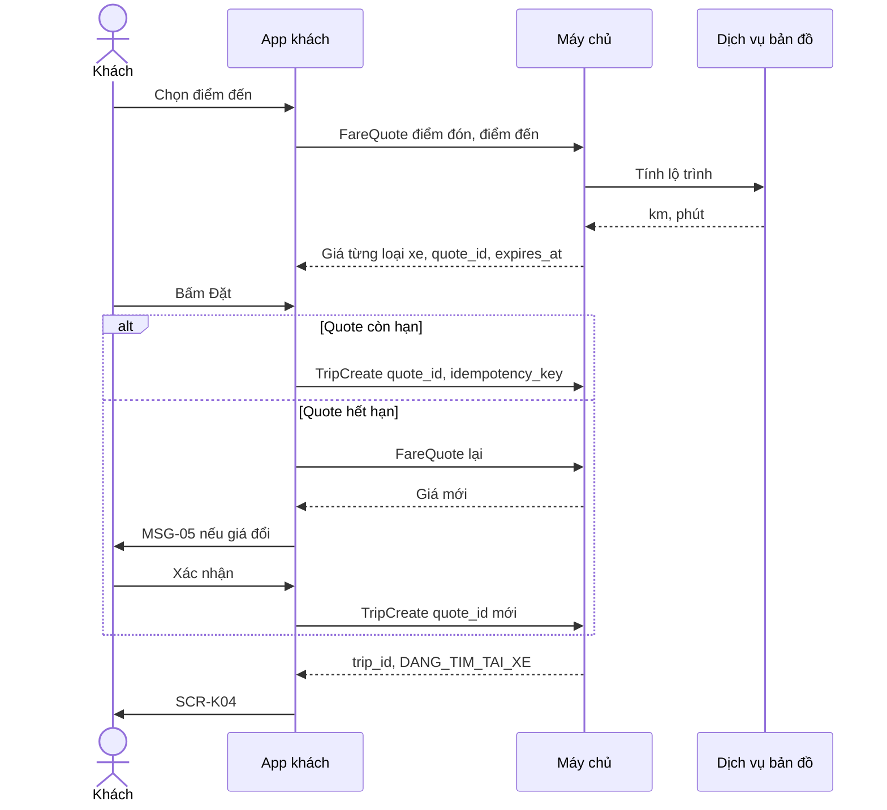

**Map lỗi → thông báo**

| **Nhóm lỗi** | **Message** |
| --- | --- |
| Không có quyền vị trí | MSG-01 |
| Vị trí kém chính xác | MSG-02 |
| Điểm đón hoặc điểm đến ngoài khu vực phục vụ | MSG-03 |
| Khoảng cách không hợp lệ | MSG-06 |
| Giá đã thay đổi khi tạo chuyến | MSG-05 |
| Đang có chuyến chưa kết thúc | MSG-07 |
| Không có xe gần | MSG-09 |
| Mất mạng, quá thời gian, lỗi máy chủ | MSG-08 |

### 8.2 Bước 2 · Ghép tài xế & nhận chuyến

| **API** | **Request chính** | **Response chính** | **Timeout / retry** |
| --- | --- | --- | --- |
| \[DriverStatusSet\] | driver_id, status | status hiện tại | 5s / 2 lần |
| \[DriverLocationPush\] | driver_id, lat, lng, heading, accuracy | – | Mỗi 5 giây khi `DANG_RANH`, `DANG_CHAY` |
| \[DispatchOffer\] (máy chủ → tài xế) | offer_id, trip_id, thông tin chuyến (không gồm điểm đến, chỉ km và hướng đi), expires_at | – | Qua kết nối realtime; dự phòng thông báo đẩy |
| \[OfferRespond\] | offer_id, action (ACCEPT, DECLINE) | accepted, trip | 5s / không tự retry; hỏi \[TripGet\] khi không rõ |
| \[TripEvent\] (máy chủ → khách) | trip_id, status, driver | – | Qua kết nối realtime; dự phòng thông báo đẩy |
| \[TripGet\] | trip_id | Trạng thái và thông tin đầy đủ của chuyến | 5s / 2 lần |
| \[TripDriverCancel\] | trip_id, reason | – | 5s / 2 lần |

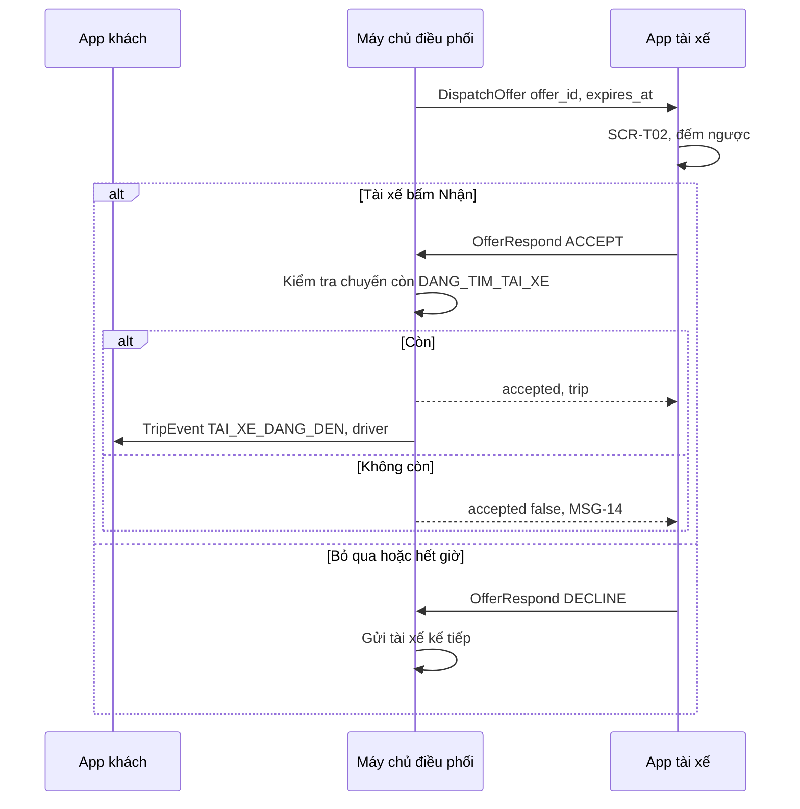

**Map lỗi → thông báo**

| **Nhóm lỗi** | **Message** |
| --- | --- |
| Yêu cầu hết hạn trước khi tài xế trả lời | MSG-13 |
| Chuyến không còn (khách huỷ, tài xế khác đã nhận) | MSG-14 |
| Chưa cấp quyền vị trí "Luôn cho phép" | MSG-15 |
| Mất kết nối | MSG-16 |
| Hết thời gian tìm tài xế | MSG-11 |

### 8.3 Bước 3 · Theo dõi chuyến & an toàn

| **API** | **Request chính** | **Response chính** | **Timeout / retry** |
| --- | --- | --- | --- |
| \[DriverLocationPush\] | trip_id, lat, lng, heading, timestamp | – | Mỗi 5 giây; lưu và gửi bù khi mất mạng |
| \[TripEvent\] (máy chủ → hai app) | trip_id, status, driver_location, eta, wait_timer | – | Kết nối realtime; dự phòng thông báo đẩy |
| \[TripArrive\] | trip_id, vị trí | status `TAI_XE_DA_DEN` | 5s / gửi lại cùng request_id |
| \[TripStart\] | trip_id, confirm_code | status `DANG_DI` hoặc lỗi mã | 5s / gửi lại cùng request_id |
| \[TripEnd\] | trip_id, vị trí, lý do (nếu xa) | status `CHO_THANH_TOAN`, giá cuối | 8s / gửi lại cùng request_id |
| \[CallSessionGet\] | trip_id | Số trung gian | 5s / 1 lần |
| \[MessageSend\] | trip_id, text hoặc template_id | message_id | 5s / 2 lần |
| \[TripShareCreate\] | trip_id | share_url, expires_at | 5s / 1 lần |
| \[SmsSosSend\] | trip_id, contact_ids | Kết quả từng liên hệ | 8s / 2 lần |
| \[SafetyTicketCreate\] | trip_id, vị trí, loại | ticket_id | 5s / 3 lần |

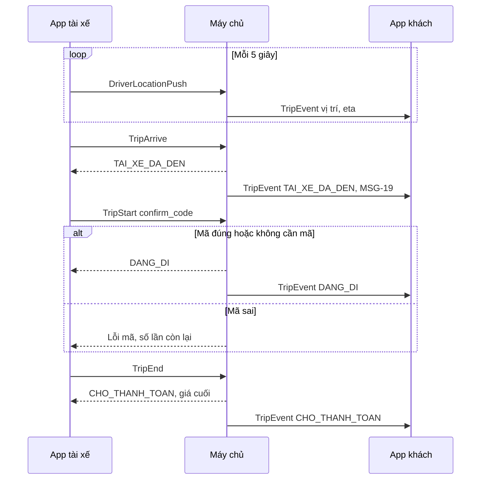

**Map lỗi → thông báo**

| **Nhóm lỗi** | **Message** |
| --- | --- |
| Vị trí tài xế không cập nhật | MSG-18 |
| Mã xác nhận sai | MSG-21 |
| Kết thúc chuyến khi còn xa điểm đến | MSG-22 |
| Link chia sẻ hành trình hết hiệu lực | MSG-26 |
| Mất mạng khi đổi trạng thái chuyến | Báo "Đang chờ kết nối", xếp hàng gửi lại (UC-06, E2) |
| Gửi SMS khẩn cấp thất bại | Thông báo lỗi chung của app (ngoài bộ MSG của SRS này), cho thử lại; vẫn cho gọi 113 |

### 8.4 Bước 4 · Thanh toán, đánh giá & huỷ chuyến

| **API** | **Request chính** | **Response chính** | **Timeout / retry** |
| --- | --- | --- | --- |
| \[PaymentMethodsGet\] | user_id | Phương thức, số dư ví, mặc định | 5s / 1 lần |
| \[FareFinalize\] | trip_id, lộ trình thực tế, thời gian chờ | Giá cuối, từng dòng, lý do chênh lệch | Máy chủ tự gọi khi \[TripEnd\] |
| \[PaymentCharge\] | trip_id, amount, method, idempotency_key = trip_id | status, transaction_id | 10s / không tự retry, kiểm tra \[PaymentStatus\] |
| \[PaymentStatus\] | trip_id | status giao dịch | 5s / 3 lần |
| \[CashConfirm\] | trip_id, amount | status `HOAN_THANH` | 5s / gửi lại cùng request_id |
| \[CancelQuote\] | trip_id, actor | fee, lý do miễn phí (nếu có) | 3s / 1 lần |
| \[TripCancel\] | trip_id, actor, reason, quoted_fee | status `DA_HUY`, fee thực thu, debt | 5s / gửi lại cùng request_id |
| \[RatingSubmit\] | trip_id, actor, stars, reasons, comment, tip | – | 5s / 2 lần |
| \[TripHistory\] | user_id, cursor | Danh sách chuyến | 5s / 1 lần |
| \[IssueCreate\] | trip_id, type, description, photos | issue_id, sla | 8s / 2 lần |

```mermaid
sequenceDiagram
  participant TA as App tài xế
  participant S as Máy chủ
  participant W as Đối tác ví
  participant KA as App khách
  TA->>S: TripEnd
  S->>S: FareFinalize
  S->>KA: CHO_THANH_TOAN, giá cuối
  S->>TA: CHO_THANH_TOAN, giá cuối
  alt Ví liên kết
    S->>W: PaymentCharge key = trip_id
    alt Thành công trong 10 giây
      W-->>S: SUCCESS
    else Không phản hồi
      S->>W: PaymentStatus
      W-->>S: SUCCESS hoặc FAILED
    end
    opt FAILED
      S->>KA: MSG-29, chuyển tiền mặt
      S->>TA: MSG-29, thu tiền mặt
      TA->>S: CashConfirm
    end
  else Tiền mặt
    TA->>S: CashConfirm
  end
  S->>KA: HOAN_THANH, MSG-28
  S->>TA: HOAN_THANH
```

**Map lỗi → thông báo**

| **Nhóm lỗi** | **Message** |
| --- | --- |
| Ví không đủ số dư | MSG-27 |
| Trừ ví thất bại hoặc không phản hồi | MSG-29 |
| Huỷ khi chuyến đã bắt đầu | MSG-38 |
| Phí huỷ thay đổi giữa lúc báo và lúc xác nhận | Hiện lại MSG-30 với phí mới |
| Còn nợ phí huỷ khi đặt chuyến mới | MSG-36 |
| Mất mạng, lỗi máy chủ khác | Thông báo lỗi chung của app (ngoài bộ MSG của SRS này), cho thử lại |

## 9. Danh sách thông báo

| **ID** | **Nơi hiện** | **Nội dung (VI)** |
| --- | --- | --- |
| MSG-01 | Banner | Bật vị trí để app tìm điểm đón cho bạn, hoặc nhập điểm đón bên dưới. \[Bật vị trí\] |
| MSG-02 | Banner **SCR-K01** | Vị trí chưa chính xác. Kiểm tra lại ghim điểm đón nhé |
| MSG-03 | Inline | Địa điểm này nằm ngoài khu vực phục vụ |
| MSG-04 | Popup | Đang cao điểm, giá cao hơn bình thường ×{hệ số}. Giá ước tính: {giá} ₫. \[Đồng ý\] \[Để sau\] |
| MSG-05 | Popup | Giá đã cập nhật thành {giá mới} ₫. \[Đặt với giá mới\] \[Huỷ\] |
| MSG-06 | Inline | Điểm đến cần cách điểm đón từ 300 m đến 100 km |
| MSG-07 | Popup | Bạn đang có một chuyến chưa kết thúc. \[Xem chuyến hiện tại\] |
| MSG-08 | Toast | Kết nối không ổn định, vui lòng thử lại |
| MSG-09 | Inline **SCR-K03** | Hiện không có xe gần bạn. Vui lòng thử lại sau ít phút |
| MSG-10 | **SCR-K04** | Đang mở rộng khu vực tìm tài xế |
| MSG-11 | **SCR-K04** | Hiện chưa có tài xế nhận chuyến. Bạn không bị tính phí. \[Thử lại\] \[Chọn loại xe khác\] |
| MSG-12 | Thông báo đẩy (khách) | {Tên tài xế} đang đến đón bạn · {biển số} · {n} phút |
| MSG-13 | Toast (tài xế) | Đã bỏ qua yêu cầu vì hết thời gian |
| MSG-14 | Toast (tài xế) | Chuyến này không còn |
| MSG-15 | Popup (tài xế) | Cần bật vị trí "Luôn cho phép" để nhận chuyến. \[Mở Cài đặt\] |
| MSG-16 | Toast (tài xế) | Chưa kết nối được, vui lòng kiểm tra mạng |
| MSG-39 | Popup (tài xế) | Bạn đã bỏ qua 3 chuyến liên tiếp nên đã được chuyển sang Tạm nghỉ. Bật lại khi sẵn sàng nhận chuyến. \[Bật nhận chuyến\] |
| MSG-17 | Banner, thông báo đẩy (khách) | Tài xế đã huỷ chuyến. Đang tìm tài xế khác cho bạn, giá chuyến giữ nguyên |
| MSG-18 | Banner **SCR-K05** | Đang cập nhật vị trí tài xế… |
| MSG-19 | Thông báo đẩy (khách) | Tài xế đã đến · {biển số} · {màu} {hãng xe} |
| MSG-20 | Banner, thông báo đẩy (khách) | Đã hết thời gian chờ miễn phí. Phí chờ {x} ₫/phút đang được tính |
| MSG-21 | Inline **SCR-T03** | Mã chưa đúng. Vui lòng thử lại sau 1 phút hoặc gọi cho khách |
| MSG-22 | Popup (tài xế) | Bạn đang cách điểm đến {m} m. Kết thúc chuyến tại đây? \[Chọn lý do\] \[Huỷ\] |
| MSG-23 | Popup (khách) | Gọi 113? Giữ nút trong 2 giây. Cuộc gọi bắt đầu sau 3 giây. \[Huỷ\] |
| MSG-24 | Toast | Đã gửi vị trí và hành trình tới {n} liên hệ khẩn cấp |
| MSG-25 | Toast | Đội an toàn đã nhận yêu cầu và sẽ liên hệ bạn ngay |
| MSG-26 | Trang Web | Chuyến đi đã kết thúc. Đường link này không còn hiệu lực |
| MSG-27 | Inline **SCR-K03** | Số dư ví không đủ cho chuyến này. \[Dùng tiền mặt\] \[Nạp ví\] |
| MSG-28 | Toast hai phía | Đã thanh toán {số tiền} ₫ |
| MSG-29 | Popup hai phía | Thanh toán ví chưa thành công. Vui lòng thanh toán {số tiền} ₫ bằng tiền mặt cho tài xế |
| MSG-30 | Popup (khách) | Huỷ chuyến? {Bạn sẽ không mất phí / Phí huỷ: {x} ₫ vì tài xế đã nhận chuyến hơn 2 phút{, cộng phí chờ {y} ₫}}. \[Giữ chuyến\] \[Xác nhận huỷ\] |
| MSG-31 | Toast (khách) | Đã huỷ chuyến{, phí huỷ {x} ₫ {đã trừ ví / sẽ cộng vào chuyến sau}} |
| MSG-32 | Popup (tài xế) | Khách đã huỷ chuyến{. Bạn nhận {x} ₫ phí huỷ} |
| MSG-33 | Thông báo đẩy (khách) | Tài xế đã chờ {n} phút tại điểm đón và huỷ chuyến vì không gặp bạn. Phí huỷ {x} ₫, phí chờ {y} ₫ |
| MSG-34 | Thông báo (tài xế) | Khách đã tip cho bạn {x} ₫ |
| MSG-35 | Toast | Đã gửi báo cáo, mã {issue_id}. Chúng tôi sẽ phản hồi trong {sla} |
| MSG-36 | Popup (khách) | Bạn còn {x} ₫ phí huỷ chưa thanh toán. Vui lòng thanh toán trước khi đặt chuyến mới. \[Thanh toán bằng ví\] \[Trả bằng tiền mặt ở chuyến tới\] |
| MSG-37 | Thông báo đẩy (khách) | Chuyến của bạn với {tài xế} thế nào? \[Đánh giá\] |
| MSG-38 | Inline | Chuyến đã bắt đầu nên không thể huỷ. Nếu có vấn đề, hãy dùng nút an toàn |

## 10. Yêu cầu phi chức năng

| **Mục** | **Yêu cầu** |
| --- | --- |
| Hiệu năng | Định vị và hiện tên điểm đón ≤ 3 giây; \[FareQuote\] ≤ 2 giây (p95); gợi ý địa chỉ ≤ 1 giây; Yêu cầu hiện trên App tài xế ≤ 2 giây sau khi máy chủ gửi; cập nhật ghép xong tới App khách ≤ 2 giây; Sự kiện trạng thái tới app còn lại ≤ 2 giây (p95); vị trí tài xế hiện trên app khách ≤ 10 giây; Giá cuối hiện ≤ 2 giây sau khi kết thúc chuyến; trừ ví ≤ 10 giây (p95) |
| Độ chính xác | Giá cuối lệch giá ước tính ≤ 10% khi đi đúng lộ trình đề xuất |
| Bảo mật, riêng tư | Vị trí chỉ lấy khi app đang dùng; địa điểm đã lưu chỉ người dùng thấy; Không hiện số thật; link chia sẻ không chứa thông tin cá nhân nhạy cảm, hết hạn đúng lúc; nhật ký vị trí chuyến giữ 90 ngày |
| Log / audit | Mỗi quote: quote_id, đơn giá, hệ số, thời điểm; mỗi chuyến: quote_id đã dùng; Mỗi offer: offer_id, trip_id, driver_id, thời điểm gửi, trả lời, kết quả; Mỗi đổi trạng thái: thời điểm, vị trí, actor; mỗi SOS: loại, thời điểm, vị trí; Mỗi chuyến: giá chốt, giá cuối, từng dòng, phương thức, kết quả thanh toán; mỗi lần huỷ: actor, trạng thái lúc huỷ, phí báo, phí thu |
| Tracking | Mở app, kéo ghim, chọn điểm đến (nguồn), xem loại xe, gặp cao điểm, đồng ý, đặt, lỗi; Bật, tắt nhận chuyến; offer gửi, nhận, bỏ qua, hết hạn; thời gian ghép; không tìm được; huỷ sau nhận; Mở **SCR-K05**, gọi, nhắn (mẫu hay tự gõ), chờ (thời lượng), nhập mã sai, chia sẻ hành trình, mở bảng an toàn, từng hành động SOS; Phương thức chọn; ví lỗi; chênh lệch giá; huỷ (actor, trạng thái, phí); đánh giá (sao, lý do, có nhận xét, tip); báo sự cố (loại) |
| Accessibility | Ghim và nút có nhãn đọc màn hình; có cách chọn điểm đón không cần kéo bản đồ (tìm địa chỉ); giá đọc được đầy đủ; Nút Nhận ≥ 64 pt chiều cao; âm thanh và rung đủ mạnh; đếm ngược có số, không chỉ vòng màu; Biển số cỡ chữ lớn; trạng thái chuyến đọc được bằng trình đọc màn hình; nút vuốt để xác nhận có thao tác thay thế giữ 2 giây; Từng dòng giá đọc được bằng trình đọc màn hình; sao có nhãn "1 sao … 5 sao"; phí huỷ hiện bằng chữ, không chỉ bằng màu |
| Nhất quán | Máy chủ là nguồn đúng về trạng thái; một chuyến chỉ có một tài xế; app không tự kết luận khi chưa có phản hồi; Mọi đổi trạng thái idempotent theo request_id; app không đổi màn khi chưa có xác nhận của máy chủ |
| Realtime | Kết nối realtime giữ khi tài xế bật nhận chuyến; tự kết nối lại; thông báo đẩy làm dự phòng; Tự kết nối lại; mở app thì lấy trạng thái đầy đủ qua \[TripGet\] trước khi nhận sự kiện |
| Pin, dữ liệu | Gửi vị trí 5 giây khi rảnh, giảm tần suất khi đứng yên lâu |
| Bảo mật | Thẻ yêu cầu không hiện số điện thoại của khách; vị trí tài xế chỉ gửi khi đang bật nhận chuyến hoặc đang có chuyến; khách chỉ thấy vị trí tài xế của chuyến mình; Không lưu thông tin ví ngoài token của đối tác; hoá đơn chỉ gửi email của chủ tài khoản |
| An toàn | Bảng an toàn mở ≤ 1 giây; SOS hoạt động khi mạng yếu (gọi 113 không cần mạng dữ liệu) |
| Toàn vẹn tiền | Không trừ ví hai lần cho một chuyến; mọi khoản phí, tip có bản ghi giao dịch; đối soát với đối tác ví hằng ngày |
